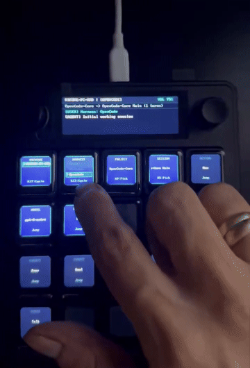
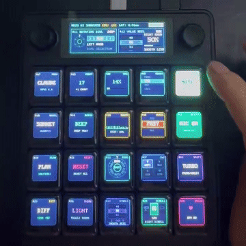
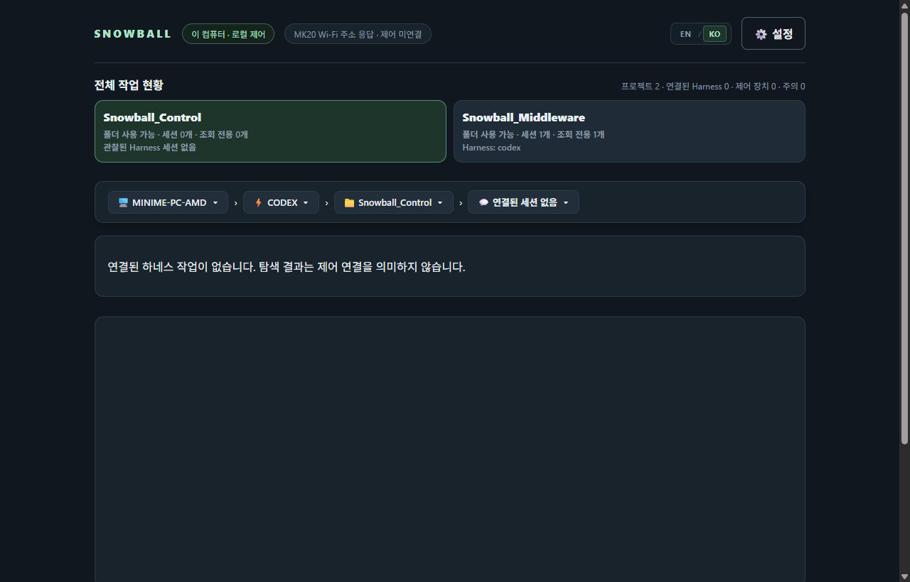
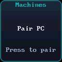
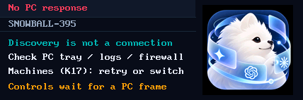

<p align="center">
  
</p>

<h1 align="center">
  
  Snowball Control — Preview
</h1>

<p align="center">
  <strong>Snowball의 inter-Harness 로컬 제어를 위한 물리 데스크 터미널</strong>
</p>

<p align="center">
  <a href="README.md">English</a> | <a href="README.ko.md">한국어</a>
</p>

<p align="center">
  <a href="LICENSE"></a>
  
  
  <a href="https://github.com/fkiller/Snowball_Middleware#one-shot-install"></a>
</p>

---

<a id="one-shot-install"></a>
## Snowball 한 번에 설치

**PC마다 Snowball을 한 번 설치하세요.** 기본 설치에 Web UI, MK20 검색·연결·음성 런타임, M5Stack 검색·게이트웨이, Codex·Antigravity·OpenCode 하네스 플러그인 3종이 모두 포함됩니다. 기기 프로필을 고르거나 USB 기기를 연결할 필요가 없습니다.

아래에서 플랫폼을 펼친 뒤 GitHub 코드 블록의 **Copy** 버튼으로 명령을 복사하세요. README Markdown에서는 접기/펼치기 선택을 사용하며, 실제 탭은 별도 문서 웹사이트가 필요합니다.

<details open>
<summary><strong>Windows · PowerShell</strong></summary>

```powershell
& ([scriptblock]::Create((irm 'https://raw.githubusercontent.com/fkiller/Snowball_Middleware/main/install.ps1')))
```

</details>

<details>
<summary><strong>macOS · Terminal</strong></summary>

```bash
curl -fsSL https://raw.githubusercontent.com/fkiller/Snowball_Middleware/main/install.sh | bash
```

</details>

<details>
<summary><strong>Linux · Terminal</strong></summary>

```bash
curl -fsSL https://raw.githubusercontent.com/fkiller/Snowball_Middleware/main/install.sh | bash
```

</details>

Windows는 Node/Git/Python을 준비합니다. macOS/Linux는 curl·Git·venv/pip을 포함한 Python >=3.12가 필요하며, 설치기가 체크섬을 검증한 Node LTS를 사용자 폴더에 준비합니다. 구성 요소를 빌드하고 실제 격리 하네스 워커를 확인한 뒤, 트레이 아이콘이 있는 사용자별 숨김 백그라운드 앱을 시작합니다. 소유 런타임이 응답하면 설치 터미널로 돌아옵니다. 트레이에서 Web UI, 상태, 설정, 일시정지/재개, 재시작, 종료, 로그인 자동 시작을 제공합니다. Web UI는 **http://127.0.0.1:8765/**이며 기본 설치 위치는 Windows `%LOCALAPPDATA%\Snowball`, macOS `~/Library/Application Support/Snowball`, Linux `${XDG_DATA_HOME:-~/.local/share}/Snowball`입니다. **Start-Snowball.ps1**(Windows) / **Start-Snowball.sh**(macOS/Linux)은 다운로드 없이 다시 실행합니다. 네이티브 하네스 앱과 로그인은 공급자를 통해 준비하며, 없으면 사용 불가로 표시합니다.

기존 설치 업데이트는 Windows에서 같은 `-InstallRoot`에 `-Update`, macOS/Linux에서 같은 `--root 경로`에 `--update`를 추가하고 프로필 옵션은 생략하세요. 예를 들어 Linux에서는 `install.sh`를 내려받아 `bash install.sh --root "$HOME/.local/share/Snowball" --update`로 갱신합니다(실제 기존 설치 경로 사용). 기존 단일 기기 설치에도 두 어댑터를 준비하며 기기 설정·페어링 키·컨트롤러 상태·음성 캐시·사용자 지정 API 포트·로그인 자동 시작 설정을 보존합니다. 사설 LAN이 없거나 선택이 모호하면 자동 검색은 대기·재시도하고 Web UI는 유지합니다. 필요하면 Windows `-Bind PC의_사설_IP` / macOS·Linux `--bind PC의_사설_IP`를 지정하세요.

MK20은 Wi-Fi에 독립적으로 연결한 뒤 K17(Machines)에서 PC를 선택해 페어링합니다. M5Stack 펌웨어 **0.4.0 이상**은 같은 LAN의 등록 PC와 새 미들웨어를 자동 검색합니다. 머신 목록에서 새 PC를 선택하면 Wi-Fi로 페어링합니다. PC 추가에는 전체 미들웨어 설치만 필요하며 기기별 추가 설치·USB 연결·등록 스크립트는 필요하지 않습니다. 같은 브로드캐스트 서브넷, 기기 포트 허용, 클라이언트 격리 해제 상태의 신뢰하는 사설 LAN을 사용하세요.

모든 기기 펌웨어·런타임 변경은 공통 **기기 설정…** 창에서 제공합니다. 같은 설치 루트에서 일반 미들웨어 **Update**를 마친 뒤 **Installed → Included**와 개선 사항을 확인하세요. 개발 소스만 수정하면 설치본의 제공 후보는 바뀌지 않습니다.

M5Stack 최초 준비나 펌웨어 갱신은 **USB 연결 시 자동으로 열리는 기기 설정 창**에서 진행합니다. 트레이의 **기기 설정…**에서도 열 수 있습니다. 현재/제공 버전과 개선 사항을 보여주며, 사용자가 설치·업데이트를 선택해야 전체 플래시 비공개 백업 → 펌웨어 쓰기 → Wi-Fi·페어링 저장 영역 보존 검증 → 자동 재기동 확인을 수행합니다. [제공 펌웨어 버전과 개선 사항](https://github.com/fkiller/Snowball_Device_M5Stack/blob/main/firmware/release.json)을 확인할 수 있습니다. 저장된 네트워크가 없으면 기본 선택된 가져오기 옵션으로 업데이트 후 PC의 연결된 Wi-Fi를 OS가 허용하는 범위에서 이관하고, 기존 정보가 있으면 덮어쓰지 않습니다. OS 비밀번호는 해당 선택 이후에만 읽으며 UI·로그에 표시하지 않습니다. 가져올 수 없으면 같은 창에서 설정 → Wi-Fi, 네트워크 선택, FACES 키보드 비밀번호 입력을 그림으로 안내합니다. 최초 ESP32 Core 4MB/16MB만 지원합니다. CP210x만으로 기종을 확정하지 않으며 Snowball 응답이 없는 기기는 사용자가 실제 기종을 확인해야 합니다. 빌드는 누락된 도구를 다운로드할 수 있습니다. 0.3.0 이하는 새 PC LAN 검색을 위해 기기 펌웨어를 한 번 업그레이드해야 합니다. `Register-M5Stack.ps1` / `.sh`는 선택적 레거시 유지보수 도구로 남으며 일반 설치와 `-Update`가 기기를 자동 플래싱하지 않습니다.

<p align="center">
  <br>
  <em>사용자 제공 캡처(2026-10-12): 0.5.0 → 0.5.2 업데이트의 전체 플래시 백업이 19%(3.0/16.0 MiB) 진행 중인 예시입니다.</em>
</p>

MK20과 미래 기기를 포함한 모든 디바이스는 같은 **기기 설정…** 여정(감지·버전/개선 사항·동의·검증한 복구 백업·설정 보존·업데이트·재기동·네트워크 설정/시각 안내)을 따릅니다. 지원 어댑터는 기본 설치에 포함하며 별도 등록 스크립트가 필요 없습니다. MK20 런타임 0.2.5는 제품 USB 수신기를 추가하여 SD 카드를 기기에 둔 채 변경하는 런타임 파티션 전체 백업·고정 파일 전송·자동 재기동 후 실행 이미지 해시 검증을 수행합니다. QMK는 별도 DFU·읽기 백업 경로를 유지합니다. 카드 리더는 일반 여정의 단계가 아닌 고급 복구 수단입니다. 기존에 허용된 LAN 관리 연결이 있는 구 펌웨어에는 Windows 기기 설정에서 **MK20 · LAN maintenance → 백업 후 런타임 업데이트**를 제공합니다. 런타임 파티션 전체 백업을 검증한 뒤 고정 파일만 교체하고 Wi-Fi·PC 등록 보존과 실제 재부팅 후 실행 파일을 확인합니다. 키보드 USB 연결만으로 런타임 업데이트가 가능해지지는 않습니다. 공통 창은 MK20 실제 20개 화면 키·두 노브와 M5Stack Core A/B/C·FACES를 반영한 단계별 인터랙티브 안내를 제공합니다. 안내 클릭은 실물 제어나 연결 성공으로 처리하지 않습니다. M5Stack 0.5.2는 업데이트 후 실물 백업·Wi-Fi·두 PC LAN 검증을 통과했습니다(상세 범위는 중앙 검증 기록 참조). MK20 첫 USB 이관·업데이트 검증은 미해결이며 일반 LAN 페어링·하네스 3종 계약은 유지합니다.

<p align="center">
  <br>
  <em>사용자 제공 캡처(2026-10-12): MK20 LAN 관리 연결에서 제공 런타임 0.2.6으로 업데이트하기 위한 파티션 백업 진행 예시입니다. 현재 버전의 미확인은 버전을 확인하지 못했다는 뜻이며, 업데이트 완료 화면은 아닙니다.</em>
</p>

MK20 준비 검색은 Windows의 복합 USB 기능을 실제 부모별로 합치며 서로 다른 기기는 유지합니다. 키보드 HID·DFU 백업 접근·런타임 CDC 응답·LAN 발견은 별개입니다. 미확인 버전을 추측하지 않습니다. 연결된 구 런타임에는 업데이트 수신기가 없고 첫 USB 이관이 아직 미해결입니다. M5Stack 0.5.2는 새 PC 페어링 재부팅도 수정합니다. 2026-10-12 실물에서 0.5.2, 정상 16MB 백업, 기존 Wi-Fi·구 페어링 보존과 MINIME-PC-AMD·SNOWBALL-395의 인증된 LAN 페어링을 확인했습니다. 반복 전환 시 재부팅 없이 각 PC의 실제 Codex·Antigravity 세션 내용에 도달했습니다. USB는 실제 탐색 핸들러 호출에만 사용했고 페어링·제어는 LAN으로 진행했으며 프롬프트는 보내지 않았습니다. 손으로 버튼 조작과 MK20 첫 USB 이관은 별도 실물 검증입니다.

Windows가 Node.js 네트워크 접근을 요청하면 미들웨어가 사용할 개인 네트워크 접근을 허용합니다. 거절하면 백그라운드 미들웨어·USB 감지가 동작해도 LAN 검색과 선택은 차단될 수 있습니다. 로컬 Web UI는 계속 루프백 전용입니다.

옵션: `-Update`, `-InstallRoot 경로`, `-Bind PC의_사설_IP`, `-Port 8765`, `-NoStart`, `-NoShortcut`. `-Profile web|mk20|m5stack`은 개발·진단용 명시적 부분 구성으로 유지하며 일반 설치에서는 필요 없습니다. 같은 루트에 이미 설치된 어댑터는 유지합니다. macOS/Linux 옵션: `--update`, `--root 경로`, `--bind PC의_사설_IP`, `--port 8765`, `--no-start`, `--no-shortcut`, `--python 경로`, `--data-dir 경로`. 전체 옵션은 `bash install.sh --help`로 확인합니다. Linux는 그래픽 데스크톱·Electron 시스템 라이브러리·사용자의 USB/시리얼 접근 권한이 필요하며 sandbox 우회나 USB 권한 자동 변경은 하지 않습니다. Linux에서 OS Wi-Fi 가져오기를 지원하지 않으면 공통 기기 설정 안내를 사용합니다. macOS/Linux의 대화형 실물 기기 인수 검증은 자동 테스트와 별도입니다. 프로토콜·인증·실물 검증 범위는 중앙 명세를 확인하세요.

[공통 아키텍처와 저장소 역할](https://github.com/fkiller/Snowball_Control/blob/main/docs/ARCHITECTURE.md)

[Control · MK20](https://github.com/fkiller/Snowball_Control) · [Middleware · Installer / Web UI](https://github.com/fkiller/Snowball_Middleware) · [Device · M5Stack](https://github.com/fkiller/Snowball_Device_M5Stack) · Harness: [Codex](https://github.com/fkiller/Snowball_Harness_Codex), [Antigravity](https://github.com/fkiller/Snowball_Harness_Antigravity), [OpenCode](https://github.com/fkiller/Snowball_Harness_OpenCode)

---

## 🌟 개요 (Overview)

**Snowball은 inter-Harness 로컬 제어 인터페이스입니다.** 개발자가 MK20 데스크 터미널과 로컬 Web Supervisor에서 Codex, AGY, OpenCode를 공통된 조작 방식으로 탐색하고 제어합니다. 사용자가 하네스·프로젝트·세션을 선택하고, 각 하네스는 고유한 실행 환경·이력·모델·권한을 유지합니다.

제품의 철학은 **제어권을 사용자의 손과 컴퓨터에 두는 것**입니다. 도구를 오가고 작업을 확인하는 동작은 즉각적이어야 하며, 기능은 실제 설치 환경에서 발견하고 결과와 한계는 사실대로 보여줘야 합니다. 자세한 [제품 철학](docs/ARCHITECTURE.ko.md#제품-철학-inter-harness-로컬-제어)은 아키텍처 문서에서 중앙 관리합니다.

**Preview:** 개인 PC와 신뢰하는 내부 네트워크 전용입니다. 최초 범주는 Codex, AGY, OpenCode, MK20과 로컬 Web UI입니다. UDP/개발 ADB의 보안(인증 및 암호화)을 생략한 부분은 [현재 설계 문서](docs/ARCHITECTURE.ko.md)에 명시합니다.

**Snowball Control**은 MK20 데스크 터미널의 물리적 인터페이스 펌웨어(QMK), Allwinner T113 Tina Linux용 네이티브 C HUD 엔진, 하드웨어 연동 도구 및 STT 참조 호스트를 제공합니다.

전체 설치와 실행은 위의 [Snowball Middleware](https://github.com/fkiller/Snowball_Middleware) 공통 진입점을 사용합니다. 이 저장소는 MK20 기기 구성 요소이며, Control의 `host/npm start`는 Codex 전용 참조 런타임입니다.

---

## 🎥 하드웨어 시연 및 비주얼 쇼케이스 (Visual Showcase)

### 1. 계층 네비게이션 및 음성 세션 실기기 시연
MK20에서 구동되는 브레드크럼 계층 네비게이션(`기기 > 하네스 > 프로젝트 > 세션`), 내장 마이크 음성 프롬프트 캡처, 모달 뷰(좌측 상단 타이틀 겸 Close 버튼, 열별 단축키, 4×4 그리드 캔버스), 그리고 로터리 노브 선택 동작 시연입니다:

<p align="center">
  <br>
  <em>실물 하드웨어에서 동작하는 브레드크럼 네비게이션 및 모달 제어.</em><br>
  <a href="assets/videos/mk20_navigation_demo.mp4">▶️ 고화질 전체 MP4 영상 보기</a> &nbsp;|&nbsp; <a href="https://x.com/fkiller/status/2099345561627382015">🔗 X (Twitter) 원본 글</a>
</p>

### 2. UI 엘리먼트 및 키 매트릭스 테스트
20개 기계식 스위치 위의 개별 128×128 LCD 키캡 화면, 듀얼 로터리 엔코더 노브, 동적 명암비 반전 테마, 초저지연 프레임버퍼 렌더링 물리 테스트입니다:

<p align="center">
  <br>
  <em>키 매트릭스 디스플레이, 다이얼 및 동적 테마 렌더링 물리 테스트.</em><br>
  <a href="assets/videos/mk20_ui_elements_test.mp4">▶️ 고화질 전체 MP4 영상 보기</a> &nbsp;|&nbsp; <a href="https://x.com/fkiller/status/2095861881281917119">🔗 X (Twitter) 원본 글</a>
</p>

### 3. 웹 수퍼바이저 대시보드 (Web Supervisor)
탐색된 작업공간, 세션 저널, MK20 하드웨어 연결 상태를 실시간으로 모니터링하는 로컬 루프백 제어 평면(`http://127.0.0.1:8765/`) 화면입니다:

<p align="center">
  
</p>

### 4. MK20 오프라인 대기 화면 및 연결 상태
선택한 미들웨어의 유효한 화면이 없으면 **Machines(K17)**를 계속 표시하여 페어링·재시도·전환할 수 있습니다. 선택하면 실제 PC 이름과 `Connecting to PC`를 표시하며, 8초 동안 유효한 화면이 없으면 `No PC response`를 표시합니다. 최근 알림을 받은 `available`과 실제 화면을 받은 `connected`를 구분합니다. 일반 조작은 선택 PC의 유효한 화면과 scope를 확인한 뒤 가능합니다. 저장된 선택은 페어링된 PC를 다시 발견하고 유효한 화면이 돌아오면 복귀합니다.

| 미연결 Machines 안내 (`/dev/fb17`) | 선택 PC의 화면 응답 없음 (`/dev/fb21`) |
| :---: | :---: |
|  |  |

2026-10-08에 런타임 0.2.1에서 캡처한 실제 프레임버퍼입니다. 응답 없음 화면은 미해결 연결을 기록하며 PC 페어링/제어 성공을 뜻하지 않습니다. 교차 구성 검증과 남은 실물 확인은 [중앙 문서](docs/ARCHITECTURE.ko.md#변경-영향과-문서-동기화)에 기록합니다.

---

## ⌨️ MK20 하드웨어 준비 (MK20 Setup)

- **수정된 MK20 QMK 업데이트 필수**: USB host 연결 없이 독립 전원에서 키 입력 스캔이 멈추는 원래 QMK 버그를 해결하기 위해, 수정된 QMK 펌웨어 업데이트가 **필수**입니다. [플래싱 안내](hardware/mk20/qmk/README.ko.md)를 따르세요.
- **변경 전 복구 백업 필수**: 제품 USB 업데이트는 변경하는 런타임 파티션 전체 백업을 검증합니다. 전체 카드 이미지 설치·복원은 고급 유지보수 작업입니다. [배포·백업·복원 절차](docs/ARCHITECTURE.ko.md#sd-이미지-배포백업복원)를 참고하세요.
- **Wi-Fi 설정**: 저장된 Wi-Fi가 없을 때 공통 설정 창에서 가져오거나 직접 입력하며 기존 설정을 보존합니다. 실제 접속 정보는 Git에 포함하지 않습니다. [기기 연결 도구](hardware/mk20/dev-tools/README.md)를 참고하세요.
- **네이티브 HUD 데몬**: 현재 HUD는 Tina Linux(ARMv7)의 C 데몬이며 상단 428×142, 키 128×128 framebuffer를 사용합니다.
- **로컬 STT**: CUDA 또는 CPU 추론을 지원합니다. 기본 설치가 MK20의 Python 의존성을 준비하고, 런타임이 실제 하드웨어에 맞는 로컬 모델을 확인·다운로드합니다.

---

## M5Stack + FACES 실기 영상

[](https://github.com/fkiller/Snowball_Device_M5Stack/blob/main/assets/videos/m5stack_navigation_demo.mp4)

[기기 펌웨어와 설치](https://github.com/fkiller/Snowball_Device_M5Stack) · [GitHub 전체 MP4](https://github.com/fkiller/Snowball_Device_M5Stack/blob/main/assets/videos/m5stack_navigation_demo.mp4) · [X](https://x.com/fkiller/status/2106892916149158101?s=20)

---

## 🧪 검사 및 테스트 (Verification & Tests)

```bash
# 하드웨어 플러그인 계약 테스트 (13개 통과)
npm test --prefix plugins/device-mk20

# Linux <-> GD32/QMK 시리얼 계약 테스트 (14개 통과)
powershell -File hardware/mk20/contract/Test-QmkProtocol.ps1

# 호스트 참조 단위 테스트 (52개 통과)
npm test --prefix host
```

---

## 📁 저장소 구조 (Repository Structure)

```text
Snowball_Control/
├── assets/                     # 브랜딩, 부트로더 로고, 시연 영상 및 기기 캡처 스크린샷
│   ├── banner.png
│   ├── icon.png
│   ├── bootlogo.bmp            # U-Boot 로고 (160x160 24-bit BMP)
│   ├── mk20-plus.bin           # 상단 디스플레이 부팅 리소스 (428x142 RGB565)
│   ├── screenshots/            # 실제 기기 프레임버퍼 캡처, GIF 및 웹 UI 화면
│   │   ├── mk20_navigation_demo.gif
│   │   ├── mk20_ui_elements_test.gif
│   │   ├── web_supervisor_dashboard_ko.png
│   │   ├── web_supervisor_dashboard_en.png
│   │   ├── mk20_no_pc_response.png
│   │   ├── mk20_pairing_key17.png
│   │   └── online_top_display.png
│   └── videos/                 # 원본 고화질 MP4 녹화 영상
│       ├── mk20_navigation_demo.mp4
│       └── mk20_ui_elements_test.mp4
├── docs/                       # 아키텍처 및 상세 사양서 (단일 설계 원천)
│   ├── ARCHITECTURE.md         # 영문 아키텍처 사양서 (기본)
│   └── ARCHITECTURE.ko.md      # 한글 아키텍처 사양서
├── hardware/mk20/
│   ├── contract/               # Tina Linux <-> QMK 하드웨어 시리얼 계약
│   ├── dev-tools/              # MK20 부트스트랩 스크립트, lunch.sh & mk20ctl
│   ├── hud/                    # Tina Linux용 초저지연 네이티브 C HUD 엔진
│   └── qmk/                    # 독립 구동 지원 수정 QMK 펌웨어 소스 및 바이너리
├── host/                       # 참조 호스트 런타임 및 STT 어댑터
├── plugins/device-mk20/        # 격리된 하드웨어 전송 계층 및 스킨 엔진
├── LICENSE                     # Apache-2.0 라이선스
├── README.md                   # 영문 기본 README
└── README.ko.md                # 한글 README
```

---

## 📄 라이선스와 공개 범위 (License)

Snowball 자체 코드는 [Apache-2.0](LICENSE)입니다. QMK와 Allwinner T113 펌웨어 소스는 제조사로부터 직접 이메일로 제공받았습니다. QMK 기반 펌웨어의 GPL 고지와 제조사·제3자 구성의 조건은 별개입니다. 제조사 SDK/BSP, 개인 설정, SD 백업은 이 저장소에 포함하지 않습니다. 배포 대상과 빌드 기록은 [단일 설계 문서](docs/ARCHITECTURE.ko.md)에서 관리합니다.
