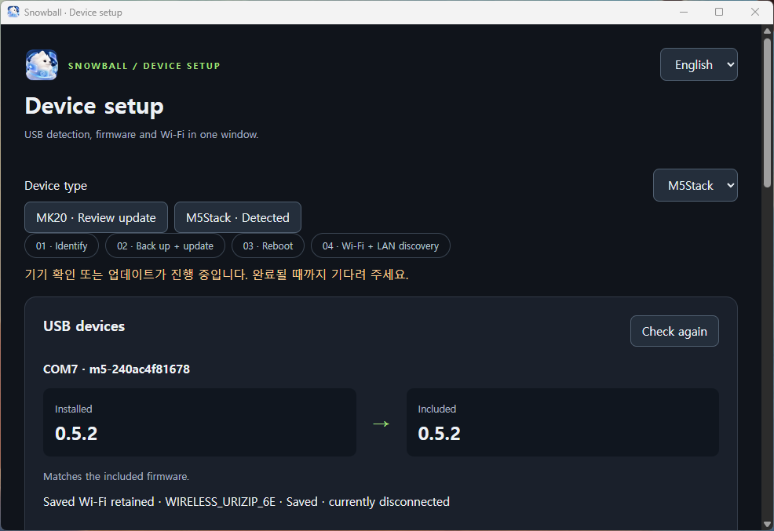
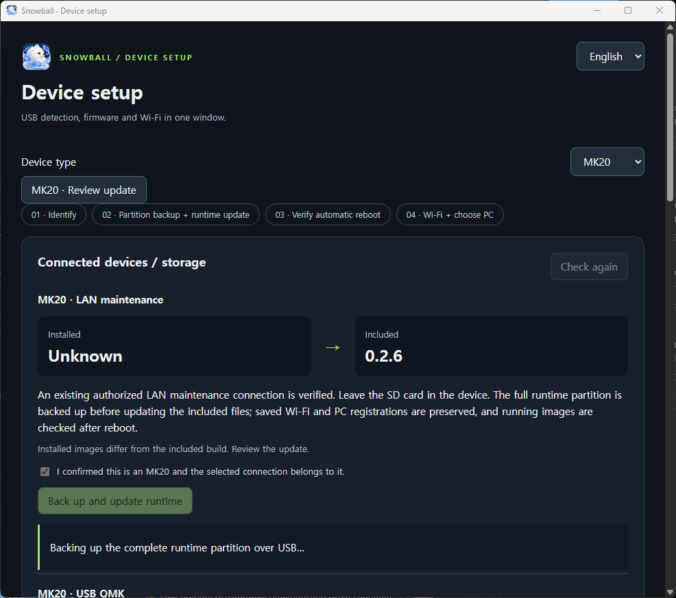
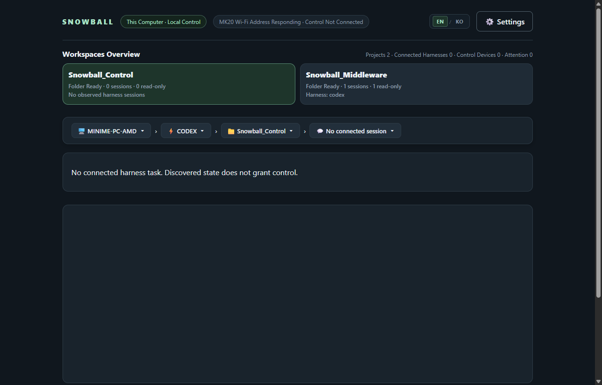

<p align="center">
  
</p>

<h1 align="center">
  
  Snowball Control — Preview
</h1>

<p align="center">
  <strong>The Physical Terminal for Snowball's inter-Harness Local Control</strong>
</p>

<p align="center">
  <a href="README.md">English</a> | <a href="README.ko.md">한국어</a>
</p>

<p align="center">
  <a href="LICENSE"></a>
  
  
  <a href="https://github.com/fkiller/Snowball_Middleware#one-shot-install"></a>
</p>

---

<a id="one-shot-install"></a>
## Install Snowball

**Install Snowball once per PC.** The default installation includes the Web UI, MK20 discovery/transport and speech runtime, M5Stack discovery/gateway, and all three Codex/Antigravity/OpenCode harness plugins. No device profile selection or connected USB device is needed.

Expand your platform and copy its command.

<details open>
<summary><strong>Windows · PowerShell</strong></summary>

```powershell
& ([scriptblock]::Create((irm 'https://raw.githubusercontent.com/fkiller/Snowball_Middleware/main/install.ps1')))
```

</details>

<details>
<summary><strong>macOS · Terminal</strong></summary>

```bash
curl -fsSL https://raw.githubusercontent.com/fkiller/Snowball_Middleware/main/install.sh | bash
```

</details>

<details>
<summary><strong>Linux · Terminal</strong></summary>

```bash
curl -fsSL https://raw.githubusercontent.com/fkiller/Snowball_Middleware/main/install.sh | bash
```

</details>

After installation, open the tray icon to launch the Web UI at **http://127.0.0.1:8765/** or manage Settings, Pause/Resume and login startup. Windows prepares Node/Git/Python. macOS/Linux need curl, Git and Python >=3.12 with venv/pip; Linux also needs a graphical desktop and Electron system libraries. Install and sign in to native harness applications through their vendors.

<a id="update-snowball"></a>
## Update Snowball

### 1. Update PC software

**Use your existing installation folder.** The examples below use the default folder; change the first line if you installed elsewhere (for example, `Snowball-LAN`). Omit the device profile option.

<details open>
<summary><strong>Windows · PowerShell</strong></summary>

```powershell
$installRoot = Join-Path $env:LOCALAPPDATA 'Snowball'
& ([scriptblock]::Create((irm 'https://raw.githubusercontent.com/fkiller/Snowball_Middleware/main/install.ps1'))) -InstallRoot $installRoot -Update
```

</details>

<details>
<summary><strong>macOS · Terminal</strong></summary>

```bash
install_root="$HOME/Library/Application Support/Snowball"
curl -fsSL https://raw.githubusercontent.com/fkiller/Snowball_Middleware/main/install.sh | bash -s -- --root "$install_root" --update
```

</details>

<details>
<summary><strong>Linux · Terminal</strong></summary>

```bash
install_root="${XDG_DATA_HOME:-$HOME/.local/share}/Snowball"
curl -fsSL https://raw.githubusercontent.com/fkiller/Snowball_Middleware/main/install.sh | bash -s -- --root "$install_root" --update
```

</details>

The update preserves device settings, pairing keys, controller state, speech caches, the API port and login startup preference. Older single-device installations gain both bundled device adapters. PC updates refresh the **Included** firmware candidate; device firmware is updated separately below.

<a id="update-device"></a>
### 2. Update device firmware

1. After the PC update, connect the device with a USB data cable and open **Device setup…** from the tray.
2. Select the device and compare **Installed → Included** and the listed improvements.
3. Confirm the device, then choose **Install / Update**. The window verifies a recovery backup and preserves settings before writing.
4. Keep USB connected until the window confirms reboot and the running version. Follow the Wi-Fi guide if needed.

[Device-specific steps and recovery](https://github.com/fkiller/Snowball_Middleware#update-device) · [Current M5Stack firmware and improvements](https://github.com/fkiller/Snowball_Device_M5Stack/blob/main/firmware/release.json)

<details>
<summary>Device setup examples</summary>

<p align="center">
  <br>
  <em>User-provided capture, 2026-10-12: installed and included firmware both show 0.5.2; saved Wi-Fi is retained and currently disconnected.</em>
</p>

<p align="center">
  <br>
  <em>User-provided capture, 2026-10-12: MK20 LAN maintenance with the runtime-partition backup in progress and included runtime 0.2.6. Installed Unknown means the version is unverified; this capture shows the backup stage, not update completion.</em>
</p>

</details>

## Connect a device to a PC

MK20: connect Wi-Fi, press **K17 · Machines**, and select the PC. M5Stack firmware 0.4.0 or later: select the registered or new PC in **Machines** to pair over LAN. Adding a PC needs the full PC installation; USB registration scripts are unnecessary. Use the same trusted private LAN with device ports allowed and client isolation disabled.

<details>
<summary><strong>Advanced options</strong></summary>

| Purpose | Windows | macOS / Linux |
| --- | --- | --- |
| Existing installation folder | `-InstallRoot PATH` | `--root PATH` |
| Choose a private LAN interface | `-Bind PRIVATE_PC_IP` | `--bind PRIVATE_PC_IP` |
| Custom API port | `-Port PORT` | `--port PORT` |
| Install without starting | `-NoStart` | `--no-start` |
| Skip shortcuts | `-NoShortcut` | `--no-shortcut` |
| Diagnostic subset | `-Profile web\|mk20\|m5stack` | `--profile web\|mk20\|m5stack` |

Normal installation/update includes both devices and all three harnesses. If LAN selection is unavailable or ambiguous, discovery waits while the local Web UI stays available.

M5Stack **0.5.6** removes the unresolved “Previously paired PC” row from Machines without deleting its legacy key; only real host identities are selectable. Reader input moves already received native rows and the scrollbar immediately, with a loading row for content still awaiting the selected PC. The host also excludes recognized Hyper-V/WSL/VPN adapter names when automatically choosing a device LAN; explicit bind and target-subnet selection retain their precedence. A PC update fixes host discovery and includes the firmware candidate. Install firmware through Device setup with review, full backup and retained settings. Physical A/C acceptance of 0.5.6 remains pending; the pre-update diagnostic reader received actual 395 offsets 0, 12 and 24.

On Windows, allow the middleware Node.js process on your private network when Windows asks. Linux USB/serial access uses your normal OS permissions. Run `bash install.sh --help` for Unix options. **Start-Snowball.ps1** / **Start-Snowball.sh** in the installation folder restart without downloading.

</details>

[Common architecture and verification limits](https://github.com/fkiller/Snowball_Control/blob/main/docs/ARCHITECTURE.md)

[Control · MK20](https://github.com/fkiller/Snowball_Control) · [Middleware](https://github.com/fkiller/Snowball_Middleware) · [M5Stack](https://github.com/fkiller/Snowball_Device_M5Stack) · Harness: [Codex](https://github.com/fkiller/Snowball_Harness_Codex), [Antigravity](https://github.com/fkiller/Snowball_Harness_Antigravity), [OpenCode](https://github.com/fkiller/Snowball_Harness_OpenCode)

---

## 🌟 Overview

**Snowball is an inter-Harness local control interface.** It gives developers a common way to navigate and control Codex, AGY, and OpenCode through an MK20 desk terminal and local Web Supervisor. The user chooses the harness, project, and session; each harness keeps its native runtime, history, models, and permissions.

Our philosophy is to keep control in the user's hands and on their computer: make switching tools and following work immediate, discover capabilities from the installed environment, and show real results and limitations. The full [product philosophy](docs/ARCHITECTURE.md#product-philosophy-inter-harness-local-control) is maintained with the architecture.

**Preview:** Intended exclusively for personal workstations and trusted local networks. The initial scope covers OpenAI Codex, Google Antigravity (AGY), OpenCode, MK20 hardware, and local Web UI. Certain security boundaries (such as unencrypted UDP sync and development TCP ADB) are omitted as documented in [Current Architecture and Boundaries](docs/ARCHITECTURE.md).

**Snowball Control** provides the physical terminal runtime, custom QMK firmware, native Tina Linux HUD engine, device tools, and STT reference host for the **MK20 Desktop Terminal**.

Install the complete middleware through the common entry point above. This repository is the MK20 device component; its internal `host/npm start` is a legacy Codex-only reference runtime.

---

## 🎥 Hardware Demos & Visual Showcase

### 1. Live Breadcrumb Navigation & Voice Session
Demonstration of the MK20 running its dynamic breadcrumb hierarchy (`Device > Harness > Project > Session`), built-in mic speech prompt capture, modal view with top-left title/close button, and rotary knob selection:

<p align="center">
  <br>
  <em>Physical hardware demonstration of breadcrumb hierarchy and modal navigation.</em><br>
  <a href="assets/videos/mk20_navigation_demo.mp4">▶️ Watch Full High-Res MP4</a> &nbsp;|&nbsp; <a href="https://x.com/fkiller/status/2099345561627382015">🔗 Original Post on X</a>
</p>

### 2. UI Elements & Key Matrix Testing
Physical testing of the 20 mechanical key switches with individual 128×128 LCD keycaps, dual rotary encoders, dynamic contrast themes, and low-latency frame drawing:

<p align="center">
  <br>
  <em>Physical testing of key matrix displays, rotary dials, and dynamic themes.</em><br>
  <a href="assets/videos/mk20_ui_elements_test.mp4">▶️ Watch Full High-Res MP4</a> &nbsp;|&nbsp; <a href="https://x.com/fkiller/status/2095861881281917119">🔗 Original Post on X</a>
</p>

### 3. Web Supervisor Dashboard
The local-loopback control plane (`http://127.0.0.1:8765/`) visualizing detected workspaces, session journals, and MK20 hardware status in real-time:

<p align="center">
  
</p>

### 4. MK20 Offline Standby Screen & Status
When no valid frame is received from the selected middleware, the terminal keeps **Machines (K17)** available for pairing, retry or switching. Selection displays the actual PC name with `Connecting to PC`; eight seconds without a valid frame displays `No PC response`. The recent-advertisement label `available` is separate from `connected`. Ordinary controls wait for the selected PC's accepted frame and scope. A saved selection reconnects when its paired PC becomes available and returns valid frames.

| Disconnected Machines cue (`/dev/fb17`) | Selected PC without a display response (`/dev/fb21`) |
| :---: | :---: |
|  |  |

These are actual runtime 0.2.1 framebuffers captured on 2026-10-08. The timeout capture documents an unresolved connection, not successful PC pairing/control. The [central specification](docs/ARCHITECTURE.md#change-impact-and-documentation) records cross-component verification and remaining field checks.

---

## ⌨️ MK20 Hardware Setup

- **Mandatory Modified QMK Firmware**: Due to a hang condition in factory QMK waiting for USB host enumeration on standalone power, flashing the modified QMK firmware is **strictly required**. See [Flashing Guide](hardware/mk20/qmk/README.md).
- **Verified Runtime Backup**: USB runtime setup verifies a complete backup of the affected runtime partition before writing. Full-card image installation/recovery remains an advanced maintenance operation. Refer to [Deployment, Backup & Recovery](docs/ARCHITECTURE.md).
- **Wi-Fi Configuration**: Import or enter Wi-Fi in the common setup window when the device has no saved network. Existing settings are retained; `dev-access.conf` stays private. See [Device Tools Guide](hardware/mk20/dev-tools/README.md).
- **Native HUD Daemon**: The HUD is a native C daemon running on Tina Linux ARMv7 (Allwinner T113), utilizing the 428×142 top display (`/dev/fb21`) and 128×128 key displays (`/dev/fb1`..`/dev/fb20`).
- **Local STT**: Supports CUDA or CPU inference. The default installation includes the MK20 Python dependencies and the runtime resolves/downloads the local model from hardware capabilities.

---

## M5Stack + FACES hardware demo

[](https://github.com/fkiller/Snowball_Device_M5Stack/blob/main/assets/videos/m5stack_navigation_demo.mp4)

[Device firmware and setup](https://github.com/fkiller/Snowball_Device_M5Stack) · [Full MP4 on GitHub](https://github.com/fkiller/Snowball_Device_M5Stack/blob/main/assets/videos/m5stack_navigation_demo.mp4) · [X](https://x.com/fkiller/status/2106892916149158101?s=20)

---

## 🧪 Verification & Test Suite

Run the full verification suite across all submodules:

```bash
# Pure hardware plugin contract tests (13 tests)
npm test --prefix plugins/device-mk20

# Linux <-> GD32/QMK serial contract tests (14 tests)
powershell -File hardware/mk20/contract/Test-QmkProtocol.ps1

# Host reference unit tests (52 tests)
npm test --prefix host
```

---

## 📁 Repository Structure

```text
Snowball_Control/
├── assets/                     # Branding, bootloader logo, videos, and screen captures
│   ├── banner.png
│   ├── icon.png
│   ├── bootlogo.bmp            # U-Boot splash logo (160x160 24-bit BMP)
│   ├── mk20-plus.bin           # Top screen boot resource (428x142 RGB565)
│   ├── screenshots/            # Live hardware captures, GIFs & Web UI dashboard
│   │   ├── mk20_navigation_demo.gif
│   │   ├── mk20_ui_elements_test.gif
│   │   ├── web_supervisor_dashboard_en.png
│   │   ├── web_supervisor_dashboard_ko.png
│   │   ├── mk20_no_pc_response.png
│   │   ├── mk20_pairing_key17.png
│   │   └── online_top_display.png
│   └── videos/                 # Full high-res MP4 video recordings
│       ├── mk20_navigation_demo.mp4
│       └── mk20_ui_elements_test.mp4
├── docs/                       # Single Source of Truth architecture specification
│   ├── ARCHITECTURE.md         # English canonical architecture specification (default)
│   └── ARCHITECTURE.ko.md      # Korean architecture specification
├── hardware/mk20/
│   ├── contract/               # Tina Linux <-> QMK hardware serial contract
│   ├── dev-tools/              # MK20 microSD bootstrap, lunch.sh & mk20ctl
│   ├── hud/                    # Native C low-latency HUD engine for Tina Linux
│   └── qmk/                    # Modified QMK firmware source & binaries
├── host/                       # Reference host runtime & STT adapter
├── plugins/device-mk20/        # Isolated lab hardware transport & skin engine
├── LICENSE                     # Apache-2.0 License
├── README.md                   # English project documentation (default)
└── README.ko.md                # Korean project documentation
```

---

## 📄 License & Publication Limits

Snowball custom codebase is licensed under [Apache-2.0](LICENSE). QMK firmware sources and Allwinner T113 BSP code were provided directly by the hardware manufacturer via email. QMK-based code is governed by upstream GPLv2 and vendor notices. Vendor SDKs/BSPs, private network credentials, and full SD card backups are excluded from this repository. Complete architectural specifications, build records, and verification criteria are maintained in [docs/ARCHITECTURE.md](docs/ARCHITECTURE.md).
