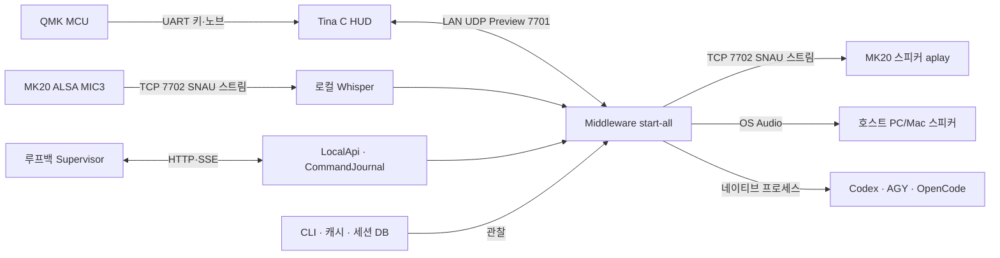
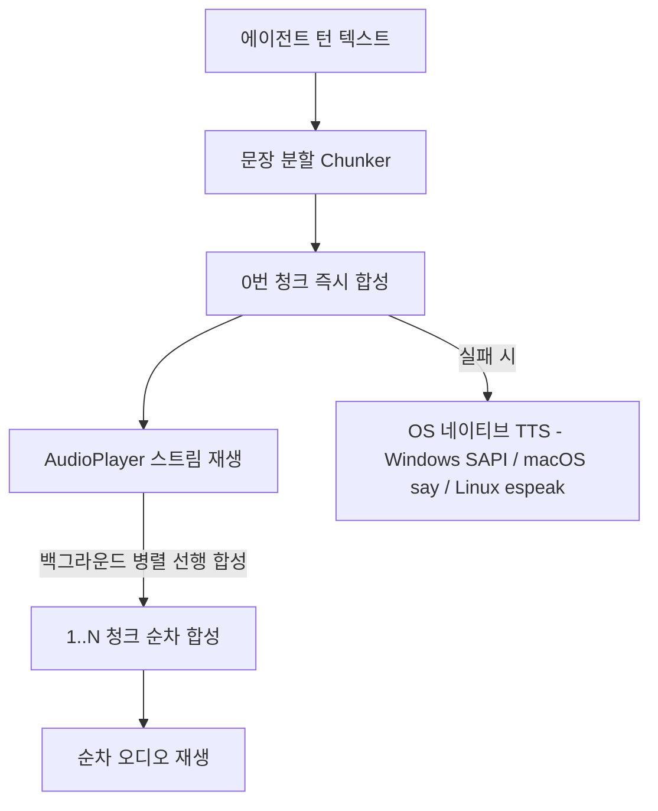

<p align="right">
  <a href="ARCHITECTURE.md">English</a> | <strong>한국어</strong>
</p>

# Snowball Control & Middleware — Preview

이 문서는 기기와 미들웨어 전체의 현재 설계를 관리하는 단일 원천이다. 최초 범주는 **Codex, AGY, OpenCode, MK20, 로컬 Web Supervisor**다. 공개 Preview는 신뢰하는 개인 PC와 내부 네트워크용이며, 인터넷이나 다중 사용자 환경에 대한 보안 보장을 제공하지 않는다.

## 제품 철학: inter-Harness 로컬 제어

**Snowball은 사용자가 자신의 여러 컴퓨터에서 AI 하네스를 오가며 직접 통제하는 inter-Harness 로컬 제어 인터페이스다.** Codex, AGY, OpenCode를 물리 데스크 터미널과 로컬 Web Supervisor에서 탐색하고 관찰하며, 지원되는 네이티브 동작을 실행한다. 여기서 **inter-Harness**는 하네스를 가로지르는 공통 사용자 제어 인터페이스를 뜻한다. 독립된 MK20에서 작업 대상은 사용자가 선택한 `머신 > 하네스 > 프로젝트 > 세션`으로 명확하게 정한다.

제품은 다음 원칙을 따른다.

- **작업의 주인은 사용자다.** 사용자의 PC가 프로젝트·네이티브 프로세스·세션 데이터를 소유한다. 프롬프트를 보낼 곳과 사용할 도구는 사용자가 선택한다. MK20은 키·노브·화면·음성 입력으로 그 선택을 손에 닿는 동작으로 만든다.
- **공통 인터페이스 안에서도 하네스의 차이를 존중한다.** 각 하네스의 세션 이력, 모델 식별자, 지원 effort, 권한 의미를 유지한다. 어댑터는 네이티브 기능을 연결하며, 호환성은 실제 설치 버전과 관찰한 동작을 기준으로 판단한다. 하네스 간 세션 변환·대화 이관·에이전트의 자율 협업은 현재 Preview 범위에 포함되지 않는다.
- **로컬 제어가 먼저다.** 제어 경로에 클라우드 제어 플레인을 필수로 두지 않는다. 로컬 의존성을 준비한 뒤에는 인터넷 없이도 기기 조작과 로컬 관찰·제어가 가능해야 한다. 클라우드 모델 추론에는 해당 제공자의 네트워크 연결이 필요하다. 루프백 Supervisor는 로그인/PIN 없이 열며 기기 페어링은 별도 경계로 관리한다.
- **실제가 원천이다.** 모델·effort·프로젝트·세션은 네이티브 도구와 로컬 데이터에서 발견한다. 실행과 완료는 실제 네이티브 이벤트로 확인하고, 승인·중단은 하네스가 실제 제공하는 기능에 맞춰 처리해야 한다. 발견 실패나 미지원 동작은 성공으로 꾸미지 않고 드러낸다.
- **편의성의 경계를 명시한다.** 플러그인 권한을 제한하면서 승인된 호스트의 실행·관찰은 유지해야 한다. 현재 Preview는 개인 PC와 신뢰하는 내부 네트워크용이며, 문서에 명시한 보안 생략과 미완성 네이티브 연동도 제품의 한계로 공개한다.

이 원칙은 제품이 지향하는 방향이다. 아래 각 절에서 현재 구현·검증된 동작·남은 작업을 구분하며, 모든 하네스에서 모든 제어 기능이 완성되었다는 뜻은 아니다.

### 독립 MK20과 여러 미들웨어 머신

제품의 의도된 흐름은 MK20이 독립 기기로 Wi-Fi에 연결되고, 내부 LAN의 미들웨어 호스트를 발견하며, 사용자가 여러 호스트를 페어링하는 것이다. 두 호스트를 페어링하면 머신 두 개, 세 호스트를 페어링하면 머신 세 개가 보인다. 머신을 선택하면 해당 미들웨어에 등록된 하네스·프로젝트·세션을 표시하고, 지원되는 동작을 선택한 머신으로 전달한다. 발견은 후보 탐색이며 페어링은 사용자가 선택한 호스트의 등록이다. 페어링된 호스트 목록과 선택은 특정 PC 하나에 의존하지 않고 기기가 유지한다.

새 미들웨어 PC의 추가와 전환은 일반적인 발견·페어링 동작이어야 한다. 이를 위해 SD 편집, PC MAC 교체, USB 재연결, ADB 활성화를 요구해서는 안 된다. SD 이미지 설치·Wi-Fi 초기 설정·펌웨어 유지보수·복원은 별도 기기 준비 작업이다. 현재 개발 부팅 설정의 `DEV_PC_MAC`은 TCP ADB 접근을 제한하는 값이며 제품의 머신 페어링 목록이 아니다.

**현재 구현:** 네이티브 HUD가 발견·페어링·머신 선택(K17)을 직접 관리한다. 미들웨어의 영속 host ID와 실제 OS 호스트명을 발견하며, 기기는 최대 16개 페어링과 마지막 선택을 `/mnt/SDCARD/snowball-hosts.v1`에 보관한다. 선택한 PC만 입력을 받고 자기 PC의 네이티브 하네스·프로젝트·세션을 제공한다. PC를 떠나도 그 PC의 컨트롤러 컨텍스트와 실행 중인 네이티브 작업은 유지한다. 실제 PC 2·3대의 전환 검증은 아직 필요하며, 한 PC의 여러 프로세스나 테스트 fixture를 그 증거로 취급하지 않는다.

- `SNMK1` UDP 발견: 기기가 서브넷 브로드캐스트 47772에 `DISCOVER`를 보내며 PC도 선택한 NIC에서 2초마다 `OFFER`를 알린다. 기기는 응답의 실제 송신 IP/포트에 `SELECT`·`RELEASE`·선택 heartbeat를 보낸다. Windows의 브로드캐스트 응답 예외는 활성 방화벽 프로필/정책에 따라 달라지므로, PC 알림 수신만으로 선택 요청의 수신까지 확인할 수 없다. 브로드캐스트/응답이 차단된 네트워크는 로컬 네트워크 설정이 필요하다. 미들웨어는 실제 수신 IP/포트와 최초 선택 요청 수신을 lease 토큰 없이 기록한다.
- K17은 Machines, 왼쪽 노브는 이동·선택, K16도 선택, K4는 돌아가기, K8은 페어링 해제다. 미등록 후보는 만료되고 페어링된 오프라인 PC는 남는다. 발견만으로 선택/등록하지 않는다. host ID를 유지하므로 DHCP/PC명 변경으로 같은 머신을 중복 생성하지 않는다. 자동 NIC 선택은 시작마다 다시 수행하며 명시한 `-Bind`만 고정한다.
- Machines는 최근 알림을 받은 `available`과 선택한 PC의 실제 화면 프레임을 받은 `connected`를 구분한다. 선택 직후 PC 이름과 `Connecting to PC`를 표시하고, 8초 동안 유효한 화면이 없으면 `No PC response`와 트레이/로그/방화벽 점검 안내를 표시한다. 연결 요청은 계속하며 K17에서 재시도·전환할 수 있지만 일반 조작은 차단한다. 페어링 저장만으로 런타임 연결 성공을 표시하지 않는다.
- 선택마다 새 lease를 만든다. 화면은 선택 IP·lease와 controller/run/sequence를 검사하며 이전 lease와 재생된 입력은 거부한다. 머신을 떠나면 발화를 중단하고 캡처한 음성은 원래 세션 초안에 전사한다. 진행 중인 네이티브 작업은 원래 PC에 남고 돌아오면 같은 컨텍스트·소유한 Stop 핸들을 사용한다. 전송 여부가 불명확하면 `unknown`으로 남기며 자동 재전송하지 않는다.
- lease는 **신뢰하는 LAN용 Preview의 평문 라우팅 경계**이며 암호화된 신원 증명/인증이 아니다. ADB는 명시적인 유지보수·디버깅 전용이다. 일반 `mk20` PC 설치는 호스트 라이브러리·로컬 음성 의존성을 준비하고 PC를 알린다. 기기 배포, ADB 발견, Wi-Fi/개발 MAC 변경은 수행하지 않는다.


## 1. 저장소와 실제 실행 경로

**Snowball**은 전체 로컬 제어 시스템이며, **Snowball Middleware**가 공통 설치·PC 실행·Web UI를 담당한다. **Snowball Control**은 MK20 기기 구성 요소와 이 공통 아키텍처 문서를 관리한다. 두 번째 미들웨어가 아니다. **Snowball Device · M5Stack**은 ESP32 펌웨어·게이트웨이를 관리하고, **Snowball Harness · Codex / Antigravity / OpenCode**는 모든 설치에 포함하는 독립 빌드 플러그인이다.

Windows 공통 진입점은 `Snowball_Middleware/install.ps1`이며 **기본 설치에 모든 지원 기기를 포함한다**(`all`). Middleware·Control 호스트 라이브러리·M5Stack 게이트웨이·독립 하네스 플러그인 3종을 빌드한다. PC 설치에 USB 연결·프로필 선택·펌웨어 작업은 필요 없다. 실제 격리 워커 초기화를 확인하고 `.snowball/suite.json`에 소스 커밋과 승인된 진입점 다이제스트를 기록한다. 추적 파일 수정은 거부하고 체크아웃을 초기화하지 않는다. 공급자 앱·로그인은 별도 준비이며 없으면 사용 불가다. 모델·Effort·프로젝트·세션은 계속 네이티브 원천에서 동적으로 관찰한다.

**같은 설치 루트**에 일반 업데이트하면 기존 Web/MK20/M5Stack 단독 설치에도 두 어댑터를 준비한다. `deviceProfiles`와 `devices`로 Python·NIC·등록 경로를 구분하며 M5Stack `.local`의 페어링·기기·탐색 파일, 컨트롤러 상태, 음성 캐시, 사용자 지정 API 포트와 로그인 자동 시작 설정을 유지한다. 하나의 소유 트레이·suite·API가 두 기기를 제공한다. `-Profile web|mk20|m5stack`은 개발·진단용 명시적 부분 구성이고 기존 어댑터를 유지한다. 이 옵션은 USB 준비를 암묵적으로 실행하지 않는다. 검색·기기 등록·선택은 별도의 신뢰·소유 동작이다.

| 작업 | 설치 구성 / 기기 영향 |
| --- | --- |
| 일반 설치 / `-Update` | 두 호스트 어댑터·Web UI·하네스 3종. 설치가 플래싱하지 않으며 실행된 트레이가 USB 설정을 제안하되 쓰기를 자동 승인하지 않음 |
| MK20 최초 연결 | 독립 Wi-Fi 기기에서 K17로 PC 검색·페어링. 공통 기기 설정 창에서 QMK DFU와 SD 런타임을 처리하며 일반 LAN 페어링은 펌웨어 준비와 독립적으로 동작 |
| M5Stack PC 추가, 펌웨어 0.4.0 | 머신에서 등록 PC와 새 LAN 미들웨어를 자동 표시. 새 PC 선택으로 Wi-Fi 등록하며 USB·등록 스크립트 불필요 |
| M5Stack 최초 펌웨어 / 업그레이드 | USB 연결 시 네이티브 설정 창: 버전·개선 사항 → 명시적 선택 → 전체 백업 → NVS 보존 쓰기 → 재기동·버전 확인 → Wi-Fi 이관 또는 기기 조작 안내 |
| 개발용 부분 구성 | `-Profile web`, `mk20`, `m5stack`. 하네스 3종은 유지 |

**MK20을 포함한 모든 디바이스의 공통 준비 여정 (2026-10-10):** MK20, M5Stack과 앞으로 추가할 모든 디바이스 플러그인에 하나의 네이티브 **기기 설정…** 창과 공통 진행 관리자 계약을 적용한다. 필수 흐름은 연결 감지 → 실제 기종·설치 버전과 제공 버전·개선 사항 확인 → 명시적 동의 → 전체 백업 → 기존 설정을 보존한 펌웨어 업데이트 → 실제 자동 재기동 검증 → 기존 네트워크 유지 또는 정보가 없을 때 검토한 OS Wi-Fi 이관·기기 시각 안내다. 기기별 사용자 설치나 등록 스크립트를 요구하지 않는다. MK20은 구체적인 버전 2 구성 요소 어댑터로 같은 여정을 사용한다. 미래 기종은 일반 번들 설치·런타임 어댑터 목록에 추가하고 같은 준비 계약을 제공한다. 설정 창이나 진행 코드를 복제하지 않으며 아직 지원하지 않는 하드웨어를 구현된 것처럼 표시하지 않는다.

**MK20 실제 준비 어댑터 (버전 2, 0.2.2):** 일반 설치가 기존 `controlRoot`에서 기본 포함 `hardware/mk20/firmware/setup.json` 어댑터를 등록하고 고정한 PyUSB/libusb 의존성을 설치한다. 공통 진행 관리자·창에서 구성 요소별 현재/제공 버전, 연결 토큰, 백업 기록, 동의, 기기 조작 안내와 기기 응답 대기 상태를 제공한다. MK20은 QMK와 T113/SD 런타임을 처리하며 창 복제·플러그인 worker의 플래싱 권한·ADB 의존성을 추가하지 않는다. USB/SD 연결의 미확인·이전 펌웨어·빈 Wi-Fi는 같은 창에서 안내한다. USB 식별자만으로 MK20임을 보증하지 않으며 사용자가 실물 기종과 선택한 연결을 확인한다.

QMK는 `0x08002000`부터 STM32duino DFU 대체 설정 2를 사용한다. 실제 upload/readback 지원과 STM32F103 64/128KB의 앱 용량을 확인하고, 변경하는 앱·설정 영역 전체(수정하지 않는 부트로더 제외)를 저장·재해시한다. 검토한 수정 MK20 바이너리만 병합하고 EEPROM을 포함한 나머지 모든 바이트를 보존한다. 쓴 영역 전체를 다시 읽어 비교한 뒤 manifestation/reset을 요청하고 같은 USB 토폴로지에 키보드가 나타나야 완료한다. 읽기·드라이버·기종·용량 미지원은 쓰기 전에 실패한다. DFU VID/PID나 타이머만으로 성공을 인증하지 않는다. 구현은 [상류 DFU 읽기 프로토콜](https://github.com/rogerclarkmelbourne/STM32duino-bootloader/blob/master/dfu.c)을 따른다.

SD 준비는 실제 이동식 매체 목록의 기존 MK20 리소스 카드를 식별하고 시스템·부팅 디스크와 빈 리더를 거절한다. 실제 매체 식별자·용량을 고정하고 비공개 백업 공간을 확인한 뒤 카드 전체 원시 이미지를 두 번째 원본 읽기와 대조해야 검토한 런타임 파일만 갱신한다. Windows는 읽기 전용 백업 helper에만 네이티브 UAC를 요청할 수 있으며 승격 코드가 펌웨어·카드 쓰기, 비밀번호 처리나 ADB를 수행하지 않는다. 기존 Wi-Fi·PC 등록·키맵은 해시로 보존을 확인한다. 저장 네트워크가 없을 때만 같은 창에서 검토한 PC Wi-Fi 이관 또는 마스킹한 직접 입력을 제공한다. 비밀번호는 명령행·공개 기록·로그에 넣지 않으며 직접 입력도 닫힌 네이티브 IPC/stdin으로만 전달하고 렌더러에 저장하지 않는다. 설치하는 `lunch.sh`는 WPA 값을 이스케이프하고 개방형 네트워크도 지원한다.

기기 밖의 SD 카드만 갱신해서 MK20을 재기동할 수는 없다. 파일 검증 뒤 **기기 응답 대기**로 표시하고 트레이 재시작에도 비공개 대기 기록을 보존하며 카드를 돌려 넣고 전원을 연결하도록 시각 안내한다. **부팅 확인**은 새로운 LAN `SNMP1 PROBE` nonce를 보내고 실제 HUD가 카드 기록 nonce·컴파일된 런타임 버전·실제 기기 ID와 실행 중인 HUD/audio 프로세스 이미지 SHA-256을 응답해야 완료한다. 사설 LAN 원본만 받으며 응답 빈도를 제한한다. 이 읽기 전용 Preview 메타데이터 경로는 쓰기·dispatch·페어링 권한을 주지 않으며 암호학적인 LAN 신원 증명도 아니다. 무응답·해시 불일치는 미완료로 남긴다. 이 경로는 기존 리소스 매체에 Snowball T113 런타임을 배포하며 디스크 포맷이나 공장 T113 OS 재설치를 하지 않는다. 기존 ADB 설치기는 배포를 거절하고 명시적 `-NoDeploy` 진단만 제공한다. 실물 DFU 플래싱·전체 카드 백업/UAC·SD 재삽입/부팅·네트워크 이관·macOS는 인수 검증이 필요하며 소프트웨어 구현을 기기 플래싱 완료로 표시하지 않는다.

**MK20 구성 요소 통합 검증 (2026-10-10):** 최종 Middleware 281개 통과·선택적 생략 5개, Control 호스트 70개 통과·STT 생략 2개, MK20 UX parity 10개 통과·선택 생략 1개, Python 파일·형식 가드 4개, 실제 네이티브 카탈로그 전환과 제조사 ARM 빌드·소프트웨어 렌더러 검사가 통과했다. OpenCode CLI는 미확인으로 모델 선택이 비어 있으며 네이티브 프롬프트를 보내지 않았다. 실물 M5Stack 0.2.2가 연결된 상태에서 실제 OS 인벤토리와 공통 창의 한·영 표시를 확인했고 MK20/SD/DFU는 연결되지 않았다. 최종 Windows 패키지 앱 파일 140개 중 137개 해시와 네이티브 트레이·루프백·일시정지 검사를 통과했다. 이전 MK20 framebuffer는 새 런타임 캡처가 아니다. 실물 백업/UAC/플래싱/재기동, SD 부팅, OS 비밀번호 이관, 여러 실물 PC 전환과 macOS는 미검증이다. Web/API/플러그인 worker/하네스 dispatch 계약은 변경하지 않았고 M5Stack v1과 MK20 v2는 같은 coordinator의 작업 소유권과 중첩 작업 거절을 공유한다.

데이터 전용 `firmware/setup.json` 계약은 기종 식별, 실제 Python JSON-line 브리지·릴리즈 경로, 검토할 소스 목록, 필수 전체 백업·설정 보존·재기동 보장, Wi-Fi 이관 지원 여부와 한·영 시각 안내를 제공한다. 설치 시 이 소스의 SHA-256 승인을 `suite.json.devicePreparations`에 기록하고 시작 및 각 helper 호출에서 변경된 소스, 루트 밖 경로, 필수 보장·안내 누락을 거절한다. 권한 있는 호스트가 디바이스 worker 코드를 import하거나 worker에 플래싱 권한을 주지 않는다. `DeviceSetupHub`가 등록 프로필 사이의 검색·쓰기를 직렬화하고 선택한 설치 프로필로만 작업을 전달하며 다른 기종으로의 쓰기를 거절한다. 다른 디바이스·하네스의 LAN/Web 처리는 계속된다. 완료 보고에는 백업·설정 검증·재기동 진행, 기대 버전의 실제 기기 응답 및 백업 크기·SHA-256 일치가 모두 필요하다. 승인한 네이티브 브리지가 물리 백업·보존·플래싱을 수행하며 메타데이터만으로 실물 동작을 보증하지 않는다. 기존 Wi-Fi는 이관으로 덮어쓰지 않고 OS 이관이 불가능하면 같은 창에서 어댑터가 제공한 그림·조작 순서를 안내한다. 트레이 항목은 **기기 설정…**으로 통일했다(기존 M5Stack 설정).

버전 1 브리지는 stdin의 JSON 요청 하나와 stdout의 크기가 제한된 JSON-line 응답을 사용한다. `list`는 실제 OS의 `ports`, `probe`는 실제 `device`/허용 필드의 `hello` 또는 미확인 상태를 반환한다. 명시적인 `install`은 검토한 버전·기종 확인과 선택한 기기·USB 식별자를 받고 `identify`, `backup`(비공개 절대 `.bin` 경로·실제 크기), `backup-verified`, 선택적인 `build`, `flash`, `verify-settings`(기존 M5Stack 별칭 `verify-nvs`), `reboot` 순서로 실제 작업과 진행 보고를 수행해야 한다. 인접 `.json` 백업 기록에는 실제 `flashBytes`·`sha256`를 저장하며 호스트는 비어 있지 않은 일반 백업 파일과 최종 기기 용량·기록·해시 일치를 확인한다. 완료 응답은 제공 펌웨어 버전으로 재기동한 기기의 실제 `hello`다. `wifi`는 현재 SSID·보안 방식만 반환한다. 명시적인 `migrate`는 선택한 기기, 변경되지 않은 승인 SSID와 비어 있는 저장 네트워크를 확인한 뒤 OS 키를 비공개로 읽고 실제 기기 연결 후에만 성공을 보고한다. 비밀번호·페어링 비밀·원시 도구 출력을 내보내지 않는다. 현재 실제 구현 예시는 M5Stack의 `firmware/setup.json`이며 미래 어댑터도 같은 작업을 실제로 구현해야 하고 정적 성공 응답으로 대체하지 않는다. 버전 2는 구성 요소별 버전과 실제 연결의 불투명 토큰, 구성 요소 크기의 복구 기록을 추가하며 실제 설치 후 부팅을 확인하기 전에는 `awaiting-device`를 반환한다. 공통 진행 관리자·창과 버전 1 M5Stack 동작을 유지한다.

**공통 여정 검증 (2026-10-10):** Middleware 전체 회귀 279개 통과·선택 5개 생략, 공통/M5Stack 경계 검사 8개 통과(OS 실제 조회·소유 하위 프로세스 종료 포함). 계약 검사는 MK20을 포함한 세 메타데이터 프로필을 하드웨어 실행 없이 등록하고 필수 보장·안내 누락, 변경된 helper, 다른 기종 쓰기, 미등록 프로필 및 중첩 USB 작업을 거절했다. Control 호스트 70개 통과·2개 생략, M5Stack Node 21개·Python 설치기 6개, MK20 parity 10개 통과·1개 생략과 실제 하네스 카탈로그 전환 검사가 통과했다. 실제 두 기기 suite는 사용자 미들웨어가 기본 포트에서 계속 실행되는 동안 공통·기존 소유 IPC의 USB 해제/재개, 미구현 USB 해제 요청(현재 MK20 LAN 런타임)·미등록 프로필 거절, 암호화한 M5Stack 페어링·poll 및 별도 MK20 composition을 통과했다. 최종 비공개 Windows 패키지 138개 앱 파일 중 135개 해시와 네이티브 트레이 검사가 통과했다. 공통 한·영 창에서 COM7의 실제 0.2.2와 제공 0.5.0을 표시했고 가장 최근 실물 MK20 캡처의 SNOWBALL-395 표시도 육안으로 확인했다. 펌웨어 쓰기·OS 비밀번호 읽기는 수행하지 않았다. 실물 업데이트·백업·네트워크 이관, macOS와 미래 하드웨어 어댑터는 미검증이며 이 이전 검증 이후 위의 구체적인 MK20 버전 2 어댑터를 추가했다.

실행 중인 설치와 독립적인 진단 suite는 프로세스 전용 `SNOWBALL_MK20_DISCOVERY_PORT`, `SNOWBALL_MK20_DISCOVERY_ANNOUNCE=0`, `SNOWBALL_M5_DISCOVERY_PORT`, `SNOWBALL_M5_HTTP_PORT`, `SNOWBALL_M5_BROKER_PORT`로 포트를 분리하고 테스트 호스트의 광고를 끈다. 제품 기본 포트와 기기 프로토콜은 그대로이며 설치기가 진단 값을 저장하지 않는다.

설치된 `Register-M5Stack.ps1` / `.sh`는 선택적인 USB 유지보수 도구다. 실제 펌웨어/FACES 점검과 명시적인 전체 백업 후 펌웨어 업로드를 수행하며 기존 설정을 보존하고 실패해도 이전에 실행 중이던 해당 설치의 트레이를 재시작한다. 기본 점검은 플래싱·의존성 다운로드를 하지 않지만 명시적 펌웨어 빌드에는 누락된 도구 다운로드가 생길 수 있다. 일반 펌웨어 준비는 네이티브 설정 창을 사용한다. 펌웨어 0.4.0 이상의 일반 PC 추가에는 USB 등록이나 이 스크립트가 필요 없다. 이전 펌웨어의 기존 연결은 유지하며 새 LAN 등록을 쓰려면 기기를 한 번 업그레이드한다.

전체 미들웨어 설치마다 M5Stack 검색이 자동으로 실행된다. 펌웨어 0.4.0은 미등록 PC까지 발견하며 기기에서 명시적으로 선택한 PC를 LAN으로 등록한다. 검색만으로 자동 등록·선택하지 않는다. 사설 NIC가 없거나 자동 선택이 모호하면 검색은 대기·재시도하고 루프백 Web UI는 유지한다. 모호한 구성에는 `-Bind`를 지정한다. 실제 listener 바인딩 실패와 잘못된 명시적 설정은 오류이며 NIC 대기를 기기 연결 성공으로 표시하지 않는다. 게이트웨이 준비는 실제 listener 응답에 근거한다. 실행 중 NIC가 바뀌면 트레이를 재시작한다. 같은 브로드캐스트 서브넷, 기기 포트 허용과 AP 클라이언트 격리 해제가 네트워크 전제다.

`Start-Snowball.ps1`은 `scripts/start-installed.mjs`를, Windows 바로가기는 네이티브 Electron 트레이를 직접 실행한다. 설치기는 고정된 Electron 바이너리를 준비하고 자식 프로세스를 숨김 실행한다. 자신이 시작한 런타임의 IPC 준비 응답과 루프백 스냅샷을 확인하면 터미널로 돌아온다. 트레이가 모든 프로필에서 동일한 전체 `start-suite.mjs` / `start-all.mjs` 런타임을 관리하므로 MK20도 포함된다. 상태, Web UI, 설정, 일시정지/재개, 재시작, 종료, OS 로그인 자동 시작을 제공한다. 일시정지는 MK20의 새 음성 녹음·Send도 차단하며 기존 네이티브 작업은 계속된다. 브라우저나 설치 터미널을 닫아도 실행을 유지하고, 종료·부모 IPC 연결 해제는 소유한 프로세스만 정리하며 명령을 재전송하지 않는다. 로그는 `.snowball/desktop.log`에 크기를 제한해 보관한다.

실행 형태는 **사용자별 백그라운드 앱**이다. 로그인한 사용자의 네이티브 하네스·트레이에 접근해야 하므로 Windows SYSTEM 계정 서비스로 실행하지 않는다. Windows는 이름이 구분되는 네이티브 로그인 항목, macOS 소스 설치는 사용자별 LaunchAgent를 사용한다. 서명 없는 소스 Electron 앱의 macOS 앱 로그인 등록은 신뢰할 수 없기 때문이다. 최초 설치는 로그인 자동 시작을 켜고 트레이·설정에서 변경하며, 업데이트는 선택한 값을 유지한다. `-NoStart`는 실행·자동 시작 등록 없이 준비만 한다. macOS 자동 시작은 실물 Mac 검증이 남아 있다. 점유된 루프백 포트는 거부하고 다른 서비스의 프로세스를 채택하거나 종료하지 않는다.

MK20 발견과 루프백 API는 음성 다운로드와 독립적으로 준비된다. 선택 후 실제 연결·네이티브 목록 읽기 상태를 주기적으로 표시하고, 호스트 단위 STT 준비를 백그라운드에서 한 번 수행한다. 모델 다운로드·워밍업 실패에도 탐색을 유지하고 Talk에서 준비 상태나 실제 오류를 표시한다. 실제 워커의 응답 전에는 음성 준비 완료를 주장하지 않는다. 연결 전에도 기기 자체 K17 **Machines / Pair PC / Press to pair**와 페어링 안내를 항상 표시한다.

재실행은 소스를 자동 업데이트하지 않는다. 명시적 `-Update`로 공식 main을 가져와 Middleware·Control·M5Stack·하네스 3종을 fast-forward하며, 추적 파일 수정이나 분기 충돌은 거부한다. 해당 설치의 등록된 트레이만 종료한 뒤 다시 빌드하고 모델·컨트롤러 상태·페어링은 보존한다. 기존 LAN 설치는 같은 경로를 유지한다: `install.ps1 -InstallRoot "$env:LOCALAPPDATA\Snowball-LAN" -Update`. PC 설치는 MK20 펌웨어를 배포하지 않으며, 이전 HUD의 K17 표시는 별도의 검증된 기기 런타임 업데이트가 필요하다.

Windows 부트스트랩은 지원 Node(공식 LTS ZIP·SHA-256 검사), Git, 필요한 Python을 준비한다. macOS 소스 설치는 Node/Git/Python 사전 준비가 필요하고, Linux 전체 플러그인 워커는 아직 지원하지 않는다. M5Stack USB·DFU 준비와 공급자 로그인은 사용자 단계다. `-NoFlash`는 명시적 `-PrepareM5Stack`의 기존 펌웨어 확인에만 적용한다. 공통 MK20 펌웨어 준비는 쓰기 전 검증된 백업을 필수로 요구하며 PC 추가는 SD를 변경하지 않는다. 모든 README는 동일 배너·아이콘과 `Snowball <구성 요소> · <공급자> — Preview` 명칭을 사용한다.

| 구성 | 위치 | 현재 역할 |
| --- | --- | --- |
| 키보드 MCU | `Snowball_Control/hardware/mk20/qmk/` | QMK 키 스캔, USB HID, Tina Linux와 UART 통신 |
| 기기 Linux | 제조사 Tina T113 기반 Snowball SD 배포 | 프레임버퍼, ALSA, Wi-Fi, ADB 제공. SDK/BSP는 이 저장소에 포함되지 않는다. |
| 기기 HUD | `Snowball_Control/hardware/mk20/hud/` | 현재 네이티브 C HUD 데몬. `/mnt/SDCARD/mk20-hud`에서 실행 (UDP 7701) |
| 기기 오디오 데몬 | `Snowball_Control/hardware/mk20/hud/` | 네이티브 C 오디오 스트리밍 데몬. `/mnt/SDCARD/mk20-audio`에서 실행 (TCP 7702 SNAU 프로토콜) |
| 기기 부팅 도구 | `Snowball_Control/hardware/mk20/dev-tools/` | SD 설정, Wi-Fi, ADB, HUD/오디오 시작 |
| MK20 장치 플러그인 | `Snowball_Control/plugins/device-mk20/` | 격리된 Preview 전송/화면 인코딩 모듈 |
| 미들웨어·Web API | [Snowball_Middleware](https://github.com/fkiller/Snowball_Middleware) `packages/core`, `packages/api`, `apps/supervisor` | 세션/명령 저널, 작업공간, 로컬 API와 Web UI |
| 통합 MK20 런타임 | `Snowball_Middleware/scripts/start-all.mjs` | 실물 MK20, STT, 실제 하네스 스캔·dispatch와 Web UI 연결 |
| 네이티브 하네스 실행 | `Snowball_Middleware/scripts/harness-dispatch.mjs` | Codex app-server, AGY stream-json, OpenCode run. 플러그인 격리와 호스트 실행 권한은 별개의 경계다. |
| 설치·모델 발견 | `harness-runtime.mjs`, `harness-catalog-scanner.mjs` | PATH/명시적 실행 파일과 네이티브 CLI·캐시에서 발견. 실패하면 빈 목록/미확인 표시 |
| 세션·프로젝트 발견 | `harness-session-scanner.mjs`, `harness-db-scanner.py`, `harness-project-scanner.mjs` | 네이티브 인덱스/DB를 관찰. 스캔 자체는 DB에 쓰지 않는다. |
| 데스크톱 트레이 | `Snowball_Middleware/apps/desktop/` | 설치된 전체 런타임을 관리하는 사용자별 백그라운드 셸. 트레이와 OS 로그인 자동 시작을 제공한다. |
| 이전 호스트 | `Snowball_Control/host/`, Middleware `reference/legacy-host/` | 참조 구현. Control의 기본 `npm start`는 Codex 전용이며 전체 미들웨어 시작 명령이 아니다. |
| 이전 PowerShell 오케스트레이션 | `hardware/mk20/orchestration/` | 레거시 진단 자료. 실제 물리 승인·안전한 페어링 구현으로 사용하지 않는다. |

### 변경 영향과 문서 동기화

동작·설치·운영·프로토콜 변경은 완료 보고나 배포 전에 같은 변경 세트에서 이 중앙 문서, 한국어 번역과 관련 README/개발자 안내에 반영한다. 동반 저장소는 설계를 복제하지 않고 중앙 문서를 연결한다. 적용 프로필, 네이티브 어댑터/worker 계약, 상태 보존과 종료 경로를 확인하고 자동 테스트·실물 검증·미해결 문제를 구분한다.

| 검토한 변경 | 영향받는 구성 | 호환성 및 검증 경계 |
| --- | --- | --- |
| 모든 기기 기본 설치와 명시적 기기 준비 (2026-10-09) | 설치기, suite 수명주기, Web/MK20/M5Stack, 하네스 3종 | USB 없이 두 어댑터를 준비하고 기존 설정·경로를 이관한다. Middleware 276개 중 270 통과·선택 6 생략, Control host 72개 중 70 통과·2 생략, M5Stack 19 통과, parity 10 통과·1 생략, 실제 카탈로그 전환 통과. 별도 실제 전체 기기 트레이 수명주기와 두 검색/MK20 실제 composition/M5Stack 서명 poll 검증 통과. 읽기 전용 실물 MK20 캡처에서 기존 395 선택·내용을 확인했다. 펌웨어·페어링 프로토콜·SDK/worker·하네스 dispatch·승인 의미는 변경하지 않는다. 새 PC 전체 부트스트랩·신규 USB 준비·실물 M5Stack 두 PC 전환은 미실행이며 펌웨어·네이티브 프롬프트는 전송하지 않았다. |
| K17 대기 안내, available/connected/응답 없음 표시 | MK20 C HUD만 | JSON `v2_sync`, `SNMK1`, controller/run/sequence 및 lease 검사는 그대로다. 런타임 0.2.1은 HUD 갱신이며 QMK·audio·M5Stack 펌웨어·하네스 RPC를 바꾸지 않는다. 실제 화면을 확인했다. 395 로그의 중복 등록 오류는 아래 재연결 경로로 수정했으며 사용자가 395에서 수정 후 실물 연결 성공을 확인했다. |
| LAN 수신 주소/선택 수신 로그 | 설치된 MK20 어댑터만 | 실제 IP/포트·요청 수신을 lease 값 없이 기록한다. PC 알림만으로 인바운드 수신을 보장하지 않으며 새 방화벽 규칙을 설치하지 않는다. 기본 설치에 이 listener와 M5Stack 게이트웨이를 포함한다. 명시적 Web/M5Stack 개발용 부분 구성은 생략할 수 있다. |
| 기기 추가 설치와 M5Stack 여러 PC | suite 수명 주기, M5Stack 게이트웨이·펌웨어, 공개 API host identity | 기존 MK20 어댑터와 기기별 설정, 하나의 루프백 API 및 하네스 worker 3종을 유지한다. M5Stack은 별도 발견과 기기에서 선택한 LAN 등록을 사용하며 MK20 wire/lease·QMK·오디오·worker Protocol 1은 변경하지 않는다. 새 펌웨어와 실제 두 PC 전환은 현장 확인이 필요하다. |
| MK20 재선택·시작 실패 후 재시도 | Middleware `mk20` 구성의 DeviceRegistry 바인딩 | 같은 source와 MAC identity는 register 대신 현재 revision으로 명시적 reconnect한다. device/controller ID와 선택 상태를 보존하며 새 lease를 발급한다. 해제·시작 실패는 해당 revision만 offline으로 표시해 이전 정리가 새 연결을 끊지 못한다. 공통 registry API, USB/HID, Web/M5Stack, 하네스·worker 프로토콜은 변경하지 않는다. |
| 설치 트레이, 로그인 자동 시작, Update, 설정 보존 | Web/MK20/M5Stack 공통 suite와 하네스 worker 3종 | 동일한 소유 런타임·루프백 API를 사용하며 worker 프로토콜·manifest 승인·SDK major는 바꾸지 않는다. Windows 실제 트레이/로그인, 격리 worker 초기화, 소스 Update/상태 보존·포트 충돌을 검증했다. macOS 로그인과 설치된 M5Stack 트레이에서 실물 gateway까지는 현장 검증이 남았다. M5Stack USB/등록은 별도 명시적 준비 작업이며 기본 검증은 펌웨어를 업로드하지 않는다. |
| 제어 일시정지·재개 | 공통 API와 MK20 직접 Talk/Send 처리 | Web/M5Stack의 새 명령·생성·attach는 API에서 차단하며 MK20 직접 음성/전송도 차단한다. 관찰·탐색과 이미 실행 중인 네이티브 작업은 계속된다. 공통 API/설정·트레이 일시정지 보존 검증은 통과했으나 물리 승인/중단 인증은 아니다. |
| 비동기 음성 준비·닫힌 worker 재시작 방지 | MK20 전체 런타임과 Control 레거시 `LocalWhisperProvider` 사용자 | 실제 준비/오류를 표시하며 close 이후 worker를 다시 만들지 않는다. 취소 인수는 선택 사항으로 기존 호출을 유지한다. 명시적 Web/M5Stack 개발용 부분 구성은 Control·STT 없이 실제 API 시작·종료를 검증했다. 기본 설치는 두 어댑터를 포함한다. |
| 디바이스/하네스 확장 계약 | Protocol 1 SDK/PluginHost, 하네스 3종, HID/LAN/virtual 및 M5Stack worker | 정적 의존성 검사, 독립 프로세스 예제, PluginHost·승인된 독립 하네스 초기화·기기 테스트가 계약 호환성 근거다. OS 샌드박스나 물리 하네스 작업 성공을 뜻하지 않는다. MK20의 호스트 직접 로딩 Preview 전송은 범용 SDK worker와 별개다. |

**교차 구성 후속 검증 (2026-10-08):** 추가 프로필/PluginHost/실제 설치 트레이 검사 16/16, 공개 main 기준 M5Stack 프로토콜·탐색·격리 worker 19/19, 실제 PlatformIO 설치 설정 검사 2개(4MB/16MB 설정·미지원 용량 거부, 플래싱 없음), MK20 플러그인 15/15, 독립 가상 worker와 정적 패키지 경계 검사가 통과했다. 동일 런타임 소스의 직전 전체 회귀는 Middleware 262개 통과·생략 5개, Control 호스트 70개 통과·생략 2개다. 이번 후속은 문서만 변경한다. 기존 가이드의 SDK/어댑터 계약·MK20 JSON/렌더링 경로를 바로잡고 미지원 공급자 예제와 과장된 샌드박스/플랫폼 인증 설명을 제거했다.

제조사 Qt `KeyboardDevice`는 현재 제품 HUD가 아니다. 기존 자료의 Qt 화면/공장 애플리케이션 설명은 제조사 런타임에 대한 참고이며, 현재 네이티브 HUD의 사양으로 해석하지 않는다.



MK20은 화면·키·양방향 음성 오디오 스트리밍(TCP 7702 `SNAU` 바이너리 프로토콜)을 맡고, PC가 작업공간과 하네스 실행을 소유한다. 오디오 입출력은 기기 플래시 디스크 I/O 없이 실시간 네트워크 스트리밍으로 동작한다. USB HID/CDC 패키지와 승인된 LAN transport는 별도 경로이며, 위 UDP Preview가 자동으로 유선 failover나 production 페어링을 제공하지 않는다.

**2026-10-07 검증:** 제조사 SDK로 HUD/audio를 빌드하고, 네이티브 발견·scope 계약, Control host(69 통과·선택 검사 2 생략), 장치 플러그인(15 통과), Middleware 전체 테스트(261 통과·선택 5 생략, Node 24.19.0), QMK 계약(14 통과), MK20 UX parity, 실제 하네스 카탈로그 전환을 검사했다. 실물 Wi-Fi MK20에서 저장된 호스트 선택 복원과 그 PC의 실제 Codex 프로젝트·세션 렌더링을 확인했다. 복원 검사용 실제 호스트 기록은 유지보수 도구로 입력했으므로 물리 버튼 페어링 검증으로 간주하지 않는다. TCP로 실제 마이크 PCM 28,000바이트를 수신했고, 잘못된 lease 거부, 재생 중 볼륨 응답 64ms·Stop 응답 141ms를 확인했다. 로컬 CUDA Whisper가 주변 소리 캡처를 처리했으며 결과는 빈 텍스트였다. CPU Supertonic은 2,120ms 음성을 합성했고, 음소거한 네이티브 ALSA 재생의 DONE을 확인했다. 하네스에 실제 프롬프트는 보내지 않았다. 실제 2·3대 PC 전환, 손으로 키·노브를 눌러 페어링, 전체 SD 이미지 복원은 현장 검증으로 남는다. 배포 전 기기 파일을 비공개로 백업했으며 카드 전체 이미지 백업은 아니다. 자동 승인 검토가 상세 이유 없이 기존 8765 미들웨어 재시작을 거부해, 별도 상태 디렉터리와 루프백 8766에서 검증했다. PC를 다시 선택할 때 네이티브 프로젝트·세션을 재관찰하고 진행 중 작업의 객체를 유지하며, 이름이 같은 디렉터리는 실제 경로로 구분한다.

**설치 문제 후속 검증 (2026-10-07):** Middleware 262개 통과·선택적 생략 5개, Control 호스트 70개 통과·생략 2개, 기기 플러그인 15개 통과, UX parity 10개 통과·생략 1개, 실제 네이티브 목록 기반 전환 검증 통과. 새 테스트는 실제 Electron과 전체 런타임을 실행해 설치 실행기 종료 후 API 유지, 단일 인스턴스, 재시작 후 일시정지·언어 보존, 점유 포트 거부와 기존 프로세스 보존, 소유 프로세스 종료를 검증했다. Windows 로그인 자동 시작 등록·해제(공백 경로 포함)와 창 없는 트레이 검증도 통과했다. 공개 PowerShell 부트스트랩으로 공식 Node 24.21.0과 공개 하네스 저장소 3종을 사용한 Web 신규 설치·명시적 Update가 통과했고, 설치기가 반환한 뒤에도 실제 트레이·API가 실행됐다. Windows 패키지는 앱 파일 129개의 다이제스트 126개와 네이티브 트레이·루프백·일시정지 검증을 통과했다. 제조사 툴체인 HUD 빌드·실제 렌더러 계약 및 MK20 프레임버퍼로 미연결 K17 안내와 숨김 트레이 런타임의 저장된 머신·Codex 세션 표시를 확인했다. UI 시작 뒤 실제 음성 준비·CUDA 워커 응답을 관찰했다. 하네스 프롬프트 전송·QMK 플래싱은 수행하지 않았다. 기기 기존 HUD·페어링 목록을 비공개 백업하고 HUD만 교체했다. 새 PC의 실제 버튼 페어링과 macOS 로그인 자동 시작은 현장 검증이 남아 있다.

**새 PC 선택 후속 확인 (2026-10-08):** 실물 패킷과 framebuffer는 SNOWBALL-395 발견·SELECT 송신 및 `No PC response`를 확인했다. 제공된 PC 로그에서 `Verified device already registered; reconnect explicitly`의 반복을 확인해 수신 후 runtime 등록 실패로 원인을 좁혔다. MK20 구성은 기존 identity를 명시적으로 재연결하고 종료·실패 시 해당 registry revision을 offline으로 표시한다. 별도 펌웨어/SD 수정이나 페어링 삭제는 필요 없다. 재선택·실패 후 재시도·IP 변경·상태 보존·이전 종료와 새 연결의 경쟁을 검증했다. Middleware 265개 통과·선택적 생략 5개, Control 호스트 70개 통과·생략 2개, UX parity 10개 통과·생략 1개, 실제 네이티브 목록 전환 검증이 통과했다. 격리 UDP peer로 실제 MK20 프로필 미들웨어를 두 번 구성해 두 선택 모두 화면 프레임을 보내고 재연결 시 registry revision이 증가함을 확인했다. 하네스 프롬프트는 전송하지 않았다. 호스트 구성 검증이며 실물 연결 인증은 아니다. 사용자가 수정 후 395 연결 성공을 확인했다. 여러 PC 사이를 반복 전환하는 현장 확인은 남아 있다.

## 2. Preview 보안 경계

- Web Supervisor는 **`127.0.0.1:8765`**에만 바인딩하며 로그인/PIN 없이 사용한다. 기기 페어링과 별개다. 외부 주소로 바인딩하거나 인터넷 프록시로 공개하지 않는다.
- MK20의 UDP 상태·키 이벤트와 개발용 TCP ADB는 내부 LAN을 사용한다. Preview UDP는 암호화된 기기 인증을 제공하지 않는다. IP/포트 고정과 입력 검증은 인증을 대신하지 않는다.
- Tina 개발 이미지의 ADB 인증은 생략되어 있다. 부팅 스크립트의 MAC 필터는 내부 개발용 제한이다. 물리적 신원 증명이나 완전한 접근 제어라고 표현하지 않는다.
- `plugins/device-mk20`의 lab/Preview 경로와 `packages/core`의 승인된 production transport 경로를 구분한다. 현재 lab 통합이 모든 production 페어링·서명 보장을 구현했다고 주장하지 않는다.
- `packages/plugin-host`는 승인한 entry digest, manifest capability, 프레임·요청·이벤트 한도를 검사하고 별도 프로세스로 장애를 격리한다. 현재 자식 Node 프로세스는 OS 파일 시스템 sandbox가 아니다. 신뢰하지 않는 플러그인을 실행하는 용도로 공개하지 않으며, 임의 플러그인 확장에는 추가 권한 격리가 필요하다.
- 네이티브 dispatch는 실제 하네스의 권한·승인 정책을 따른다. stdout에서 실행 후 관찰한 이벤트나 콘솔 입력/timeout을 물리 승인으로 바꾸지 않는다. 승인 브리지가 없는 경로는 명시적으로 미지원이다.
- 인터넷 없이 로컬 UI·기기 제어·이미 설치한 STT 모델은 사용할 수 있다. 클라우드 모델의 추론과 최초 모델 다운로드에는 해당 공급자의 연결이 필요할 수 있다.

## 3. 현재 설치 버전 기준과 변경 관찰

2026-10-02 현재 리뷰 PC에서 읽은 기준이다. 다른 PC의 설치 버전이나 전체 동작 검증 결과로 추정하지 않는다.

| 구성 | 읽은 버전 | 근거 |
| --- | --- | --- |
| Codex PATH CLI | `0.160.0` | `codex --version`, PATH의 npm 네이티브 실행 파일 |
| Codex 앱 내 app-server | `0.159.2` | 현재 실행 중인 앱의 codex.exe `--version` |
| AGY CLI | `1.2.13` | `agy --version` |
| OpenCode Desktop | `1.18.33` | 설치된 app.asar package.json 및 exe ProductVersion |
| OpenCode CLI | 미발견 | Desktop 버전으로 CLI 호환성을 추정하지 않음 |
| 미들웨어 Node 요구 | `>=22.12` | package.json. 검증용 Node `24.19.0` 사용 가능 |
| Python | `3.12.10` | 현재 Python 런타임 |

기계가 읽는 기준은 Middleware `config/harness-compatibility.json`이다. 모델·effort 목록은 이 버전 표에서 고정하지 않고 네이티브 원천에서 읽는다. Windows의 `.cmd`에 사용자 프롬프트를 넣어 실행하지 않도록 네이티브 실행 파일을 찾는다. 필요하면 `SNOWBALL_CODEX_EXECUTABLE`, `SNOWBALL_AGY_EXECUTABLE`, `SNOWBALL_OPENCODE_EXECUTABLE`에 실제 파일의 절대 경로를 지정한다.

아직 버전별 adapter 분기는 없다. 새로운 버전을 발견하면 app-server RPC, stream-json, 세션/DB 스키마, 모델/variant, 승인·중단, 작업공간 전달을 비교한다. [Codex 릴리즈](https://github.com/openai/codex/releases), [AGY 릴리즈](https://github.com/google-antigravity/antigravity-cli/releases), [OpenCode 릴리즈](https://github.com/anomalyco/opencode/releases)를 모니터링한다. 자동 점검은 하네스 설치, 펌웨어 플래싱, DB 변경, 프롬프트 전송을 수행하지 않는다. 작업 환경의 예약 점검은 저장소 복제만으로 설치되지 않는다.

## 4. MK20 펌웨어와 Snowball SD 이미지

QMK 펌웨어와 Allwinner T113 펌웨어 소스는 사용자가 제조사로부터 직접 이메일로 제공받았다(2026-10-02 사용자 확인). 제조사 제공 소스를 기반으로 우리가 구성하는 Snowball SD 이미지가 배포·검증 대상이다. 이전 SD의 내용 분석이나 공장 이미지 재구성은 작업 범위에 포함하지 않는다. 소스의 입수 경로와 배포 산출물의 재현 가능한 빌드 기록은 구분한다.

### 필수 수정 QMK

기존 QMK는 USB host 열거를 기다려 독립 전원에서 키 스캔/UART가 시작되지 않는 문제가 있다. MK20 독립 동작에는 수정된 QMK 업데이트가 **필수**다. `mk20_plus/rules.mk`의 `NO_USB_STARTUP_CHECK = yes`, `NO_SUSPEND_POWER_DOWN = yes`가 그 조건이다.

현재 제조사 안내와 함께 보관된 MK20 바이너리는 `hardware/mk20/qmk/bin/syk_keyboards_mk20_plus_via.bin`이며 SHA-256은 `28415537c79b7b08a0d735e337423633838d857dcae9e4968d4fbd103a2fff19`다. 제조사 릴리즈 안내는 USB 시작 검사 수정 적용을 설명한다. 배포 시 이 파일의 해시와 사용한 소스·toolchain·빌드 명령을 기록한다. 현재 기기의 플래시를 읽거나 USB host를 뺀 상태의 키 입력을 이번 리뷰에서 검증하지 않았다.

DFU 진입은 USB 분리 → 왼쪽 위 키를 누른 채 USB 연결이다. 일반 준비는 공통 **기기 설정… → MK20**에서 실제 읽기 백업·설정 보존·쓰기 검증·재기동 확인을 진행한다(1절). MK10 바이너리를 MK20에 사용하지 않는다. 수동 QMK Toolbox는 개발 복구 도구이며 공통 백업·검증을 대신하지 않는다. 이 작업에서 실물 펌웨어를 플래싱하지 않았다.

### SD 이미지 배포·백업·복원

`dev-access.conf.example`을 SD의 `dev-access.conf`로 복사하여 본인의 Wi-Fi와 개발 PC MAC을 설정한다. 실제 설정은 Git에서 제외한다. `lunch.sh`, HUD, 필요한 글꼴을 같은 SD에 배치한다.

운영 절차는 **변경 전 SD 전체 백업 → Snowball 이미지 적용 → 문제가 생기면 백업 이미지 복원**이다. 이전 SD에 어떤 애플리케이션이 있었는지 분석하지 않아도 백업·복원할 수 있다.

1. 기기를 종료하고 SD의 파티션 테이블을 포함한 전체 이미지를 저장소 밖에 백업한다. 카드 용량·백업 일자·SHA-256을 기록하고, 백업 파일을 다시 읽어 해시를 확인한다. 개인 설정의 파일 백업도 함께 보관한다.
2. Snowball 배포 이미지의 버전·해시와 대상 SD를 확인한 뒤 적용한다. 부팅, 수정 QMK의 독립 키 입력, HUD, 네트워크 및 PC 연결을 검사한다.
3. 문제가 생기면 기기를 종료하고 해당 SD에 백업 전체 이미지를 다시 기록한 뒤 부팅을 확인한다. 복원은 백업 당시 SD 상태를 되돌리는 절차이며 QMK MCU 플래시는 별도 대상이다.

Wi-Fi 비밀번호가 포함된 SD 설정·개인 백업은 공개하지 않는다. 이 백업·복원 절차의 실물 시험은 아직 수행하지 않았으며, 이전 공장 환경 조사나 공장 복구 인증을 공개 조건으로 요구하지 않는다.

### HUD 빌드·화면 및 대기 모드

실제 상단 화면은 **428×142**, 각 키는 **128×128**이다. `/dev/fb21`과 키 framebuffer를 RGB565로 사용한다.

- **부트로더 및 부팅 로고**:
  - U-Boot 160×160 로고: `/mnt/SDCARD/bootlogo.bmp` (저장소 `assets/bootlogo.bmp`)
  - 상단 화면 428×142 부팅 리소스: `/mnt/SDCARD/mk20-plus.bin` (저장소 `assets/mk20-plus.bin`)
- **오프라인 대기 화면 (Standby & Offline Mode)**:
  - 호스트 미들웨어(`start-all.mjs`)가 시작되지 않았거나 UDP sync 패킷이 15초 이상 끊기면 자동으로 Snowball 대기 화면으로 진입한다.
  - **상단 디스플레이 (`/dev/fb21`)**: 좌측에 "Host Disconnected" 경고, "Waiting for host middleware...", "Snowball Standby Mode" 안내 문구를 렌더링하고, 우측(x=286, y=7)에 128×128 RGB565 Snowball 강아지 아이콘을 배치한다.
  - **키 디스플레이 (`/dev/fb10` 및 1~20)**: 중앙 10번 키에 128×128 Snowball 강아지 아이콘을 띄우고, 나머지 19개 키는 백라이트를 꺼서(COLOR_BLACK) 오프라인 상태임을 직관적으로 전달한다.
  - 호스트 미들웨어가 연결되면 즉시 실제 작업공간 세션 화면으로 복원된다.

| 대기 모드 상단 화면 (`/dev/fb21`) | 대기 모드 10번 키 (`/dev/fb10`) | 미들웨어 연결 완료 (`/dev/fb21`) |
| :---: | :---: | :---: |
|  |  |  |

- **펌웨어 업데이트 시 보존 및 복원**:
  - **일반 재부팅 / 전원 온오프**: `/mnt/SDCARD`는 eMMC의 FAT32 `boot-resource` 파티션(`/dev/mmcblk0p1`)에 상주하므로 전원 순환 및 재부팅 후에도 커스텀 로고와 `mk20-hud` 설정이 100% 영구 보존된다.
  - **전체 펌웨어 플래싱 (LiveSuite / PhoenixCard / OTA)**: 파티션 전체를 새로 포맷하여 기록하는 전체 펌웨어 리플래시 시에는 기본 이미지로 덮어씌워진다. 이를 방지하려면 Tina Linux BSP 소스의 boot-resource 번들에 교체 포함하거나, `lunch.sh` 부팅 훅에 자동 복원 스크립트를 구성한다.

기본 대기 화면은 호스트 sync 이전에 실제 세션이나 모델이 있는 것처럼 표시하지 않는다. 긴 UTF-8 텍스트는 코드포인트 경계에서 자르고, 잘린 목록 값의 나머지도 끝까지 소비한다. 한글 스크롤은 Unicode 렌더러로 clipping한다.

HUD는 ARMv7 hard-float의 **Tina 이미지와 호환되는 sysroot/toolchain**이 필요하다. 제조사 SDK는 Git에 포함되지 않는다. SDK가 있으면 기본 `make`를 사용하고, 외부 환경에서는 `CROSS_COMPILE`, `FREETYPE_HEADERS` 또는 `FREETYPE_ARCHIVE`를 제공한다. 최신 배포판의 ARM 컴파일러로 빌드가 성공했다고 Tina의 오래된 glibc에서 실행된다고 보장하지 않는다. 글꼴은 `SNOWBALL_FONT` 또는 SD의 `fonts/D2Coding.ttf`에서 읽는다. STT backend는 CUDA 또는 CPU이며 Metal/Vulkan 지원을 주장하지 않는다.

## 5. 실제 상태와 전송

- 프로젝트/세션 원천이 비어 있으면 빈 상태를 보여준다. 개인 프로젝트, 모델, 성공 응답을 대신 만들지 않는다.
- MK20의 `New task`는 첫 네이티브 실행 전의 로컬 초안이며 네이티브 세션 생성 완료가 아니다. Web API에서 아직 연결되지 않은 네이티브 생성 기능은 오류/미지원으로 응답한다.
- 전송은 선택한 세션의 실제 cwd를 사용한다. cwd가 없거나 존재하지 않으면 임의의 기본 프로젝트로 보내지 않는다.
- MK20 모델·effort 편집은 발견한 항목만 제공한다. Access는 현재 `Native policy` 한 항목으로 표시하며 UI 선택만으로 네이티브 권한이 변경되었다고 주장하지 않는다. Codex 신규 턴의 현재 요청은 `on-request`/`read-only`이며, 기존 세션은 네이티브 resume 정책을 따른다.
- K4 전송 중단은 해당 세션에 연결한 네이티브 자식 프로세스에 AbortSignal을 전달한다. 외부에서 실행 중인 하네스 전체나 손자 프로세스의 종료를 보장하지 않는다. 모델 응답 완료는 실제 하네스 완료 이벤트/exit로 판단한다.
- 네이티브 DB와 인덱스는 기본적으로 하네스가 관리한다. `SNOWBALL_ENABLE_LEGACY_DESKTOP_SYNC=1`은 이전 데스크톱 메타데이터 복사 경로를 켜는 실험 옵션이며 현재 스키마에 대한 호환성을 보장하지 않는다. 관찰을 위해 켜지 않는다.
- Codex Desktop 도구가 오류를 반환하면 초안을 지우지 않는다. 전송 여부를 확정할 수 없으면 unknown 상태로 보존하며 자동 재전송하지 않는다.
- 백엔드 종료 시 보류 중 승인을 만료시켜 재시작한 서버의 동일 ID 요청과 섞이지 않게 한다.
- STT 워커의 ready와 실제 마이크 PCM 생성 확인 전에는 준비 성공을 반환하지 않는다. 생산 코드에서 mock capture 환경변수로 가짜 녹음을 만들지 않는다. 테스트는 별도 주입한 fixture transport를 사용한다.
- Git 파일 diff는 인수 배열로 실행하며 shell/외부 diff/textconv를 사용하지 않는다. rename과 Unicode 이름은 NUL 구분 status로 읽는다.

**상태 소유와 내구성:** MK20 `ContextManager`는 하네스·기기·프로젝트별 scope와 세션별 초안을 유지한다. 음성 캡처와 dispatch는 시작 당시의 세션 객체에 연결하고, 다른 세션으로 전환한 뒤에도 원래 목적지에 결과를 기록한다:
- `K13`: 하네스 선택
- `K9`: 프로젝트 선택
- `K5`: 세션 선택
- `K1`: 로컬 새 초안 (New task)
- `K12`: **MK20 기기 본체 스피커** 음성 출력 (대상: `device`. TCP 7702 포트 `SNAU` 바이너리 프로토콜로 `mk20-audio` 데몬 $\rightarrow$ ALSA `aplay`로 실시간 스트리밍, 기기 플래시 쓰기 제로, 하드웨어 믹서로 기기 볼륨 조절; 다시 누르면 중단)
- `K8`: **호스트 PC / Mac 스피커** 음성 출력 (대상: `host`. Windows/Linux는 `Speak PC`, macOS는 `Speak Mac` 라벨; 오른쪽 노브 음량과 연동된 16비트 PCM 소프트웨어 스케일링; 다시 누르면 중단)
- `K20`: 마이크 음성 녹음 토글 (TCP 7702 포트 실시간 스트리밍 캡처; 하울링 및 ALSA 디바이스 충돌 방지를 위해 실행 중인 TTS 음성을 즉시 차단)
- `K16`: 전사 및 전송 (Transcribe & Send)
- `K4`: 취소 / 초안 폐기 / 양쪽 스피커 음성 재생 즉시 중단 (호스트 플레이어 프로세스 kill + `mk20-audio` 정지 시그널)
- `왼쪽 노브`: 목록·본문 탐색과 선택 커밋
- `오른쪽 노브`: 시스템 음량(0..100) 조절 및 클릭 음소거. MK20 하드웨어 스피커(믹서 게인 + PCM 배율)와 PC 호스트 스피커에 실시간 동적 적용.
- `양쪽 노브 동시 클릭`: HOST 모드(키 입력 마스킹) 및 HID 모드(PC 키 입력 전달) 전환.

### 음성 합성 (TTS) 3계층 폴백 파이프라인

에이전트의 텍스트 응답은 로컬 우선, 초저지연 음성 합성 파이프라인을 통해 전달된다:



1. **Tier 1 (Supertonic 최적화 ONNX CPU)**: Supertonic-3 상주 합성 엔진.
   - **처리량 프로파일**: Supertonic은 멀티 스텝 루프를 포함하는 ONNX 확산 모델 파이프라인이다. ONNX Runtime `CPUExecutionProvider`(AVX2/AVX-512)는 CUDA 루프에서 발생하는 200회 이상의 PCIe 호스트-디바이스 `Memcpy` 병목을 제거하여 문장당 **~1.5초**(RTF 0.37)의 실시간 초저지연을 달성한다.
   - **문장 파이프라인 스트리밍**: 300자 이상의 긴 응답을 한 번에 블로킹 합성하지 않고, 문장 단위로 분할하여 첫 문장(0번 청크)의 실제 합성이 끝난 뒤 재생하며, 재생되는 동안 1..N번 문장을 백그라운드에서 병렬 사전 합성(Prefetch)한다.
2. **Tier 2 (Supertonic 대안 EP)**: 필요 시 `CUDAExecutionProvider`, `DmlExecutionProvider`, `CoreMLExecutionProvider` 동적 평가 지원.
3. **Tier 3 (OS 네이티브 TTS)**: 플랫폼 기본 음성 합성기(`PowerShell SAPI`, macOS `say`, Linux `espeak`)를 최후의 오프라인 안전망으로 사용하여 설치되어 있을 때 사용한다. 모든 엔진이 실패하면 요청에 오류를 반환한다.

#### 발화 텍스트 정제 및 음성 필터링 (`host/src/audio/korean-transliterate.ts`)
합성 전 모든 발화 문장은 `cleanTextForSpeech()`를 통과한다:
1. **마크다운 구문 제거**: 코드 블록(```...```) $\rightarrow$ "코드 블록 생략", 인라인 백틱, 링크, 제목(#), 인용구(>), 불릿 목록 제거.
2. **무의미 토큰/해시 제거** (`stripMeaninglessHashes`): UUID, `0x...` 메모리 주소, `sha256:` 다이제스트, 7~64자리의 영숫자 혼합 Git 커밋 해시 등을 자동 인식하여 제거하고 한글 조사(`-을/를`, `-은/는`, `-이/가`, `-과/와`)를 문맥에 맞게 재정렬(`attachParticle`).
3. **개발자 영단어 한글 발음 표기** (`transliterateEnglishToHangul`, 텍스트가 한국어일 때만 동작): 개발 용어 사전(`GitHub` $\rightarrow$ 깃허브, `PowerShell` $\rightarrow$ 파워셸, `MK20` $\rightarrow$ 엠케이이십, `PC` $\rightarrow$ 피씨 등), 키 이름(`K12` $\rightarrow$ 케이십이), 2~5자리 영문 약어 철자 발음 변환.

### 하드웨어 가속 매트릭스 (STT & TTS)

현재 상주 STT 구현은 `faster-whisper`의 CPU/CUDA다. 진단 도구의 Vulkan/Metal 탐지가 성공해도 whisper.cpp/MLX 상주 adapter를 활성화하지 않는다. 지원하지 않는 결과는 CPU와 실제 CPU용 모델 계획으로 바꾼다. TTS 기본값은 실제 CPU ONNX provider이며, 가속 provider를 명시하려면 해당 런타임이 설치되어 있어야 한다. 합성 지연 측정은 모든 문장의 완료 시한을 보장하지 않는다.

| 호스트 환경 | 상주 STT | 기본 TTS | 오프라인 폴백 |
| :--- | :--- | :--- | :--- |
| Windows + 사용 가능한 NVIDIA CUDA | faster-whisper CUDA, 런타임 실패 시 CPU | Supertonic CPU | 설치된 Windows SAPI |
| Windows AMD/Intel 또는 CUDA 없음 | faster-whisper CPU | Supertonic CPU | 설치된 Windows SAPI |
| macOS 소스 설치 | faster-whisper CPU, 실물 Mac 검증은 남음 | Supertonic CPU | 설치된 macOS `say` |
| Linux | CPU/CUDA worker 코드가 있으나 전체 suite 미지원 | Supertonic CPU | 설치된 `espeak` |

### 네이티브 음성 스트리밍 (`mk20-audio`, `SNAU`)

부팅 시 HUD와 TCP 7702 음성 서비스를 함께 시작한다. 재생·녹음 워커와 연결 수락 루프를 분리하여 스트리밍 중에도 Ping·Stop·볼륨을 처리한다. 데몬이 소유한 ALSA 프로세스 그룹만 중단하며 ADB 폴백과 전역 `killall aplay`는 사용하지 않는다. 두 바이너리는 제조사 Tina SDK의 glibc 기준으로 빌드한다.

고정 LE 헤더는 **16바이트**다: `magic:SNAU`(4), `mode`(1), `channels`(1), `volume`(1), `muted`(1), `sample_rate:LE32`(4), `data_len:LE32`(4). mode는 재생 1·녹음 2·ping 3·볼륨 4·stop 5이며 `0x80`은 lease 요청이다. lease 요청은 32바이트 ASCII hex를 붙여 총 48바이트다. 녹음은 16000Hz·모노 PCM16이며 `data_len=0xffffffff`, 재생은 실제 바이트 길이, 제어는 0이다. 별도 `format`·`reserved` 필드는 없다.

HUD가 선택 PC IP·lease·6초 만료를 mode-0600 RAM 파일에 기록하고 연결 중에 갱신한다. 음성 데몬은 수락 전과 스트리밍 중에 소유를 확인한다. 머신 전환·연결 종료·HUD 중단으로 권한이 만료된다. 미선택/이전 요청은 `ERR1`, 읽기 전용 ping은 `PONG`만 반환한다. 이것은 Preview의 라우팅 경계이며 적대적인 LAN에서의 암호 인증이 아니다.

- 녹음은 실제 `arecord -D hw:0,0 -f S16_LE -r 16000 -c 3 -t raw`의 MIC3을 추출한다. 마이크 바이트가 나온 뒤에만 `RDY1`을 보낸다. 호스트는 120초/3.84MB로 제한하고 WAV로 변환한 호스트 임시 파일을 Whisper에 전달한 뒤 지운다. 기기에 음성 임시 파일을 쓰지 않는다.
- 재생은 PCM16을 `aplay -D default`에 전달한다. `RDY1`은 스트림 수락이며, 모든 바이트를 처리하고 소유한 player가 정상 종료해야 `DONE`이다. busy·stale lease·중단·실패는 완료로 표현하지 않는다. 기기 볼륨은 하드웨어 믹서를 사용하여 중복 감쇄를 피하고 호스트 볼륨은 문장 청크마다 적용한다.
- Stop은 소유한 워커 종료를 기다린다. 단일 코덱의 재생·녹음은 배타적이다. 늦은 준비 응답이나 취소가 이전 캡처/재생을 새 작업에 붙이지 못한다. 전사 결과는 시작한 host/controller/harness/session/capture ID에 속하며 명시적 Send 전까지 초안으로 남는다.
- 데몬 부재·구버전은 음성 오류로 표시한다. 일반 런타임은 ADB·helper 업로드·음성 pull·Wi-Fi 변경을 수행하지 않는다. 백업을 검증한 SD 런타임 갱신과 실제 LAN 부팅 확인은 공통 **기기 설정… → MK20**에서 수행한다. 구체적인 준비 계약은 1절을 따른다. 기존 `install-mk20.ps1`는 명시적 `-NoDeploy` 읽기 전용 진단만 지원한다.

Web 명령은 `CommandJournal`의 세션 소유, revision, 명령 fingerprint와 상태 기록을 사용한다. `WorkspaceStore`의 발견 후보는 파일 읽기 권한이 아니며, 사용자가 선택한 디렉터리의 파일 시스템 identity를 확인하고 grant를 영속 저장한 뒤 제공한다. MK20 Preview의 직접 dispatch/파일 브라우저는 이 production 서비스와 동일한 경로가 아니므로 Web과 MK20의 동시 전송·프로세스 소유를 모두 저널이 직렬화한다고 설명하지 않는다. Supervisor 단독 런타임(`apps/supervisor/run.mjs`)은 명시적으로 연결한 adapter의 기능만 제공한다.

### 5.1 M5Stack + FACES 런타임 (0.5.0)

**USB 여정 검증 (2026-10-10):** 펌웨어 0.5.0 빌드가 통과했다(정적 RAM 58,184바이트, 앱 flash 1,529,665바이트, SHA-256 `5e974415e4f8f41958236c4a70ebf7ee6c393c404bb876483dff175d875ca1fb`). Python 6개 검사는 실제 내보낸 빌드 계획·NVS 배치, 변경 배치 거절, OS 프로필 키 경계와 release/header 일치를 확인한다. 네이티브 C++ 검사와 기기 Node 21개 검사가 통과했다. Middleware 276개 통과·선택적 생략 5개, Control 호스트 70개 통과·생략 2개, MK20 parity 10개 통과·생략 1개와 실제 목록 전환 검증이 통과했다. 실제 두 기기 suite에서 scope 통신을 유지하며 소유 네이티브 USB 조정 왕복도 확인했다. 실제 helper 실패 시 소유 하위 프로세스 종료 검사가 통과했다. 비공개 Windows 패키지의 136개 앱 파일 중 133개 해시와 트레이 검사가 통과했다. Windows 트레이 검사는 메인 창 없이 통과했고, 실제 한·영 설정 창은 실제 OS 기기 목록과 현재 SSID 조회 결과로 렌더링했다. 이후 실물 M5Stack을 연결하여 읽기 전용 USB 조회와 한·영 창에서 COM7의 펌웨어 0.2.2(16MB, FACES 연결)를 확인했고 업데이트 후보 0.5.0을 표시했다. OS 비밀번호는 읽지 않았다. 실물 MK20 읽기 전용 캡처에서도 SNOWBALL-395를 확인했다. 기기를 플래싱하지 않았으므로 실물 백업·쓰기·NVS 보존·재기동, 키 조회·이관, 395 배포와 macOS 동작은 미검증이다. 업데이트 후보는 포함된 소스 버전이며 USB 연결만으로 온라인 공급자 업데이트를 조회하지 않는다.

**USB 설정 여정 (0.5.0):** 설치된 네이티브 트레이가 연결 시 CP210x UART 후보를 찾고 제한된 Snowball `probe`로 버전을 확인한다. 자동 플래싱이나 esptool 리셋은 하지 않는다. VID/PID만으로 기종을 확정하지 않으며 무응답 기기는 공기계로 단정하지 않고 미확인 펌웨어로 표시한다. 미확인·구 버전 또는 Wi-Fi 정보가 없는 기기에 공통 sandbox/context isolation 설정 창을 열며 트레이에서도 항상 접근할 수 있다. 실제 설치 버전, 포함된 `firmware/release.json` 버전과 한·영 개선 사항을 표시하고 더 높은 기기 버전을 다운그레이드하지 않는다. 사용자가 최초 Core 기종을 확인하고 설치·업데이트를 눌러야 작업을 시작한다. 일반 기기 준비에 별도 스크립트는 필요 없다.

같은 창에서 식별 → 전체 플래시 백업 → 크기·SHA-256 → 빌드 → 쓰기 → NVS 검증 → 재기동 → 실제 hello/새 버전 확인을 이어간다. 쓰기 전에 호스트 비공개 데이터 폴더 `firmware-backups`에 전체 백업과 해시 sidecar를 남긴다. 백업·NVS 읽기는 기존 유지보수 속도인 460800 baud를 사용한다. 실제 고정 PlatformIO 빌드의 이미지 주소를 내보내 물리 용량·중첩·NVS 침범을 검사하고, 기존 NVS 파티션 배치가 호환되지 않으면 쓰기를 거절한다. 전체 erase를 하지 않는다. 앱을 정지한 상태에서 기존 NVS 바이트를 다시 읽어 일치할 때만 명시적으로 재기동하고 새 버전 응답을 확인한다. Snowball Wi-Fi 프로필·PC 키·선택 PC를 보존하며 다른 제조사 펌웨어의 비공개 Wi-Fi 형식 이관을 주장하지 않는다. 실패하면 생성된 백업을 유지하고 성공으로 표시하지 않는다. FACES가 없어도 펌웨어 갱신은 가능하며 직접 비밀번호 입력에 키보드가 필요하다는 안내를 제공한다.

Wi-Fi 정보가 없는 기기는 기본 선택된 가져오기 옵션으로 PC의 현재 연결 네트워크를 이관한다. 업데이트 제출 후 재기동 시 `wifiConfigured`를 다시 확인하며 기존 저장 정보는 현재 연결되지 않은 경우에도 덮어쓰지 않는다. Windows WLAN API, macOS 네트워크·Keychain 도구를 사용하며 OS 권한이 필요할 수 있다. 실제 이관 시 OS의 현재 SSID가 검토한 SSID와 같아야 한다. 명시적 가져오기 또는 해당 옵션을 선택한 업데이트 제출 이후에만 비밀번호를 읽고 Python 프로세스 안에서 USB로 직접 전달한다. 인자·렌더러 상태·로그·진행 정보에 비밀번호를 넣지 않는다. 기업용·암호화되어 읽을 수 없는 키, 유선 연결·권한 거절 등은 같은 창의 기기 조작 그림으로 안내한다. PC가 같은 SSID의 다른 밴드를 사용하더라도 ESP32에는 2.4GHz 연결이 필요하다. 새 펌웨어는 `onlyIfEmpty`를 강제하고 실제 GOT_IP 이후에만 저장하며 연결·저장 상태가 확인되어야 이관 완료로 표시한다. 저장 네트워크가 없으면 0.5.0은 Wi-Fi가 선택된 설정 메뉴로 부팅한다. 안내 그림은 실시간 캡처가 아닌 조작 설명임을 표시한다.

USB 설정은 신뢰 호스트의 네이티브 기능이며 플러그인 워커 권한이 아니다. preload는 정확한 로컬 설정 frame에만 상태와 닫힌 작업 목록을 노출하고 브라우저가 실행 파일·경로·비밀번호를 제공하지 못한다. 소유 IPC로 선택한 레거시 UART만 해제·재개하고 NIC 대기 중 새 게이트웨이 시작도 조정한다. MK20·인증된 M5Stack LAN·Supervisor·하네스 3종은 계속 실행한다. USB 쓰기는 직렬화하며 일반 종료·재시작 UI는 기기 작업 완료를 기다린다. 시간 초과·프로토콜 실패 시 소유 helper의 하위 프로세스까지 종료한 뒤 UART를 재사용하고 종료 미확인 시 UART를 정지 상태로 유지한다. 진행 화면 오류로 실행 중인 flasher를 끊지 않으며 Windows 도구 프로세스는 숨김으로 실행한다. 창을 닫아도 작업은 계속되고 다시 열어 확인할 수 있다. SDK/API dispatch·승인/중단·동적 목록·컨트롤러별 선택 계약은 바꾸지 않는다. 레거시 CLI 유지보수도 남지만 0.4.0 이상에서 일반 PC 추가는 계속 기기에서 선택하는 LAN 페어링이다.


**LAN 등록 수정 검증 (2026-10-10):** 펌웨어·게이트웨이 0.4.0은 PC마다 USB 등록하던 전제를 제거한다. 기기 검사 21개와 네이티브 IME·탐색·연결·페어링 검사가 통과했고 실제 ESP32 펌웨어 빌드가 통과했다(정적 RAM 58,184바이트, 앱 flash 1,528,601바이트). 실제 두 기기 suite는 등록 기기 없이 시작해 실제 host identity로 v3 검색에 응답하고 암호화 키 교환·HMAC 수신 확정을 마쳤다. 다른 board 덮어쓰기와 두 번째 미인증 키 요청을 거절한 뒤 기존 서명 검색·별도 scope M5Stack poll·실제 MK20 composition 프레임을 함께 검증했다. 네이티브 프롬프트는 보내지 않았다. Middleware 270개 통과·선택적 생략 6개, Control 호스트 70개 통과·생략 2개, MK20 UX parity 10개 통과·생략 1개, 설치된 실제 네이티브 목록 전환 검증이 통과했다(OpenCode CLI는 미확인). 현재 실물 MK20 framebuffer를 읽기 전용으로 캡처했고 머신 화면에서 SNOWBALL-395를 확인했다. 이 작업에서 0.4.0은 빌드만 했으며 기기에 플래싱하지 않았다. 새 PC 목록의 실물 렌더링, 업로드 후 NVS 보존, ESP32의 암호화 교환 및 두 실물 PC 전환은 미검증이다. 소프트웨어 endpoint fixture를 실물 turn이나 395 배포 성공으로 취급하지 않는다.

**여러 기기 후속 검증 (2026-10-08):** 사용자가 재연결 수정 후 MK20의 395 연결 성공을 확인했다. M5Stack 검색 실패는 MK20 전용 설치가 M5Stack 게이트웨이를 실행하지 않았고, 펌웨어 0.2.2가 다른 PC의 등록 하나만 보관했기 때문이다. 연결된 실물에서 0.2.2/16MB를 읽기 전용으로 확인했으며 플래싱하지 않았다. 펌웨어 0.3.0 빌드가 통과했다(정적 RAM 56,128바이트, 앱 flash 1,509,321바이트). 기기 Node 검사 19개와 네이티브 IME·탐색·연결·페어링 검사가 통과했다. Middleware 268개 통과·선택적 생략 5개, Control 호스트 70개 통과·생략 2개, UX parity 10개 통과·생략 1개, 실제 네이티브 목록 전환 검증이 통과했다. 실제 두 어댑터 suite가 같은 영속 host identity로 두 발견 프로토콜에 응답하고 기존·새 발견 MAC을 검증했다. MK20 scope 화면 프레임 전송 중 별도 controller scope의 서명된 M5Stack poll도 응답했다. 네이티브 프롬프트는 보내지 않았다. 새 펌웨어 framebuffer, 실물 업로드 후 NVS 보존과 두 실물 PC의 반복 전환은 현장 확인으로 남으며 소프트웨어 fixture를 실물 인증으로 취급하지 않는다.

M5Stack 펌웨어 0.4.0은 PC별 등록 최대 16개와 선택 PC를 NVS에 보존한다. 발견 v3는 저장 키가 없어도 브로드캐스트하고 정상 미들웨어는 기기 등록 전에도 응답한다. 머신 목록은 등록 PC와 최대 16개 발견 후보를 실제 저널 hostId로 구분하며 이름·IP를 identity로 사용하지 않는다. 미등록 응답은 인증 전 목록 정보다. 새 PC를 명시적으로 선택해야 LAN 등록을 시작하고 검색만으로 제어 권한을 부여하지 않는다. 기존 Wi-Fi·단일 키 이관과 확정 PC 키를 유지하며 확정 키는 다른 검색 응답으로 바꿀 수 없다. PC가 확정하기 전에 임시 키를 저장하므로 확정 응답을 잃어도 같은 키의 서명된 검색으로 복구할 수 있다. 다른 PC를 덮어쓰거나 자동 선택하지 않는다.

머신 breadcrumb와 설정 → 미들웨어 검색은 등록·발견 PC 목록을 연다. A/B/C로 이동·선택하며 자동 검색은 발견 상태만 갱신하고 PC를 자동 선택하지 않는다. 새 PC/등록됨과 발견 상태를 별도로 표시한다. 펌웨어 0.4.0 이후 PC 추가에는 USB나 스크립트가 필요 없다. 0.3.0 이하는 기기 펌웨어를 한 번 업그레이드해야 한다. 선택은 재시작 후 복원하며 각 PC의 컨트롤러 문맥은 그 PC에 남는다. 전송 중에는 머신 변경을 차단하고 초안은 원래 세션에 묶는다. 전환 시 프롬프트를 재전송하거나 이전 네이티브 작업을 취소하지 않는다. 오프라인 등록 PC도 목록에 남으며 만료된 미등록 응답으로는 등록할 수 없다.

M5Stack 게이트웨이는 UDP 47770의 v3 검색, HTTP 47771의 제한된 등록·기기 경로, 루프백 전용 broker TCP 47772, 기기 TCP 47774로의 선택적 아웃바운드 연결을 사용한다. 15초 ticket은 검색 nonce·board ID·hostId·epoch·출발 IPv4에 묶인다. 기기에서 선택한 등록은 임시 P-256 ECDH와 SHA-256(shared secret || 도메인 분리 transcript)로 AES-256-GCM 키를 유도하고, 후보마다 별도로 만든 무작위 등록 키를 암호화한다. 기기는 임시 키를 저장하고 도메인 분리 HMAC으로 수신을 확인하며, 일치하는 서명 확정 응답 뒤에만 PC를 선택한다. ticket 유효 기간 내 확정 재시도는 멱등이다. 게이트웨이는 기기 하나를 고정하며 등록 키를 미인증 요청에 공개하거나 다른 기기로 교체하지 않는다. 고정 자격 증명을 잃으면 명시적인 유지보수가 필요하다. ticket 최대 32개와 검색 응답 속도 제한을 둔다. 신뢰 LAN의 TOFU이며 인증서 기반 identity나 최초 등록 시 능동 MITM 방어를 제공하지 않는다. 기존 제어 프레임은 HMAC-SHA256·새 epoch·boot ID·단조 sequence의 인증된 평문이다. 이전 펌웨어의 v1/v2 서명 검색은 유지하고 Supervisor는 루프백 전용이다. hostId는 공개 identity이며 권한 부여 값이 아니다.

## 6. 설치·검증

두 저장소를 같은 부모 폴더에 둔다. 통합 Preview의 장치/STT import가 Control을 참조하므로 Middleware만 복제한 환경은 전체 MK20 실행 환경이 아니다.

```text
Snowball_Control/
Snowball_Middleware/
```

Control `host`에서 `npm ci && npm run build`, Middleware에서 `npm ci && npm run build` 후 `npm run start:local`로 루프백 Supervisor를 시작한다. 전체 MK20 통합은 Middleware에서 `node scripts/start-all.mjs`다. 로컬 모델·마이크 환경이 준비되어야 하며 하네스마다 네이티브 로그인/설치가 필요하다.

필수 검사: Control `host`의 `npm test`, 명시적으로 나열한 `plugins/device-mk20/tests/*.test.mjs` 파일의 `node --test`, `hardware/mk20/contract/Test-QmkProtocol.ps1`, Middleware의 `npm test`, `node --test tests/mk20-ux-parity.test.mjs`, `node scripts/test-harness-switching.mjs`. STT는 Python 의존성과 실제 발화 WAV fixture를 준비한 뒤 Control `host`에서 `npm run test:stt`로 별도 실행한다. 일반 테스트는 STT 통합을 명시적으로 skip하며 설치되지 않은 모델을 몰래 다운로드하지 않는다.

실물 화면은 Middleware `scripts/dump_mk20_screens.py --adb PATH --device ADDRESS:PORT --output-dir LOCAL_DIRECTORY`로 캡처한다. framebuffer 크기를 실물에서 읽으며 개인 절대 경로를 코드에 고정하지 않는다. 새 HUD 배포 후 한글 긴 목록, 모델 선택, 물리 키 승인·중단, USB host 없는 부팅은 별도 실물 확인이 필요하다. 자동 통과 숫자나 100% 커버리지를 배지로 고정하지 않는다.

2026-10-02 로컬 검증에서 Control 66개(별도 STT 2개 제외), 별도 실제 WAV STT 2개, MK20 plugin 13개, QMK 계약 14개, 레거시 승인 차단 15개가 통과했다. Middleware는 241개 통과/5개 선택 검사 제외, MK20 encoder·카탈로그·파일 경계 검사는 15개 통과했다. 선택 STT runtime 검사 6개도 로컬에 준비된 환경에서 별도로 통과했다. 실제 설치 목록을 이용한 하네스 전환 검사도 통과했으나 OpenCode CLI 턴 실행은 검사하지 않았다. HUD는 실제 Tina ARM SDK로 빌드하고 C 파서를 sanitizer로 검사했다. 현재 기기의 framebuffer 캡처는 확인했지만 수정 바이너리를 기기에 배포한 결과는 아니다. 이 결과는 Windows 리뷰 환경의 기록이며 다른 OS나 모든 하네스 버전의 인증이 아니다.

Supervisor 단독 런타임의 기본 하네스 survey는 현재 Windows/macOS에서만 연결된다. Linux 코어·API의 자동 검사를 전체 Linux 하네스 제어·네이티브 tray 패키지 지원으로 확대 해석하지 않는다. 기본 STT runtime 테스트는 형제 Control checkout과 Python 의존성 설치를 수행하는 검사를 `SNOWBALL_TEST_STT=1`일 때만 실행한다.

**검토한 공개 런타임:** [MK20 Preview 0.2.2](https://github.com/fkiller/Snowball_Control/releases/tag/mk20-preview-0.2.2)의 `mk20-runtime.zip`, SHA-256 `6e0c034fffd995ffe5eebb2ad1f8fb6681bc0f54ce4ec38b159662f1ccba02d9`. manifest는 네이티브 소스 커밋 `14849a3de72338d228232b001c5f16324241984e`, SNMK1과 SNAU-lease-v1을 고정하며 포함 파일 55개의 해시를 검증했다. 실제 제조사 ARM 도구 체인으로 빌드한 HUD/audio, 부팅 스크립트, 폰트·라이선스와 해당 HUD/제조사 QMK 소스·고지를 포함한다. 공통 준비와 명시적인 읽기 전용 `-NoDeploy` 진단 모두 이 릴리스를 고정한다. 일반 PC 추가 설치는 이를 기기에 배포하지 않는다. 산출물 검증을 새 바이너리의 실물 실행 증거로 취급하지 않는다.

## 7. 공개 전 남은 검증과 질문

1. **배포 산출물 기록**: 제조사 이메일로 받은 QMK·T113 소스를 기반으로 Snowball SD 이미지와 수정 QMK의 버전·해시·소스·toolchain·빌드 절차를 기록한다. 소스 입수 경로는 확인된 사항이며, 재현 빌드 기록은 별도 관리한다. QMK 기반 구성의 원래 라이선스 고지를 유지한다.
2. **실제 제어 대상 PC**: 현재 리뷰 PC에는 OpenCode CLI가 없고 다른 PC의 실행 버전은 읽지 않았다. 사용 중인 제어 PC의 CLI 경로와 버전도 baseline에 추가해야 한다.
3. **하네스별 승인/중단**: 레거시 PowerShell의 콘솔·타이머 승인은 제품 경로가 아니다. 통합 dispatch의 네이티브 승인·취소 브리지와 오래 걸리는 턴에 대한 종료 처리는 하네스별 실물 검증이 남아 있다.
4. **우리 이미지의 배포와 복원 시험**: 변경 전 SD 전체 백업을 검증하고, Snowball 이미지의 부팅·수정 HUD·수동 키 입력과 백업 이미지 복원 결과를 확인한다. 이전 SD 내용 분석과 공장 복구는 범위 밖이다.
5. **Git 이력 재작성 이후**: 두 원격 저장소의 main(및 Middleware 태그)을 교체했다. 기존 복제본에서 과거 이력을 다시 push하지 말고 재복제하거나 새 이력에 변경만 옮긴다. GitHub의 과거 commit URL/캐시 및 다른 복제본 정리는 원격 ref 재작성만으로 보장할 수 없다. [GitHub 정제 안내](https://docs.github.com/en/authentication/keeping-your-account-and-data-secure/removing-sensitive-data-from-a-repository)를 따른다.
6. **플러그인·동시 제어 범위**: 신뢰한 내장 플러그인으로 Preview 범위를 제한한다. 악성 플러그인의 OS 권한 격리와 Web/MK20이 같은 네이티브 세션에 동시에 전송하는 경로의 공통 직렬화는 추가 구현·검증이 필요하다.

위 항목이 남아 있으므로 공개 범위를 Preview로 명시하더라도 완전한 배포/복구 인증이라고 표현하지 않는다. 리뷰에서 발견한 미완성 기능을 새 모델 목록이나 가짜 승인으로 보완하지 않는다.
