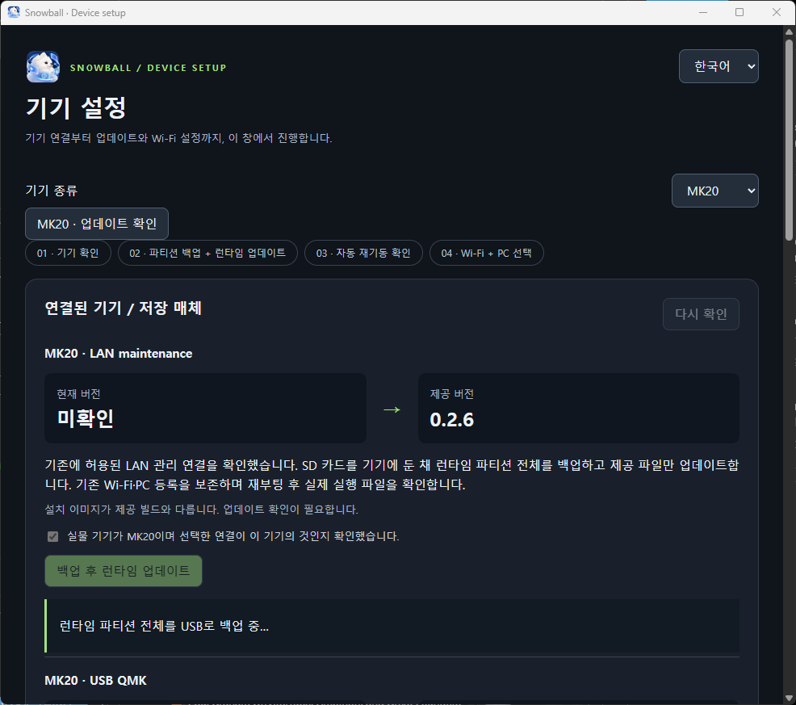
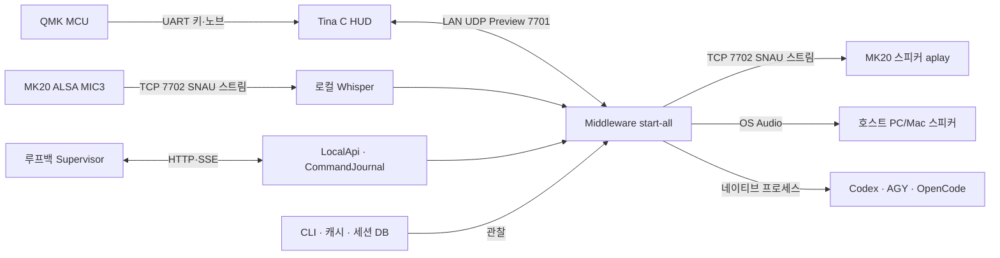
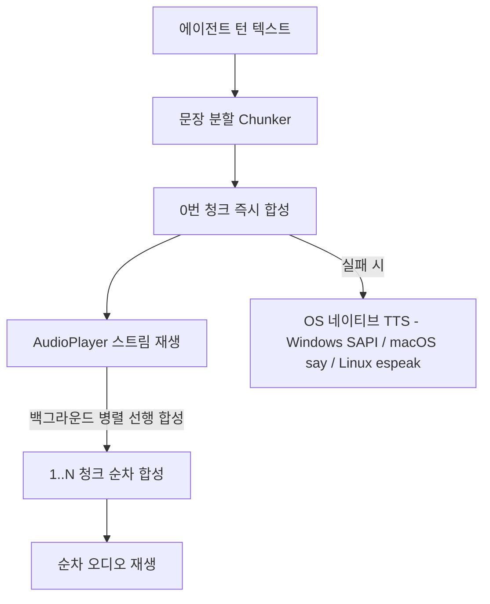
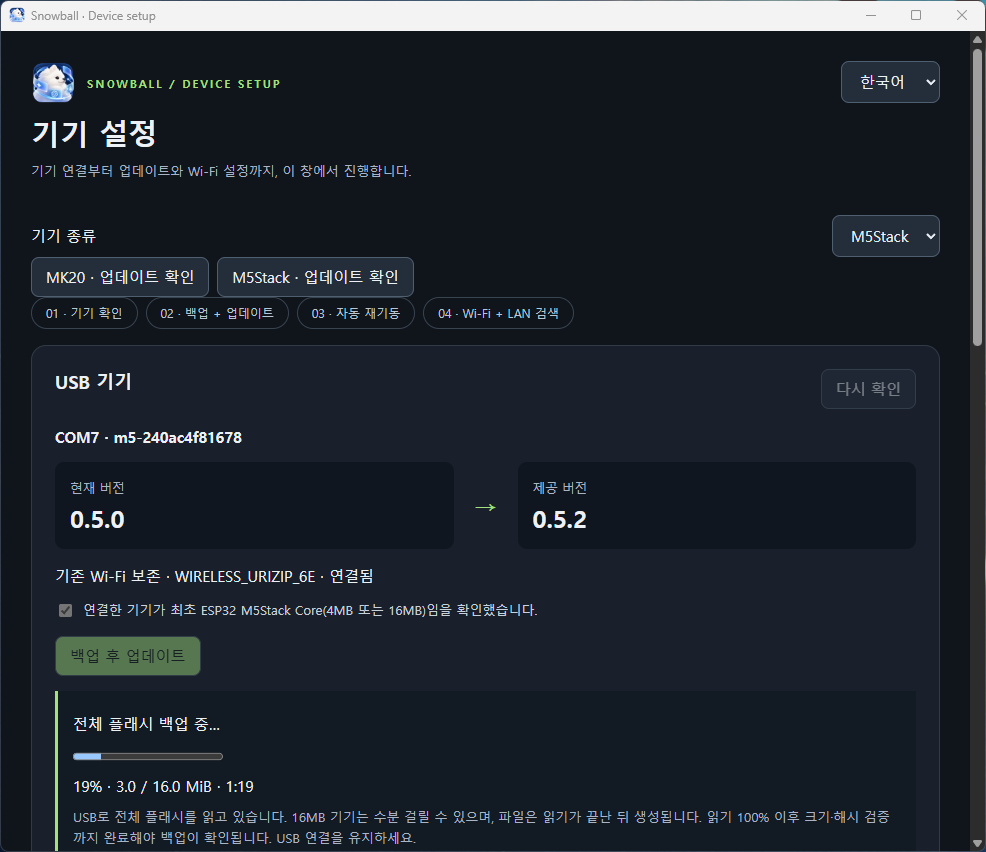

<p align="right">
  <a href="ARCHITECTURE.md">English</a> | <strong>한국어</strong>
</p>

# Snowball Control & Middleware — Preview

이 문서는 기기와 미들웨어 전체의 현재 설계를 관리하는 단일 원천이다. 최초 범주는 **Codex, AGY, OpenCode, MK20, 로컬 Web Supervisor**다. 공개 Preview는 신뢰하는 개인 PC와 내부 네트워크용이며, 인터넷이나 다중 사용자 환경에 대한 보안 보장을 제공하지 않는다.

## 제품 철학: inter-Harness 로컬 제어

**Snowball은 사용자가 자신의 여러 컴퓨터에서 AI 하네스를 오가며 직접 통제하는 inter-Harness 로컬 제어 인터페이스다.** Codex, AGY, OpenCode를 물리 데스크 터미널과 로컬 Web Supervisor에서 탐색하고 관찰하며, 지원되는 네이티브 동작을 실행한다. 여기서 **inter-Harness**는 하네스를 가로지르는 공통 사용자 제어 인터페이스를 뜻한다. 독립된 MK20에서 작업 대상은 사용자가 선택한 `머신 > 하네스 > 프로젝트 > 세션`으로 명확하게 정한다.

제품은 다음 원칙을 따른다.

- **작업의 주인은 사용자다.** 사용자의 PC가 프로젝트·네이티브 프로세스·세션 데이터를 소유한다. 프롬프트를 보낼 곳과 사용할 도구는 사용자가 선택한다. MK20은 키·노브·화면·음성 입력으로 그 선택을 손에 닿는 동작으로 만든다.
- **공통 인터페이스 안에서도 하네스의 차이를 존중한다.** 각 하네스의 세션 이력, 모델 식별자, 지원 effort, 권한 의미를 유지한다. 어댑터는 네이티브 기능을 연결하며, 호환성은 실제 설치 버전과 관찰한 동작을 기준으로 판단한다. 하네스 간 세션 변환·대화 이관·에이전트의 자율 협업은 현재 Preview 범위에 포함되지 않는다.
- **로컬 제어가 먼저다.** 제어 경로에 클라우드 제어 플레인을 필수로 두지 않는다. 로컬 의존성을 준비한 뒤에는 인터넷 없이도 기기 조작과 로컬 관찰·제어가 가능해야 한다. 클라우드 모델 추론에는 해당 제공자의 네트워크 연결이 필요하다. 루프백 Supervisor는 로그인/PIN 없이 열며 기기 페어링은 별도 경계로 관리한다.
- **실제가 원천이다.** 모델·effort·프로젝트·세션은 네이티브 도구와 로컬 데이터에서 발견한다. 실행과 완료는 실제 네이티브 이벤트로 확인하고, 승인·중단은 하네스가 실제 제공하는 기능에 맞춰 처리해야 한다. 발견 실패나 미지원 동작은 성공으로 꾸미지 않고 드러낸다.
- **편의성의 경계를 명시한다.** 플러그인 권한을 제한하면서 승인된 호스트의 실행·관찰은 유지해야 한다. 현재 Preview는 개인 PC와 신뢰하는 내부 네트워크용이며, 문서에 명시한 보안 생략과 미완성 네이티브 연동도 제품의 한계로 공개한다.

이 원칙은 제품이 지향하는 방향이다. 아래 각 절에서 현재 구현·검증된 동작·남은 작업을 구분하며, 모든 하네스에서 모든 제어 기능이 완성되었다는 뜻은 아니다.

### 제품 아이덴티티와 데스크톱 브랜딩

기존 `assets/icon.png`를 Control·Middleware·M5Stack·하네스 저장소 3종이 공유하는 Snowball 제품 아이콘으로 사용한다. 트레이용 별도 심볼을 만들지 않고 같은 원본에서 Windows ICO(16–256 px), macOS ICNS, PNG(32/256 px), 설치 프로그램 이미지를 생성한다. 고정된 데스크톱 엔진으로 `scripts/build-desktop-icons.mjs`를 실행해 다시 생성할 수 있다.

소스 설치도 엔진의 기본 앱 대신 **Snowball Middleware** 네이티브 앱(`SnowballMiddleware.exe` / `Snowball Middleware.app`)을 준비한다. 부트스트랩은 검토된 소스 suite를 불러오며 플러그인 권한·dispatch·발견·기기 준비 계약은 유지한다. 런타임 manifest로 실행 파일 SHA-256을 확인한다. 트레이·기기 설정 창·알림·대화상자·바로가기·설치/제거 프로그램·패키지 리소스에 Snowball 이름과 아이콘을 적용한다. 루프백 Supervisor의 favicon·헤더 이미지도 기존 정적 파일 origin/CSP 경계 안에서 제공한다. 하네스 제공사 표시는 해당 제공사의 브랜딩을 유지한다.

업데이트는 선택한 suite의 확인된 기존/이전 실행 파일 자동 시작 항목만 이관하고 활성/비활성 선택을 보존한다. 다른 시작 항목은 건드리지 않는다. 고정 엔진의 공백 경로 조회 결함 때문에 Windows 조회 경로만 인용하고 저장하는 실행 인자는 네이티브 인자로 분리한다. MK20·M5Stack은 이미 내장 Snowball 아이콘을 표시하므로 이 변경으로 펌웨어를 바꾸거나 플래싱하지 않는다. Windows 실행 파일 리소스·실제 트레이 소유권/자동 시작 이관·로컬 아이콘 제공·실제 설정 창 이미지 검증과 macOS·알림 전달·다른 PC 인수 검증을 구분하며 후자는 별도 현장 확인이 필요하다.

Windows 브랜딩 검토(2026-10-10): 저장소 6개의 원본 아이콘 SHA-256이 일치했다. 네이티브 실행 파일과 빌드한 설치 프로그램에서 Snowball 아이콘 8개 크기를 확인했다. 참조 패키지 144개 해시/앱 파일 147개 및 트레이·루프백·일시정지 검사가 통과했다. 실제 USB 열거로 두 기기 설정 화면의 한·영 제품 이미지를 확인했으며 M5Stack은 설치 0.2.2·제공 0.5.0을 유지했다. Middleware 283개/선택 생략 5개, Control 70개/2개, UX parity 10개/1개와 실제 사용 가능한 하네스 목록 전환이 통과했다. OpenCode CLI는 사용 불가였다. 격리한 Windows 네이티브 검사에서 기존 자동 시작 활성/비활성 선택 이관과 실행 파일 소유권을 확인했다. MK20 framebuffer를 읽기 전용 캡처했고 펌웨어를 쓰지 않았다. MINIME-PC-AMD 공식 소스 업데이트로 Middleware `dcfd3c2`를 설치했고 Snowball 실행 파일·네이티브 바로가기 2개의 앱 식별자·기존 활성 자동 시작 선택 보존·두 기기 어댑터·HTTP 200을 확인했다. 최종 브랜딩 커밋 `dcfd3c2`의 Windows x64/macOS ARM64/Intel 패키지 CI도 통과했다. 남아 있던 사용자별 참조 설치본도 새 설치 프로그램으로 제자리 갱신했고 144개 해시·네이티브 트레이·시작 메뉴 식별자·제거 프로그램 아이콘 8개 크기를 확인했다. 전체 소스 suite는 계속 정상 실행됐다. macOS 대화형 조작과 SNOWBALL-395 인수 완료는 별도로 남는다.

Windows 소스 설치는 알림과 같은 `local.snowball.middleware` AppUserModelID를 가진 네이티브 바탕화면·시작 메뉴 바로가기도 만들며 `--no-shortcut`이면 둘 다 생략한다. 네이티브 셸에서 실행 대상·아이콘·식별자를 다시 읽어 등록을 확인한다. 이 메타데이터 검증을 OS 알림 전달 성공으로 취급하지 않는다.

### 독립 MK20과 여러 미들웨어 머신

제품의 의도된 흐름은 MK20이 독립 기기로 Wi-Fi에 연결되고, 내부 LAN의 미들웨어 호스트를 발견하며, 사용자가 여러 호스트를 페어링하는 것이다. 두 호스트를 페어링하면 머신 두 개, 세 호스트를 페어링하면 머신 세 개가 보인다. 머신을 선택하면 해당 미들웨어에 등록된 하네스·프로젝트·세션을 표시하고, 지원되는 동작을 선택한 머신으로 전달한다. 발견은 후보 탐색이며 페어링은 사용자가 선택한 호스트의 등록이다. 페어링된 호스트 목록과 선택은 특정 PC 하나에 의존하지 않고 기기가 유지한다.

새 미들웨어 PC의 추가와 전환은 일반적인 발견·페어링 동작이어야 한다. 이를 위해 SD 편집, PC MAC 교체, USB 재연결, ADB 활성화를 요구해서는 안 된다. SD 이미지 설치·Wi-Fi 초기 설정·펌웨어 유지보수·복원은 별도 기기 준비 작업이다. 현재 개발 부팅 설정의 `DEV_PC_MAC`은 TCP ADB 접근을 제한하는 값이며 제품의 머신 페어링 목록이 아니다.

**현재 구현:** 네이티브 HUD가 발견·페어링·머신 선택(K17)을 직접 관리한다. 미들웨어의 영속 host ID와 실제 OS 호스트명을 발견하며, 기기는 최대 16개 페어링과 마지막 선택을 `/mnt/SDCARD/snowball-hosts.v1`에 보관한다. 선택한 PC만 입력을 받고 자기 PC의 네이티브 하네스·프로젝트·세션을 제공한다. PC를 떠나도 그 PC의 컨트롤러 컨텍스트와 실행 중인 네이티브 작업은 유지한다. 실제 PC 2·3대의 전환 검증은 아직 필요하며, 한 PC의 여러 프로세스나 테스트 fixture를 그 증거로 취급하지 않는다.

- `SNMK1` UDP 발견: 기기가 서브넷 브로드캐스트 47772에 `DISCOVER`를 보내며 PC도 선택한 NIC에서 2초마다 `OFFER`를 알린다. 기기는 응답의 실제 송신 IP/포트에 `SELECT`·`RELEASE`·선택 heartbeat를 보낸다. Windows의 브로드캐스트 응답 예외는 활성 방화벽 프로필/정책에 따라 달라지므로, PC 알림 수신만으로 선택 요청의 수신까지 확인할 수 없다. 브로드캐스트/응답이 차단된 네트워크는 로컬 네트워크 설정이 필요하다. 미들웨어는 실제 수신 IP/포트와 최초 선택 요청 수신을 lease 토큰 없이 기록한다.
- K17은 Machines, 왼쪽 노브는 이동·선택, K16도 선택, K4는 돌아가기, K8은 페어링 해제다. 미등록 후보는 만료되고 페어링된 오프라인 PC는 남는다. 발견만으로 선택/등록하지 않는다. host ID를 유지하므로 DHCP/PC명 변경으로 같은 머신을 중복 생성하지 않는다. 자동 NIC 선택은 시작마다 다시 수행하며 명시한 `-Bind`만 고정한다.
- Machines는 최근 알림을 받은 `available`과 선택한 PC의 실제 화면 프레임을 받은 `connected`를 구분한다. 선택 직후 PC 이름과 `Connecting to PC`를 표시하고, 8초 동안 유효한 화면이 없으면 `No PC response`와 트레이/로그/방화벽 점검 안내를 표시한다. 연결 요청은 계속하며 K17에서 재시도·전환할 수 있지만 일반 조작은 차단한다. 페어링 저장만으로 런타임 연결 성공을 표시하지 않는다.
- 선택마다 새 lease를 만든다. 화면은 선택 IP·lease와 controller/run/sequence를 검사하며 이전 lease와 재생된 입력은 거부한다. 머신을 떠나면 발화를 중단하고 캡처한 음성은 원래 세션 초안에 전사한다. 진행 중인 네이티브 작업은 원래 PC에 남고 돌아오면 같은 컨텍스트·소유한 Stop 핸들을 사용한다. 전송 여부가 불명확하면 `unknown`으로 남기며 자동 재전송하지 않는다.
- lease는 **신뢰하는 LAN용 Preview의 평문 라우팅 경계**이며 암호화된 신원 증명/인증이 아니다. ADB는 명시적인 유지보수·디버깅 전용이다. 일반 `mk20` PC 설치는 호스트 라이브러리·로컬 음성 의존성을 준비하고 PC를 알린다. 기기 배포, ADB 발견, Wi-Fi/개발 MAC 변경은 수행하지 않는다.


## 1. 저장소와 실제 실행 경로

**Snowball**은 전체 로컬 제어 시스템이며, **Snowball Middleware**가 공통 설치·PC 실행·Web UI를 담당한다. **Snowball Control**은 MK20 기기 구성 요소와 이 공통 아키텍처 문서를 관리한다. 두 번째 미들웨어가 아니다. **Snowball Device · M5Stack**은 ESP32 펌웨어·게이트웨이를 관리하고, **Snowball Harness · Codex / Antigravity / OpenCode**는 모든 설치에 포함하는 독립 빌드 플러그인이다.

공통 진입점은 Windows `Snowball_Middleware/install.ps1`, macOS·데스크톱 Linux(x64/arm64) `Snowball_Middleware/install.sh`이며 **기본 설치에 모든 지원 기기를 포함한다**(`all`). Middleware·Control 호스트 라이브러리·M5Stack 게이트웨이·독립 하네스 플러그인 3종을 빌드한다. PC 설치에 USB 연결·프로필 선택·펌웨어 작업은 필요 없다. 실제 격리 워커 초기화를 확인하고 `.snowball/suite.json`에 소스 커밋과 승인된 진입점 다이제스트를 기록한다. 추적 파일 수정은 거부하고 체크아웃을 초기화하지 않는다. 공급자 앱·로그인은 별도 준비이며 없으면 사용 불가다. 모델·Effort·프로젝트·세션은 계속 네이티브 원천에서 동적으로 관찰한다.

**사용자 안내 구성:** 저장소 6개의 한·영 README는 설치와 업데이트를 별도 절로 두며 Windows·macOS·Linux별 명령을 펼쳐 복사하도록 구성한다. 업데이트는 기존 suite 경로의 PC 소프트웨어 갱신 후 Installed → Included 검토와 명시적 백업 기기 업데이트로 이어진다. Middleware README에 M5Stack·MK20 런타임/QMK·복구 상세를 모으고 다른 README에서 연결한다. 과거 인수 기록은 이 명세에 유지하며 기존 UI 캡처는 예시로 표시한다. 독립 하네스 문서 생성은 별도 설치·업데이트 서술 대신 Middleware README의 공통 안내를 읽는다. 문서 구성만 변경하며 설치기·런타임·펌웨어·Web/MK20/M5Stack·하네스 3종 실행 계약은 동일하다.

**Unix 설치 계약:** `install.sh`는 curl·Git·venv/pip을 포함한 Python >=3.12가 필요하며, Linux는 그래픽 데스크톱과 Electron/GTK/NSS/ALSA/GBM 라이브러리가 필요하다. 지원 Node를 재사용하거나 공식 LTS tarball의 SHA-256을 확인한 뒤 사용자 폴더에 풀며 sudo·시스템 PATH 변경을 사용하지 않는다. 기본 루트는 macOS `~/Library/Application Support/Snowball`, Linux `${XDG_DATA_HOME:-~/.local/share}/Snowball`이다. 배열로 공백이 있는 경로·옵션을 보존하고 원격 원천·추적 파일 수정·fast-forward 갱신을 확인한 뒤 빌드한다. `--root 경로 --update`로 suite 상태를 보존하며 `Start-Snowball.sh`로 다운로드 없이 다시 실행한다. Linux도 같은 승인 다이제스트 워커 초기화·POSIX 네이티브 실행 파일 검색·제품 네이티브 실행 파일과 suite별 XDG 자동 시작을 사용하고 업데이트 시 비활성 선택을 보존한다. renderer sandbox·플러그인 승인·dispatch 경계를 완화하지 않는다. 기기 프로토콜·펌웨어·하네스 3종 동작·루프백 Web UI 계약은 유지한다. USB 권한/드라이버와 미지원 OS Wi-Fi 가져오기는 일반 OS/기기 안내를 따른다. README는 GitHub 지원 details 선택과 코드 블록 Copy를 사용하며 Markdown에서 사용자 탭/클립보드 스크립트를 실행하지 않는다. 자동 호스트 검증과 macOS/Linux 대화형 실물 인수 결과를 구분한다.

**멀티플랫폼 검증(2026-10-12):** Ubuntu x64/WSLg에서 공백이 있는 설치 루트로 실제 Unix 부트스트랩을 실행해 공식 Node LTS 다운로드·체크섬 확인, 제품 런타임·독립 하네스 3종 빌드, 실제 승인 워커 초기화를 확인했다(`--profile web --no-start`). 설치 트레이를 두 차례 시작·종료하고 루프백 UI 응답을 확인했으며 네이티브 검사에서 기본 창 없음·일시정지/재개를 확인했다. Linux 참조 압축본과 다시 푼 압축본 모두 145개 해시/앱 파일 148개를 확인하고 네이티브 검사를 통과했다. Linux 전체 회귀는 298개 중 286개 통과·선택 12개 생략이며, 실제 Gio 실행기로 예약 문자가 있는 인자를 정확히 전달하는 검사도 포함한다. 호스트 신원·bootstrap 파일은 명시적 0600으로 생성해 Unix 재시작의 개인 상태 경계를 보존한다. Windows 전체 회귀도 298개 중 286개 통과·선택 12개 생략이다. Control 호스트 70개 통과·2개 생략, MK20 플러그인 15개, MK20 parity 10개 통과·1개 생략과 실제 사용 가능 목록 전환을 확인했으며 없는 OpenCode 목록은 비워 둔다. 독립 Codex 저장소의 워커/표시 검사 2개도 통과했다. macOS/ARM64 실행·재부팅 후 그래픽 로그인 자동 시작·Linux 전체 기기/음성 의존성 설치·USB/실물 기기 인수·실제 공급자 dispatch는 미확인이다. 펌웨어를 변경하지 않았으며 ADB/기기 대상이 없어 새 MK20 framebuffer 캡처는 실행하지 못했다. 공개 한 줄 설치 명령은 Middleware 설치기와 독립 Codex Linux manifest의 main 브랜치를 사용하며, 호스트 설치와 기기 펌웨어 인수 결과는 별도로 구분한다.

**같은 설치 루트**에 일반 업데이트하면 기존 Web/MK20/M5Stack 단독 설치에도 두 어댑터를 준비한다. `deviceProfiles`와 `devices`로 Python·NIC·등록 경로를 구분하며 M5Stack `.local`의 페어링·기기·탐색 파일, 컨트롤러 상태, 음성 캐시, 사용자 지정 API 포트와 로그인 자동 시작 설정을 유지한다. 하나의 소유 트레이·suite·API가 두 기기를 제공한다. `-Profile web|mk20|m5stack`은 개발·진단용 명시적 부분 구성이고 기존 어댑터를 유지한다. 이 옵션은 USB 준비를 암묵적으로 실행하지 않는다. 검색·기기 등록·선택은 별도의 신뢰·소유 동작이다.

| 작업 | 설치 구성 / 기기 영향 |
| --- | --- |
| 일반 설치 / `-Update` | 두 호스트 어댑터·Web UI·하네스 3종. 설치가 플래싱하지 않으며 실행된 트레이가 USB 설정을 제안하되 쓰기를 자동 승인하지 않음 |
| MK20 최초 연결 | 독립 Wi-Fi 기기에서 K17로 PC 검색·페어링. 공통 기기 설정 창에서 QMK DFU와 USB 런타임을 처리하며 일반 LAN 페어링은 펌웨어 준비와 독립적으로 동작 |
| M5Stack PC 추가, 펌웨어 0.4.0 | 머신에서 등록 PC와 새 LAN 미들웨어를 자동 표시. 새 PC 선택으로 Wi-Fi 등록하며 USB·등록 스크립트 불필요 |
| M5Stack 최초 펌웨어 / 업그레이드 | USB 연결 시 네이티브 설정 창: 버전·개선 사항 → 명시적 선택 → 전체 백업 → NVS 보존 쓰기 → 재기동·버전 확인 → Wi-Fi 이관 또는 기기 조작 안내 |
| 개발용 부분 구성 | `-Profile web`, `mk20`, `m5stack`. 하네스 3종은 유지 |

**MK20을 포함한 모든 디바이스의 공통 준비 여정 (2026-10-10):** MK20, M5Stack과 앞으로 추가할 모든 디바이스 플러그인에 하나의 네이티브 **기기 설정…** 창과 공통 진행 관리자 계약을 적용한다. 필수 흐름은 연결 감지 → 실제 기종·설치 버전과 제공 버전·개선 사항 확인 → 명시적 동의 → 변경하는 저장 영역 전체 백업 → 기존 설정을 보존한 펌웨어 업데이트 → 실제 자동 재기동 검증 → 기존 네트워크 유지 또는 정보가 없을 때 검토한 OS Wi-Fi 이관·기기 시각 안내다. 기기별 사용자 설치나 등록 스크립트를 요구하지 않는다. MK20은 구체적인 버전 2 구성 요소 어댑터로 같은 여정을 사용한다. 미래 기종은 일반 번들 설치·런타임 어댑터 목록에 추가하고 같은 준비 계약을 제공한다. 설정 창이나 진행 코드를 복제하지 않으며 아직 지원하지 않는 하드웨어를 구현된 것처럼 표시하지 않는다.

**MK20 실제 준비 어댑터 (버전 2, 0.2.6):** 기본 설치가 데이터 전용 `hardware/mk20/firmware/setup.json`과 고정 PyUSB/libusb/pyserial 의존성을 준비한다. 같은 네이티브 진행 관리자가 QMK DFU·T113 런타임 구성 요소, 비공개 백업, 동의와 실제 검증을 소유한다. 제품 USB는 CDC ACM `1d6b:0104`와 실제 WLAN MAC 기반 `mk20-…` 식별자다. USB 식별자는 암호학적 기종 증거가 아니므로 실물 확인을 유지한다. 일반 페어링·SNMK1·SNAU-lease-v1·Web/API·하네스 Protocol 1은 변경하지 않는다.

**M5Stack 검색·읽기 화면 수정 (2026-10-15, 펌웨어 0.5.5):** 실제 MINIME-PC-AMD에는 Ethernet `192.168.1.225`와 Hyper-V Default Switch `172.27.64.1`이 있었고, suite는 루프백 HTTP를 제공하지만 주소 선택 모호성 때문에 두 기기 LAN 어댑터가 시작되지 않았다. 공통 선택기는 자동 fallback에서 알려진 가상/VPN 이름을 제외하되 명시적 bind와 유일한 대상 서브넷 경로를 우선하며 실제 LAN 둘의 모호성은 유지한다. MK20·M5Stack 호스트 검색에 공통 적용하며 Web 루프백·인증·하네스 3종·네이티브 SDK/worker 계약은 유지한다. “기존 등록 PC”는 발견된 PC가 아니라 host identity가 비어 있는 구 단일 키 기록이었다. 펌웨어는 서명 이관용 키를 보존하지만 머신 목록·선택·헤더에서 제외한다. 화면 행과 저장 슬롯을 매핑해 실제 PC 선택과 등록 진행 상태를 유지하며 진단에서도 식별된 PC 수와 구 키 보존 여부를 구분한다. 실제 0.5.4·16MB·FACES에서 395 인증과 네이티브 내용 105행, 진단 페이지 이동의 0 → 12 → 24행 수신을 확인했다. 요청 24/수신 12의 과도 상태에서 기존 렌더러가 LAN 응답 동안 이전 내용과 스크롤바를 그대로 그리는 것을 확인했다. 0.5.5는 이미 받은 실제 행만 요청 위치로 옮기고 없는 행에는 로딩을 표시하며 스크롤바를 즉시 이동한다. 내용이나 네이티브 완료를 만들지 않는다. 사용자는 본체 A/C에서 문제를 보고했으며 진단 탐색은 손 조작 인수 검증이 아니다. 읽기 전용 진단에 처리된 버튼 제스처와 요청/수신 위치를 추가하고 초안·키·본문은 넣지 않는다. 버전·한/영 개선 사항을 일반 기기 설정에 제공한다. 검토되지 않은 기기 쓰기는 수행하지 않으며 전체 백업 업데이트와 실물 A/C 인수는 소프트웨어 검증과 구분한다.

**0.5.6 연결 후속:** 업데이트된 호스트 게이트웨이는 실제 Ethernet 192.168.1.225에서 수신하지만 실물 0.5.4 선택은 여전히 재시도 화면에 도달했다. 이후 실제 진단에서 역방향 인증은 됐으나 네이티브 화면 조회가 없는 상태를 관찰했다. 재시도 화면은 일반 polling을 정지하므로 늦게 인증된 전송 경로에서 명시적으로 실제 화면을 조회하며 핸드셰이크 자체를 연결 성공으로 취급하지 않는다. 이미 인증된 같은 PC를 다시 고르면 소켓을 유지하고 목적지 변경 시 역방향 리스너를 재시작해 이전 연결 대기를 정리한다. 변경 명령을 재전송하지 않는다. 0.5.6에 0.5.5의 읽기·목록 수정을 포함한다. 소프트웨어 검사는 늦은 전송 인증과 실제 화면 성공을 구분하며 이 업데이트 전 단계에서는 손으로 A/C와 두 PC 인수가 남아 있었으며 이후 결과는 아래에 기록한다. 데스크톱 로그는 실제 설정 검토 창 생성을 보고했지만 Windows computer-use가 반환한 데스크톱에서는 대상 창을 찾지 못해 직접 육안 확인을 주장하지 않는다.

**0.5.6 제공 후보 확인:** 최종 ESP32 빌드 통과(정적 RAM 58,232바이트·앱 flash 1,533,229바이트, SHA-256 e29b6169427b0fb8fdf5b88dbddcff359f44c033ff0e26cb80b6f04df7385741). 연결 후속 수정 뒤 네이티브 C++ 연결·탐색·페어링·IME, M5Stack Node 21개·설치기 Python 16개를 다시 통과했다. 공통 실행 계약은 바꾸지 않아 앞서 통과한 전체 회귀와 분리 양 기기 검증이 적용된다. 공식 동일 루트 Update가 완료됐고 실행 설치 소스가 검증한 펌웨어·LAN 선택 코드와 일치했다. 실제 USB와 승인된 네이티브 설정 관리자에서 Installed 0.5.4 → Included 0.5.6, 한·영 개선 사항 전체와 기존 Wi-Fi 연결을 확인했다. 기존 검토 창 생성 로그, 살아 있는 백그라운드 트레이 소유, 루프백 HTTP 200과 192.168.1.225:47771의 M5Stack 게이트웨이를 확인했다. 다른 컨트롤러 아홉 개와 기존 명령 기록 세 개는 그대로였다. Computer-use로 원래 창을 직접 볼 수 없어 캡처가 아닌 설정 관리자 데이터로 확인했다. 펌웨어는 쓰지 않았다. 이 후보 제공 단계에서는 사용자 승인 전체 백업 업데이트와 실물 A/C·두 PC 인수가 남아 있었으며 호스트 검색 시작만으로 기기 연결 성공을 주장하지 않는다.

**M5Stack 0.5.7 저장 검증 수정(2026-10-16):** 사용자가 동의한 0.5.4 → 0.5.6 업데이트는 이미지를 쓴 뒤 NVS 보존 검증에서 멈췄다. 비공개 16 MiB 전체 백업은 메타데이터 SHA-256과 일치했다. 실제 USB 읽기는 유일한 `WIFI_STA_DEF` 드라이버 항목을 삭제 상태로 표시한 bitmap 1바이트만 달랐고, 모든 페이지 헤더와 Wi-Fi·페어링·사용자 설정을 포함한 항목 데이터는 동일했다. SDK 상태 비트 변경의 정확한 원인은 특정하지 않았다. 엄격한 검증기는 삭제를 거부했으며 허용 범위를 넓히지 않는다. 업데이트 도구는 한 번 로더에 진입한 뒤 백업 조각·빌드·쓰기·읽기 검증 사이에 명시적 `--before no_reset`을 사용하고 검증 후에만 앱으로 돌아간다. 별도 `verify-backup-settings` 단계에서 쓰기 전 NVS 바이트와 전체 백업의 정확한 일치를 요구하며, 다르면 펌웨어를 쓰지 않고 기존 이미지로 재기동한 뒤 `nvs_changed_before_flash_no_write`를 표시한다. 재기동은 실제 native hello로 확인하며 응답이 없으면 별도 재기동 미확인 오류를 반환하고 성공으로 보고하지 않는다. 이 단계는 쓰기 후 보존 검증을 대신하지 않는다. 백업 재시도·크기·해시·파티션 중첩·쓰기 후 검증은 유지한다. 읽기 전용 반복 캡처는 안정적이었다. 이미 써진 0.5.6을 재플래싱·복원 없이 재기동하여 저장 Wi-Fi와 실제 PC 2개를 확인했고, USB 진단 탐색으로 MINIME-PC-AMD·SNOWBALL-395 각각의 인증된 실제 프로젝트·세션 화면을 재부팅이나 네이티브 프롬프트 없이 확인했다. 구 키는 비공개로 남는다. 손으로 A/C를 누른 확인은 아래 제공 후보 후속에 기록하며 0.5.7 전체 백업 업데이트 완료는 별도 확인이다. 도구 수정은 M5Stack 전용이며 공통 호스트는 한·영 진행/오류 문구만 확장한다. MK20 업데이트·Web 루프백·하네스·SDK/worker 권한·승인/중단 계약은 유지한다.

**0.5.7 소프트웨어/읽기 전용 실물 검증:** ESP32 빌드는 정적 RAM 58,232바이트·앱 플래시 1,533,229바이트로 통과했으며 SHA-256은 04c841456aaac288034f692ef3006bdc0f08c1f27580658224d07c043aab52c6이다. 설치기 Python 20개·M5Stack Node 21개·네이티브 C++ 검사가 통과했다. 최종 Middleware 전체 306개 중 296개 통과·선택 10개 생략이며 실제 소유 Python 자식 실패/종료 검사도 포함한다. Control 호스트 70개/2개 생략·MK20 UX parity 10개/1개 생략·실제 사용 가능 하네스 목록 전환이 통과했다. 실물 M5Stack에서 no-reset 460800 → 460800 → 115200 baud 읽기의 20 KiB NVS 캡처가 모두 일치했다. 실제 쓰기 전 helper는 일치하는 캡처를 허용하고 이전 백업과의 차이는 펌웨어 쓰기 전에 차단했으며 실제 hello로 기존 0.5.6 재기동을 확인했다. 실제 0.5.6 framebuffer에서 395 내용과 스크롤바를 확인했지만 손으로 A/C를 누른 검증은 아니다. MK20 ADB 목록이 비어 새 framebuffer 캡처는 확인하지 못했다. 0.5.7 전체 플래싱·백업·재기동 인수와 macOS/Linux serial 동작은 미확인이다.

**0.5.7 제공 후보 확인:** 공개한 M5Stack `805b358`·Middleware `3ae5ce9`·중앙 문서를 기존 Snowball-LAN 경로의 일반 Update로 설치했다. 실제 USB와 승인된 설치 코디네이터에서 설치 0.5.6 → 제공 0.5.7·한/영 개선 사항 각각 5개·저장 Wi-Fi 연결·검증 소스 일치를 확인했다. 실제 트레이/설정 창 준비 로그와 루프백 HTTP 200이 통과했으며 네이티브 창을 직접 육안 확인했다고 보고하지 않는다. MK20은 실제 LAN 런타임 0.2.6을 업데이트 검토 없이 계속 보고했다. 보존된 16 MiB 백업은 메타데이터 해시와 계속 일치하고 다른 컨트롤러 9개 상태·명령 기록 3개는 그대로였다. 0.5.7 플래싱이나 백업 복원은 수행하지 않았다. 현재 실물은 복구된 0.5.6이며 새로 검토한 전체 백업 0.5.7 업데이트는 미확인이다. 2026-10-16 사용자가 실제 본체 A/C 버튼으로 SNOWBALL-395 세션 내용이 정상 스크롤된다고 확인했다. 이 사람의 버튼 입력 인수는 앞선 USB 진단 두 PC 연결 확인을 보완하며, 0.5.7 플래싱이나 다른 기기의 버튼 인수를 입증하지 않는다.

**0.5.5 소프트웨어 검증:** ESP32 빌드 통과(정적 RAM 58,232바이트·앱 flash 1,533,117바이트, SHA-256 636079fe15aea1c023f46f34520013b6e565055eddb697e36b3d0e9f1ff864ec). 설치기 Python 16개·M5Stack Node 21개·네이티브 C++ 검사, Middleware 293개 통과/선택 12개 생략, Control 호스트 70/2, MK20 UX parity 10/1과 실제 제공 목록 전환이 통과했다. 분리한 실제 양 기기 suite에서 MK20 composition과 암호화 M5Stack 등록·서명 polling을 함께 검증했다. 실물 MK20의 이전 디버그 주소가 응답하지 않아 새 framebuffer 캡처는 불가능했으며 실물 화면 검증 성공으로 취급하지 않는다. 업데이트 전 실물 M5Stack framebuffer와 인증된 실제 내용을 확인했다. 0.5.5 쓰기와 손으로 A/C 조작 인수는 남아 있다.

**연결 상태·USB 중복 수정 (2026-10-11):** M5Stack 0.5.2는 0.5.1의 연결 화면 수정 두 가지를 포함한다. 다중 PC 지원 이전의 키를 보존했지만 host ID가 빈 상태를 선택 완료한 PC로 취급하여 발견한 새 PC 선택을 숨기지 않는다. 선택한 PC의 실제 인증된 응답이 제한 시간 뒤 도착하면 재시도 화면에서 연결 확인·세션 내용으로 복구한다. PC가 응답하지 않으면 제한 시간 후 발견한 Machine 목록을 제공한다. 기존 키·Wi-Fi를 보존하고 검색 응답만으로 PC를 선택하거나 권한을 주지 않는다. 읽기 전용 USB 연결 진단에는 선택 host ID·저장 PC 수·검색 후보 수·최소 남은 실행 스택 바이트를 추가하며 키·네이티브 내용은 넣지 않는다. 게이트웨이는 서명 프레임·자격증명 없이 LAN 페어링 단계와 미들웨어 화면 준비 상태의 변화만 기록한다. 하네스 dispatch나 통신 계약 변경이 아닌 기기 화면 흐름 수정이다.

**실물 M5Stack 재부팅 진단 (2026-10-11, USB 후속):** 하나뿐인 USB 케이블을 MK20에서 M5Stack으로 옮긴 뒤 COM7에서 0.5.0·16MB·FACES·기존 Wi-Fi 연결(`192.168.1.163`)·구 페어링 보존·인증 화면 미수신을 확인했다. 기기의 실제 검색에 SNOWBALL-395와 MINIME-PC-AMD가 나타났다. 새 로컬 PC 선택은 게이트웨이 페어링 요청이 도착하기 전에 반복 재부팅됐으며 USB panic은 `spinlock_acquire`였다. 동일 설치 ELF SHA가 기기의 오류 기록과 일치했고 `DiscoveryCandidate` 복사 → `pairCandidate` → 선택 → 실제 진단 핸들러 → loop로 해석됐다. 실행 스택이 기본 8 KiB를 넘어 약 12 KiB에 이르며 인접 힙 상태를 손상시켰다. 0.5.2는 768/2048바이트 페어링 JSON 문서를 할당 성공을 확인하는 힙 버퍼로 옮기고 loop 스택을 16 KiB로 확보하며 컴파일러 스택 사용량과 실제 스택 high-water 진단을 제공한다. 다른 설치의 키 복사나 USB 등록 우회·네이티브 프롬프트 전송은 하지 않는다. 이 진단 단계에서는 새 펌웨어의 실물 등록·전환에 일반 동의·전체 백업 업데이트가 필요했으며 이후 사용자의 업데이트 완료에 따른 검증은 아래에 기록한다. Web/MK20·하네스 플러그인·SDK/worker 권한·페어링 암호화는 유지한다.

MK20 Windows 준비 검색은 실제 USB 부모 인스턴스만 열거하고 복합 기능·HID 컬렉션을 제외한다. 연결된 한 키보드의 USB 기능 네 개는 하나의 QMK 후보로 표시하고 서로 다른 실물 부모는 별개로 유지한다. 일반 키보드 HID 감지만으로 설치 바이너리 버전이나 DFU 읽기 백업 가능성을 증명하지 않는다. 설정 창은 키보드/DFU 준비, 백업 접근 불가, 런타임 CDC 무응답, LAN 발견을 구분하고 모든 경우를 비활성 “USB 응답 필요” 버튼으로 안내하지 않는다. 실물 구 MK20의 읽기 전용 진단에서는 HUD/audio가 실행 중이지만 런타임 수신기·설치 버전 표식이 없고 UDC가 `not attached`였다. 정확한 버전과 첫 런타임 USB 이관은 미해결이며, 이번 호스트 수정으로 수신기가 설치되거나 업데이트가 검증된 것은 아니다. SD 분리나 ADB 배포를 추가하지 않는다.

USB 후속 확인 이전의 실물 M5Stack TCP 진단에서는 선택 host ID가 비어 있었다. 이는 구 목적지 식별 미완료와 부합하지만 전체 접속 실패 원인을 단독으로 확정하지는 못했다. 이 PC의 LAN 게이트웨이 검색 응답과 실제 MK20에서 보낸 읽기 전용 HTTP 연결 확인, 실제 네이티브 목록의 유효한 컨트롤러 화면은 확인했으나 M5Stack 페어링 완료나 395 인수 검증은 아니었다. 그 이전 단계에는 M5Stack USB가 열거되지 않았고 0.5.1은 쓰지 않은 제공 후보였다. 위 USB 후속 진단이 최초 원인 분석을 갱신한다. Web/MK20 LAN·공통 준비 점유·하네스 3종·동적 목록·승인/중단·플러그인 worker 권한 계약은 유지한다. 이후 M5Stack 두 PC 인수 결과는 아래에 기록하며 MK20 첫 USB 이관·macOS는 별도 실물 검증이 남는다.

0.5.2 검증: 실제 ESP32 빌드가 통과했다(정적 RAM 58,184바이트·앱 flash 1,530,029바이트). 컴파일러 결과에서 `pairCandidate` 프레임이 실물 오류의 5,984바이트에서 3,200바이트로 줄었다. 회귀 검사는 실제 컴파일러 스택 보고서와 두 실물 용량별 설치 구성을 읽고 진단 페어링 경로를 보수적으로 합산하며 SDK/암호화 호출용 4 KiB 여유까지 16 KiB 실행 스택에 들어가는지 확인한다. 실물 스택 high-water 검증을 대신하지 않는다. 설치기 Python 11개·M5Stack Node 21개·네이티브 C++ 검사가 통과했다. Middleware 281/8(전체 289개)·Control 호스트 70/2·MK20 UX parity 10/1·실제 제공 목록 전환도 다시 통과했다. USB를 M5Stack에 연결한 동안 읽기 전용 MK20 framebuffer 육안 검토에서 395/Antigravity 세션이 유지됐다. 공식 동일 루트 Update로 MINIME-PC-AMD에 검증한 소스와 0.5.2 후보를 반영했다. 두 준비 어댑터 승인이 유효하고 백그라운드 트레이·루프백 HTTP가 살아 있으며 기존 백업 파일 두 개의 크기·해시는 그대로였다. 네이티브 준비 검색은 M5Stack 0.5.0을 다시 읽고 검토 창을 열었다. 이 검사로 기기 업데이트나 네이티브 프롬프트를 수행하지 않았다. 이는 동의 전 소프트웨어 검사이며 이후 사용자 승인 업데이트와 실물 인수 결과는 아래에 기록한다.

**실물 M5Stack 인수 확인 (2026-10-12, 사용자 승인 업데이트 후):** 기기가 0.5.2·16MB·FACES를 응답했고 기존 Wi-Fi 연결·구 페어링을 유지했다. 새 전체 플래시 백업은 16,777,216바이트이며 기록된 SHA-256과 실제 파일 해시가 일치함을 별도로 확인했다. 실제 검색에 MINIME-PC-AMD·SNOWBALL-395가 나타났고 선택 시 실제 암호화 LAN 등록과 인증된 네이티브 화면을 수신했다. 로컬 Codex와 395 Antigravity 모두 실제 프로젝트·세션·내용 12줄이 있었다. 로컬 → 395 → 로컬 → 395 → 로컬 전환을 재부팅 없이 마쳤고 최소 남은 실행 스택은 4,908바이트였다. 구 등록 하나와 식별된 두 PC, 총 세 저장 항목을 유지했다. USB 진단 탐색은 실제 버튼 핸들러를 호출했으며 등록·서명 화면·역방향 연결은 LAN을 사용했다. USB 등록 우회나 키 복사는 없었다. 다른 로컬 컨트롤러 여섯 개와 기존 명령 기록 세 개는 바이트 기준 그대로였고 프롬프트·승인·중단은 전송하지 않았다. 두 M5Stack 세션 framebuffer를 육안 확인했고 새 읽기 전용 MK20 캡처에서도 독립적인 395/Antigravity 세션이 유지됐다. 실물 페어링·화면 전환 검증이며 손으로 A/B/C 누르기, 네이티브 dispatch/승인 완료, 원격 395 설치 해시, 백업 복원, macOS나 MK20 첫 USB 이관을 인증하지 않는다. 개인 백업·캡처는 공개하지 않는다.

검증: Middleware 281개 통과·선택적 생략 8개(전체 289개), Control 호스트 70/2, MK20 UX parity 10/1, M5Stack Node 21개, 설치기 Python 10개와 MK20 준비 Python 7개가 통과했다. 실제 펌웨어가 쓰는 C++ pairing/connection 헤더로 구 PC 식별 미완료와 늦은 인증 복구를 검증했다. 최종 0.5.1 ESP32 빌드가 성공했고 분리한 실제 양 기기 suite에서 암호화 등록·서명 polling과 MK20 composition을 확인했으며 네이티브 프롬프트는 보내지 않았다. 실물 MK20 framebuffer를 캡처·육안 검토했고 한·영 네이티브 창은 실물이 아님을 명시한 데이터로 서로 다른 준비 조건을 표시하는지 확인했다. M5Stack 실물 플래싱·접속 또는 MK20 최초 이관을 검증한 것은 아니다.

설치본 확인 (2026-10-11, MINIME-PC-AMD): 공식 동일 루트 Update가 완료됐고 두 준비 어댑터 승인이 유효하며 줄바꿈을 정규화한 설치 소스가 검증한 Control/Middleware/M5Stack 코드와 일치했다. 실제 설치본 검색에서 QMK USB 부모 하나, `enter-dfu`·쓰기 불가·정확한 설치 버전 미확인을 확인했다. 소유 백그라운드 트레이가 살아 있고 루프백 HTTP 200이며 기존 전체 플래시 백업 파일 두 개의 크기·SHA-256이 그대로였다. 제공 M5Stack 후보는 0.5.1이며 새 펌웨어를 쓰지 않았다. 실제 실행 로그는 QMK USB 후보 하나와 MK20 LAN 후보 하나를 별도로 관찰했다. M5Stack USB·실물 두 PC 접속은 미검증이다.

**준비 창 재확인·연결 상태:** 다시 확인은 진행 중인 공통 검색을 기다리고 중복 요청을 최대 한 번의 강제 후속 검색으로 합친다. 자동 검색 중이라는 이유로 거절하지 않으며 두 어댑터가 같은 UART를 동시에 조회하지 않는다. 검색 시작을 즉시 표시하고 실제 조회가 끝날 때까지 수동 중복 클릭을 막는다. 자동 조회는 검색 종료 후 3초를 기다려 사용자가 검토할 여유를 둔다. 펌웨어 작업 중에는 계속 재확인·쓰기를 차단하고 종료 시 소유 검색도 정리한다. 알려진 요청 오류는 원인별로 번역하며 모든 실패를 USB 사용 중으로 표시하지 않는다. LAN으로만 발견한 MK20에는 런타임 USB 미확인 사유를 표시하고 QMK DFU 준비 조건과 구분한다. 현재 버전 미확인은 실제 버전 응답이 없다는 뜻이며 공기계 또는 0.2.6 설치를 의미하지 않는다. 호스트 재확인으로 없는 수신기를 설치할 수 없다. 이 호스트 수정은 두 준비 어댑터에 공통 적용하고 Web/API·기기 펌웨어·페어링·Wi-Fi 보존·백업 승인·플러그인 격리·하네스 3종·SDK/worker 계약은 변경하지 않는다. 실물 USB 최초 이관은 아래와 같이 미해결이다.

**기기 설정 동적 메시지 (2026-10-12):** MK20/M5Stack 공통 설정 renderer는 오류 도착 시 번역한 문장 대신 정제된 요청 오류 코드를 보관한다. 매번 화면을 그릴 때 현재 선택한 언어로 코드를 해석하여 한·영 전환 전에 표시된 안내도 즉시 갱신한다. 미등록 오류에는 해당 언어의 일반 안내를 표시하고 원시 IPC 진단·경로·비밀은 노출하지 않는다. 언어 변경으로 기기 작업을 다시 실행하지 않는다. 검색·기기 진행은 기존 상태 코드를 계속 사용한다. 호스트 UI 변경이며 Web/API·네이티브 dispatch/승인/중단·펌웨어·백업·Wi-Fi/페어링·하네스 3종·SDK/worker 계약은 유지한다.

**M5Stack 백업 실패 표시 (2026-10-12):** 버전 1 준비 호스트는 작업 실패 당시 단계를 보존한다. 복구 백업 경로는 네이티브 도구의 `backup-verified` 이후에만 공개하며 초기 예정 파일명을 실제 파일 생성 근거로 삼지 않는다. 새 설치 시도는 이전 시도의 경로를 현재 상태에서 지우되 파일 자체는 삭제하지 않는다. M5Stack UI는 최초 백업 읽기 실패와 쓰기 시작 이후 실패를 구분하고 실패 단계도 언어 변경에 맞춰 번역한다. 자동 펌웨어 쓰기·업데이트 재시도는 추가하지 않으며 백업 정책, MK20 버전 2 업데이트 도구, Web/API·하네스·플러그인 worker 계약은 유지한다.

USB 실패 검증: 사용자가 제시한 백업 파일명은 실제로 존재하지 않았다. 기존 460800 baud 전체 읽기를 반복하자 92%에서 esptool 데이터 손상 오류(4096바이트 기대·3487바이트 수신)를 재현했으며 펌웨어 쓰기 전이었다. 구간별 읽기로 실물 16,777,216바이트 백업을 완료하고 sidecar SHA-256을 별도로 검증했다. 기기는 펌웨어 0.5.2·저장된 Wi-Fi·실제 연결 상태를 응답했다. Python 설치기 13개·기기 21개·Control 호스트 70개/생략 2개·parity 10개/생략 1개와 실제 제공 목록 전환이 통과했다. Middleware 최초 전체 회귀는 284개/생략 9개였으며, 동시에 진행 중인 별도 Linux 변경이 포함된 후속 실행은 288개 통과/생략 8개와 Linux CLI 발견 검사 1개 실패였다. 실패 전용 네이티브 프로세스 가드와 한·영 실패 안내 검사는 통과했다. 실제 sandbox 네이티브 창의 검색·재확인과 한·영 캡처도 통과하고 육안 검토했다. 펌웨어 쓰기·네이티브 프롬프트는 수행하지 않았다. 구간 재시도 소진 후 실물 복귀, MK20 framebuffer 재캡처와 macOS는 별도 확인 범위이며 부분 조립 파일과 전체 백업은 비공개로 유지한다. 공개 후 공식 Update로 검토된 커밋을 설치하고 두 준비 어댑터 승인을 검증했으며 백그라운드 트레이와 인증된 M5Stack Wi-Fi 연결이 복귀했다. 깨끗한 설치본의 Middleware 전체 회귀는 총 293개 중 286개 통과·선택 7개 생략·실패 0개였다. 펌웨어는 0.5.2를 유지하며 0.5.3 갱신은 기기 설정에서 검토 후 실행한다.

검증: 회귀 검사는 이전 renderer에서 한국어 안내가 남는 문제를 재현하고 수정 후 통과했다. 한→영→한 전환, 원인별 오류, 미등록 오류의 비밀 노출 방지, 새 요청 시 안내 해제와 검색 상태를 확인했다. 실제 sandbox Electron 창에서도 읽기 전용 IPC 거부 안내가 양방향으로 바뀌었고 실제 USB 검색·재확인과 두 기기 안내가 통과했다. COM7 M5Stack은 설치 0.5.2·현재 소스 후보 0.5.3을 표시했다. 펌웨어 쓰기·OS 비밀번호 읽기·네이티브 프롬프트는 수행하지 않았다. Middleware 283개 통과·선택적 생략 8개, Control 호스트 70개 통과·생략 2개, MK20 UX parity 10개 통과·생략 1개와 실제 제공 목록 전환이 통과했다(OpenCode CLI 사용 불가). 네이티브 설정 창 캡처를 육안 검토했다. MK20 ADB 기기가 없어 이번 실물 framebuffer 재확인은 완료하지 못했으며 macOS도 미검증이다.

**재확인 수정 검증 (2026-10-10):** Middleware 전체 회귀 283개 통과·선택적 생략 5개, Control 호스트 70개 통과·생략 2개, MK20 UX parity 10개 통과·생략 1개와 실제 제공 하네스 목록 전환 검사가 통과했다. 네이티브 프롬프트는 보내지 않았다. 한·영 sandbox 설정 창에서 실제 OS 검색이 연결을 점유하는 동안 다시 확인을 눌러 강제 검색 완료·버튼 재활성화와 원인별 오류 문구를 확인했다. 실제 COM7 펌웨어는 0.2.2로 유지했다. 비공개 Windows 패키지의 파일 해시 137개와 트레이 검사를 확인했다. 읽기 전용 실물 MK20 framebuffer를 육안 검토했고 UDC는 계속 `not attached`, 수신기는 부재했다. 기기 펌웨어·저장 네트워크는 변경하지 않았다. 실물 USB 업데이트·최초 이관·macOS·395 배포는 미검증이다.

**런타임 USB 전송:** 네이티브 ARM `mk20-update`를 부팅 시 RAM에 복사한다. HUD/audio보다 먼저 중단된 교체를 복구하고 네트워크·런타임 부팅 작업이 끝난 뒤 수신기를 시작하여 백업과 부팅 쓰기가 경합하지 않게 한다. SNMU1은 INFO, BACKUP, 백업 해시를 확인한 BEGIN, 번호로 한정한 고정 파일 5개(`mk20-hud`, `mk20-audio`, `lunch.sh`, `fonts/D2Coding.ttf`, `mk20-update`)의 KEEP/PUT, APPLY, 빈 네트워크 WIFI, RESTART, ABORT만 허용한다. 임의 경로·셸·ADB·LAN 쓰기 엔드포인트가 없다. 신뢰 호스트가 실제 USB 식별자를 다시 열거하고 고정 릴리즈 ZIP·파일 해시를 인증한다. 플러그인 worker나 격리한 renderer에 펌웨어·파일시스템 권한을 주지 않는다.

**백업·복구 범위:** OS/BSP·전체 SD 이미지 교체가 아닌 런타임 파일 갱신이다. 기기는 관리 HUD/audio를 멈추고 sync 후 실제 `/dev/mmcblk0p1` 리소스 볼륨을 읽기 전용으로 바꿔 해당 블록 파티션 전체를 PC의 비공개 `.bin`에 전송한다. 호스트는 크기·기기 SHA-256·저장 백업의 재읽기 해시·구성 요소/대상에 묶인 `.json` 기록을 검증해야 BEGIN을 보낸다. 다른 SD 파티션·QMK·부트로더는 변경하지 않으며 실행 중인 root overlay까지 일관된 전체 카드 스냅샷이라고 주장하지 않는다. 바뀌지 않은 파일은 제자리에서 해시 검증하여 작은 리소스 파일시스템에 4MB 폰트를 중복 저장하지 않는다. 바뀐 파일은 staging·fsync 후 원본 존재 여부 journal과 이전 파일을 보존해 교체하며 중단되면 부팅 시 이전 세트로 복구한다. USB 수신 채널·단일 실행 잠금은 exec 시 닫아 복구로 다시 시작한 HUD/audio에 상속되지 않게 한다. Wi-Fi·`snowball-*` 설정/등록 파일은 런타임·설치 기록 메타데이터를 제외하고 해시 보존을 확인한다. 백업·여유 공간·설정 보존을 확인하지 못하면 완료되지 않는다. 전송·부팅 실패 시에도 PC 백업을 보존한다.

**재기동·네트워크:** commit 및 명시적으로 검토한 빈 네트워크 설정 후 기기가 실제 OS 재기동을 요청한다. 호스트는 같은 기기 식별자와 새 수신기 버전·실행 중인 HUD/audio 프로세스 SHA-256을 확인해야 완료한다. ACK나 시간 경과는 완료가 아니다. 기존 Wi-Fi를 덮어쓰지 않으며 PC 이관 선택 뒤에만 OS 비밀번호를 읽어 USB로 비공개 전송하고 로그에 남기지 않는다. 현재 MK20에는 기기에서 Wi-Fi 비밀번호를 편집하는 메뉴가 없다. QMK는 별도 STM32duino DFU alternate 2(`0x08002000`), 앱·설정 전체 영역 읽기 백업, 설정 보존 쓰기, 쓰기 후 전체 영역 검증과 같은 USB 위치의 키보드 재등장을 요구한다. 미지원 기종·용량·드라이버·읽기는 쓰기 전에 거절하고 부트로더는 변경하지 않는다.

**QMK DFU 읽기 수정 (2026-10-13):** 실물 키보드는 기존의 명시적 모드 전환으로 Maple DFU(`1eaf:0003`)에 진입했지만 구 호스트 도구가 앱·설정 122,880바이트를 전부 읽은 뒤 종료 응답을 실패로 처리했다. [원본 DFU 상태 기계](https://github.com/rogerclarkmelbourne/STM32duino-bootloader/blob/master/dfu.c)는 플래시 끝 읽기에서 정상 dfuIDLE로 돌아가며 [USB 제어 코드](https://github.com/rogerclarkmelbourne/STM32duino-bootloader/blob/master/usb_lib/usb_core.c)가 0바이트 응답을 STALL로 처리한다. 호스트는 지원하는 전체 56/120 KiB 경계에서 libusb PIPE가 발생하고 6바이트 OK/dfuIDLE 상태를 확인한 경우에만 정상 종료로 인정한다. 다른 STALL·시간 초과·연결 끊김·오류 상태·불완전 용량은 계속 실패다. 실물 120 KiB를 두 번 읽어 일치를 확인했으며 설치 이미지 앞부분은 제공 QMK 39,244바이트 바이너리와 달랐다. 읽기 전용 이미지 확인이며 업데이트 완료 검증이 아니다.

DFU 감지 후에는 모드 진입 안내 대신 읽기 결과를 표시한다. 읽을 수 있는 다른 이미지는 별도의 검토·백업 후 업데이트를 제공하며, 읽기 실패는 드라이버 접근 실패와 구분하고 쓰기를 허용하지 않는다. USB 접근을 확인했다면 읽기 실패 시에도 펌웨어를 쓰지 않는 키보드 복귀를 제공한다. 복귀는 1바이트 UPLOAD 뒤 USB reset을 사용한다. 이 부트로더는 dfuIDLE에서 빈 DNLOAD를 거부하며 같은 USB 위치의 실제 키보드 재등장을 확인해야 완료한다. 실제 Windows WinUSB 연결에서는 쓰기 없는 reset 요청 후 키보드 재등장을 확인하지 못해 DFU로 남았다. 창은 복귀 미확인과 완전한 전원 재연결 안내를 표시하며 USB reset 요청만으로 성공 처리하지 않는다. 호스트 전용 수정으로 QMK `2026.9.18`·런타임 `0.2.6`·두 바이너리·Wi-Fi/PC 등록·Web/M5Stack·하네스 3종·플러그인 권한은 바뀌지 않는다. 플래싱은 계속 전체 비공개 백업과 네이티브 창의 명시적 업데이트 선택이 필요하다. macOS/Linux DFU와 실제 쓰기·설정 보존 인수는 Windows 읽기 검증과 별도다.

검증: 준비 가드 13개, Middleware 전체 회귀 292개 통과/선택 12개 생략(총 304개), Control 호스트 70개/생략 2개, MK20 UX parity 10개/생략 1개가 통과했다. 실제 제공 하네스 목록 전환을 확인했으며 OpenCode CLI를 사용할 수 없어 해당 모델 목록은 비워 두었다. 실제 Windows sandbox 창에서 연결된 DFU 이미지를 읽고 한·영 업데이트 동의/버튼과 읽기 전용 재확인·언어 전환을 검증했다. 네이티브 창과 실물 MK20 framebuffer 캡처를 육안 검토했다. 이번 검사에는 M5Stack USB가 없어 해당 기기의 실물 인수를 주장하지 않는다. 펌웨어 쓰기·네이티브 하네스 프롬프트·OS Wi-Fi 비밀번호 읽기·페어링 변경은 수행하지 않았다. 같은 설치 루트의 공식 Update로 Control `6cc2363`·Middleware `5925ae4`를 설치했다. 두 준비 어댑터 승인을 검증했고 실행 중인 소스 런처가 갱신된 설치 main 모듈을 읽으며 핵심 UI·DFU 도구가 검증한 소스와 일치함을 확인했다. 설치 트레이가 런타임 0.2.6을 확인하고 DFU 키보드의 MK20 업데이트 검토 창을 열었으며 루프백 HTTP는 200이었다. 제공 QMK는 계속 2026.9.18이며 기기 플래싱은 시작하지 않았다.

**작은 파일시스템의 유지보수 준비 공간:** 구형 LAN 유지보수는 전체 백업 검증 이후 실제 파일시스템 여유 공간과 허용 파일별 크기·해시를 조회한다. 32MiB 리소스 파티션 안의 FAT 파일시스템은 8MiB일 수 있다. 해시가 같은 파일(특히 약 4MB D2Coding fallback)은 그대로 두고 commit 전 다시 검증한다. 변경 파일과 보존할 원본에 필요한 공간 및 512KiB 여유를 확보한 뒤에만 준비한다. 고정 KEEP 동작은 기존 네이티브 복구의 copyN 정리 경로와 원본 존재 journal을 사용하며 배포 경로나 펌웨어 프로토콜을 추가하지 않는다. 실제 파일시스템 검사로 commit·rollback·유지 파일 inode 보존·해시 불일치 거부를 확인한다. 공간 부족은 연결 실패 대신 저장 공간 오류로 안내한다. 재부팅 요청 중 구 adbd의 연결 종료만으로 완료를 인정하지 않으며 기존 실물 신원·전체 파일·설정·실제 실행 이미지 해시 검증을 모두 통과해야 한다. Web/M5Stack 펌웨어·하네스 3종 dispatch·플러그인 권한은 변경하지 않는다.

**구 펌웨어 이관과 유지보수 (2026-10-12):** 연결된 구형 MK20에는 USB 업데이트 수신기가 설치되지 않았으며 QMK 키보드 연결을 T113 업데이트 연결로 간주하지 않는다. Windows는 공식 Google SDK 체크섬으로 검증하고 SHA-256을 고정한 ADB 도구로 이미 연결·허용된 사설 LAN 기기만 별도 관리 항목으로 표시한다. 주소/명령을 renderer에서 받거나 서브넷을 검색하지 않고 디버그 방화벽·인증·페어링 권한도 변경하지 않는다. 실제 ARMv7·framebuffer/UART·WLAN 신원·고정 리소스 파티션을 확인한 뒤 사용자의 명시적 선택으로 진행한다. 관리 HUD/audio 정지·파티션 읽기 전용 전환·전체 블록 백업·크기/SHA-256 재검증·비공개 대상별 영수증 이후에만 SD를 변경한다. 구 adbd가 지원하는 바이너리 sync pull을 사용하며 exec-out이나 터미널 변환에 의존하지 않는다. 고정 런타임 파일 5개만 준비하고 기존 파일과 네이티브 복구 journal을 보존하며 복구 실행 파일·부팅 훅을 HUD/audio보다 먼저 교체한다. 기존 Wi-Fi·PC 등록 해시는 쓰기 전후와 실제 재부팅 후 확인하고 같은 실물 신원·전체 설치 파일·실제 실행 중인 HUD/audio 해시를 검증해야 완료한다. 이 경로는 Wi-Fi 가져오기/변경을 받지 않는다. QMK는 별도 DFU 백업/업데이트이며 단순 LAN 발견에는 쓰기 권한이 없다. Web/API·하네스 3종·SDK/worker·승인/중단 계약은 유지한다. SD 카드 리더는 고급 전체 미디어 복구 수단으로 남는다. USB 수신기 코드·소스 번들·QMK 연결만으로 T113 USB 실물 인수를 주장하지 않는다. 검증: 이미 허용된 구형 실물을 식별하고 33,554,432바이트 리소스 파티션을 읽기 전용으로 전체 백업·독립 SHA-256 검증한 뒤 기존 HUD/audio를 재시작했다. RAM 임시 gadget으로 실제 Windows COM4가 나타났으며 Windows가 USB serial을 대문자로 바꾸는 문제도 확인해 검증 전에 정규화했다. 임시 gadget은 이후 제거했다. 실제 한·영 네이티브 창에서 관리 연결과 확인 체크/업데이트 버튼을 검증했으며 펌웨어는 쓰지 않았다. 실물 framebuffer 캡처를 육안 검토했다. 네이티브 파일시스템 적용/복구 2개·Python 준비 가드 10개·Middleware 전체 286개 통과/선택 12개 생략(총 298개)·Control 호스트 70개/생략 2개·MK20 parity 10개/생략 1개·실제 제공 하네스 목록 전환이 통과했다. 실제 쓰기·전원 중단 이관·업그레이드 후 재부팅 인수는 네이티브 창의 명시적 선택 이후 확인하며 macOS/Linux 유지보수는 미검증이다. 네이티브 프롬프트·Wi-Fi 가져오기·페어링 권한 부여는 수행하지 않았다. 같은 설치 루트의 공식 Update로 Control `7dd745a`·Middleware `b87549a`를 설치하고 준비 승인을 검증했다. 실제 설치 코디네이터는 쓰기 가능한 LAN 관리 항목과 쓰기 불가능한 QMK HID를 구분했으며 검토 창 자동 열기와 루프백 UI HTTP 200을 확인했다.

**MK20 기기 설정 예시 (사용자 제공 캡처, 2026-10-12):** 아래 원본은 허용된 LAN 관리 연결에서 업데이트 완료 전 백업 단계입니다. 진행 문구의 USB 표기는 캡처 당시 그대로이며 선택된 전송 경로는 LAN 관리 연결입니다. [영문 캡처](../assets/screenshots/mk20_device_setup_en.png)도 제공합니다.

<p align="center">
  <br>
  <em>사용자 제공 캡처(2026-10-12): MK20 LAN 관리 연결에서 제공 런타임 0.2.6으로 업데이트하기 위한 파티션 백업 진행 예시입니다. 현재 버전의 미확인은 버전을 확인하지 못했다는 뜻이며, 업데이트 완료 화면은 아닙니다.</em>
</p>

**실물 조작 안내:** 공통 한·영 창이 기종별 그림을 제공한다. MK20은 실제 5×4 배열(`17,13,9,5,1 / 18,14,10,6,2 / 19,15,11,7,3 / 20,16,12,8,4`), 두 노브와 상단 화면을 사용해 K17 Machines → 왼쪽 노브 돌리기 → 누르기 → 실제 PC/하네스/프로젝트/세션 확인을 안내한다. M5Stack Core는 A/B/C와 FACES로 Settings → Wi-Fi → 네트워크 → 비밀번호/Enter → Machine을 안내한다. 밝은 조작부·단계 선택·이전/다음은 교육용 안내만 바꾸며 실물 상태나 성공을 만들지 않는다. 미래 기기에도 검토한 고유 외형·조작 안내가 필요하며 MK20 조작을 자동 일반화하지 않는다. 실제 OS 열거로 한·영 네이티브 화면과 탐색을 확인했고 M5Stack은 여전히 설치 0.2.2·제공 0.5.0이다. 공개 0.2.6 ZIP을 인증 없이 내려받아 manifest 해시 58개를 확인했고 Windows 패키지 137개 해시/앱 파일 140개와 트레이·루프백·일시정지 검사를 통과했다. 구성 요소별 백업 진행 문구는 실제 런타임 파티션 또는 QMK 영역을 표시하고 인증한 번들의 SNMU1 manifest를 필수 확인한다. 네이티브 실제 파일/파티션 전송 검사 7개, 기존 Python 가드 5개, ARM 빌드·렌더러, Middleware 281개/생략 5개, Control 70개/생략 2개, parity 10개/생략 1개, M5Stack 21개와 사용 가능한 실제 목록 전환이 통과했다. 소프트웨어·시각 증거이며 실물 플래싱이나 하네스 프롬프트/승인 검증이 아니다.

**연결 후 업데이트 안내 보완 (0.2.3):** 설치된 트레이는 시작 전부터 연결된 기기와 이후 연결을 모두 검색한다. MK20의 일반 QMK USB(`4250:426f`, composite 기능 포함), Linux 제품 CDC(`1d6b:0104`)와 DFU/저장 매체를 후보로 찾는다. 기존 소유 SNMK1 listener의 실제 DISCOVER·승인된 SELECT 관찰을 크기 제한한 suite IPC로 같은 준비 관리자에 전달한다. 이는 읽기 전용 존재 관찰이며 페어링·선택·USB/LAN 신원 병합이 아니다. 창 상단에서 검색된 기기 종류를 함께 표시하고 다른 기기가 나타나도 현재 선택을 빼앗지 않으며 미확인·구버전 준비를 안내한다. 정확한 실행 버전을 노출하지 않는 구 MK20은 **미확인 / 업데이트 확인**으로 남기고 특정 버전을 추정하지 않는다. 런타임 0.2.3은 설치 기록이 없어도 실제 컴파일 버전과 실행 HUD/audio 해시를 반환하는 `SNMP1 STATUS` 읽기 전용 메타데이터를 추가하며 nonce·원본·기기 ID를 확인한다. 제공 버전과 같아도 실행 해시가 다르면 확인 대상으로 남긴다. LAN 관찰은 펌웨어 쓰기나 SD/DFU 연결을 만들어낼 수 없다. 일반 Linux USB ID도 실물 기종 확인이 필요하며 Snowball 펌웨어 버전의 증거가 아니다. v2 메타데이터는 자체 관찰 구성 요소를 명시적으로 등록해야 하며 M5Stack UART/NVS 처리와 하네스 3종 dispatch 계약은 유지한다. 호스트 업데이트 후에도 이전 0.2.2 부팅 기록은 원래 설치한 버전으로 검증한다. 펌웨어를 자동으로 쓰지 않는다.

**0.2.3 소프트웨어 검증:** 실제 읽기 전용 M5Stack 조회가 현재 0.2.2·제공 0.5.0을 한·영 네이티브 창에 표시했다. 펌웨어 쓰기·OS 비밀번호 읽기는 하지 않았다. ARM 빌드·소프트웨어 렌더러, Python 가드 5개, Control 호스트 70개/생략 2개, MK20 parity 10개/생략 1개와 실제 사용 가능한 하네스 카탈로그 전환이 통과했다. Windows 패키지 137개 해시/앱 파일 140개와 네이티브 트레이·루프백·일시정지 검사가 통과했다. LAN callback 검사는 분리한 진단 포트에서 실제 UDP를 교환한 프로토콜 증거이며 실물 MK20 발견 성공으로 취급하지 않는다. 설치된 호스트의 검색 인수 검증은 별도로 기록한다.

**설치본 인수 검증 (2026-10-10, MINIME-PC-AMD):** 공식 `-Update`로 공개 저장소 6곳을 갱신하고 전체 기기 프로필을 보존했으며, 포함된 준비 어댑터 2개를 등록한 뒤 소유 백그라운드 트레이를 재시작했다. 실제 COM7 M5Stack 조회에서 0.2.2를 읽고 공통 업데이트 검토 창을 자동으로 열었다(제공 0.5.0). 별도 등록 스크립트나 펌웨어 쓰기는 사용하지 않았다. 이 호스트의 실제 연결 목록에는 지원 MK20 QMK/Linux/DFU 연결이 없었고 인수 검사 동안 실행 중인 listener에 MK20 검색·선택 패킷도 관측되지 않았다. 설치된 Node 실행 파일에 대한 Windows Private/Public 인바운드 차단 규칙도 활성 상태다. 기존 OS 규칙은 기록하고 변경하지 않았다. 따라서 이 호스트에서 실물 MK20 안내 창 자동 열림은 미확인이며, 이번 검사를 SNOWBALL-395 인수 검증으로 취급하지 않는다. 최종 Middleware 회귀는 281개 통과·생략 5개·실패 0개다. 실제 setup bridge의 인증 없는 공개 0.2.3 다운로드와 고정 SHA-256·실행 이미지 manifest 해시 일치도 확인했다.

**USB 진단 정정 / 런타임 0.2.4 (2026-10-10):** 호스트 목록에 없다는 사실을 사용자가 MK20 케이블을 연결하지 않았다는 뜻으로 해석하지 않는다. 읽기 전용 기기 진단에서 실제 네이티브 HUD/audio·Wi-Fi는 실행 중이지만 ConfigFS USB 구성이 없고 UDC가 `not attached`임을 확인했다. 기존 TCP 전용 부팅 경로가 제품 USB 초기화를 명시하지 않은 결함을 수정하여, ADB·네트워크 설정과 독립적으로 CDC ACM(`1d6b:0104`, Snowball MK20, 실제 기기 MAC 식별)을 준비한다. 비어 있는 컨트롤러만 사용하고 다른 활성 USB 구성은 보존하며 USB 셸은 제공하지 않는다. LAN 페어링·음성·하네스 dispatch는 변경하지 않는다. 새 초기화 함수 자체를 명시적인 진단용 ADB로 실물 MK20에서 실행하여 USB 기능 생성을 확인했으나 컨트롤러는 여전히 `not attached`였고 Windows 열거도 성립하지 않았다. USB 구성 검증을 케이블 데이터 경로 발견 성공으로 보고하지 않는다. 진단 중 휘발성 ConfigFS 상태만 변경했고 기기 HUD/audio·SD 파일·Wi-Fi·페어링·펌웨어는 갱신하지 않았다. 0.2.4 설치도 사용자 승인과 검증한 백업 이후에만 수행한다. M5Stack 준비는 그대로다. 사용자가 Windows의 Node.js 네트워크 접근 창을 허용한 뒤 해당 실행 파일의 인바운드 규칙이 Block에서 Allow로 바뀌었고, 설치 트레이가 즉시 실제 MK20을 LAN으로 관측(`version=unknown`, `review=true`)하여 준비 창을 열었다. 설치된 공통 관리자에서 실물 두 기기 종류 감지를 확인했으며 이는 LAN에 의한 MK20 준비 검증이다. USB 열거 성공은 여전히 미확인으로 구분한다. 호스트가 OS 방화벽 정책을 임의로 바꾸거나 두 기기를 플래싱하지 않았다. 이후 공식 설치본 업데이트로 0.2.4 어댑터를 등록했으며 백그라운드 트레이 재시작 후에도 실제 LAN MK20과 COM7 M5Stack의 업데이트 검토 창이 모두 자동으로 열렸다. Middleware 281개/생략 5개, Control 70개/생략 2개, MK20 parity 10개/생략 1개, Python 가드 5개, 실제 사용 가능한 목록 전환과 네이티브 ARM·소프트웨어 렌더러 검사가 통과했다. 인증 없는 공개 0.2.4 다운로드와 manifest 파일 55개 해시도 검증했다.

**MK20 구성 요소 통합 검증 (2026-10-10):** 최종 Middleware 281개 통과·선택적 생략 5개, Control 호스트 70개 통과·STT 생략 2개, MK20 UX parity 10개 통과·선택 생략 1개, Python 파일·형식 가드 4개, 실제 네이티브 카탈로그 전환과 제조사 ARM 빌드·소프트웨어 렌더러 검사가 통과했다. OpenCode CLI는 미확인으로 모델 선택이 비어 있으며 네이티브 프롬프트를 보내지 않았다. 실물 M5Stack 0.2.2가 연결된 상태에서 실제 OS 인벤토리와 공통 창의 한·영 표시를 확인했고 MK20/SD/DFU는 연결되지 않았다. 최종 Windows 패키지 앱 파일 140개 중 137개 해시와 네이티브 트레이·루프백·일시정지 검사를 통과했다. 이전 MK20 framebuffer는 새 런타임 캡처가 아니다. 실물 백업/UAC/플래싱/재기동, SD 부팅, OS 비밀번호 이관, 여러 실물 PC 전환과 macOS는 미검증이다. Web/API/플러그인 worker/하네스 dispatch 계약은 변경하지 않았고 M5Stack v1과 MK20 v2는 같은 coordinator의 작업 소유권과 중첩 작업 거절을 공유한다.

데이터 전용 `firmware/setup.json` 계약은 기종 식별, 실제 Python JSON-line 브리지·릴리즈 경로, 검토할 소스 목록, 필수 전체 백업·설정 보존·재기동 보장, Wi-Fi 이관 지원 여부와 한·영 시각 안내를 제공한다. 설치 시 이 소스의 SHA-256 승인을 `suite.json.devicePreparations`에 기록하고 시작 및 각 helper 호출에서 변경된 소스, 루트 밖 경로, 필수 보장·안내 누락을 거절한다. 권한 있는 호스트가 디바이스 worker 코드를 import하거나 worker에 플래싱 권한을 주지 않는다. `DeviceSetupHub`가 등록 프로필 사이의 검색·쓰기를 직렬화하고 선택한 설치 프로필로만 작업을 전달하며 다른 기종으로의 쓰기를 거절한다. 다른 디바이스·하네스의 LAN/Web 처리는 계속된다. 완료 보고에는 백업·설정 검증·재기동 진행, 기대 버전의 실제 기기 응답 및 백업 크기·SHA-256 일치가 모두 필요하다. 승인한 네이티브 브리지가 물리 백업·보존·플래싱을 수행하며 메타데이터만으로 실물 동작을 보증하지 않는다. 기존 Wi-Fi는 이관으로 덮어쓰지 않고 OS 이관이 불가능하면 같은 창에서 어댑터가 제공한 그림·조작 순서를 안내한다. 트레이 항목은 **기기 설정…**으로 통일했다(기존 M5Stack 설정).

버전 1 브리지는 stdin의 JSON 요청 하나와 stdout의 크기가 제한된 JSON-line 응답을 사용한다. `list`는 실제 OS의 `ports`, `probe`는 실제 `device`/허용 필드의 `hello` 또는 미확인 상태를 반환한다. 명시적인 `install`은 검토한 버전·기종 확인과 선택한 기기·USB 식별자를 받고 `identify`, `backup`(비공개 절대 `.bin` 경로·실제 크기), `backup-verified`, 선택적인 `build`, `flash`, `verify-settings`(기존 M5Stack 별칭 `verify-nvs`), `reboot` 순서로 실제 작업과 진행 보고를 수행해야 한다. 인접 `.json` 백업 기록에는 실제 `flashBytes`·`sha256`를 저장하며 호스트는 비어 있지 않은 일반 백업 파일과 최종 기기 용량·기록·해시 일치를 확인한다. 완료 응답은 제공 펌웨어 버전으로 재기동한 기기의 실제 `hello`다. `wifi`는 현재 SSID·보안 방식만 반환한다. 명시적인 `migrate`는 선택한 기기, 변경되지 않은 승인 SSID와 비어 있는 저장 네트워크를 확인한 뒤 OS 키를 비공개로 읽고 실제 기기 연결 후에만 성공을 보고한다. 비밀번호·페어링 비밀·원시 도구 출력을 내보내지 않는다. 현재 실제 구현 예시는 M5Stack의 `firmware/setup.json`이며 미래 어댑터도 같은 작업을 실제로 구현해야 하고 정적 성공 응답으로 대체하지 않는다. 버전 2는 구성 요소별 버전과 실제 연결의 불투명 토큰, 구성 요소 크기의 복구 기록을 추가하며 실제 설치 후 부팅을 확인하기 전에는 `awaiting-device`를 반환한다. 공통 진행 관리자·창과 버전 1 M5Stack 동작을 유지한다.

**M5Stack 백업 진행 표시 (2026-10-11):** ESP32 helper는 esptool 4.9의 백스페이스 구분 바이트 출력을 실행 중에 읽고, 검증한 단조 증가 `completedBytes`, 전체 `bytes`, `elapsedSeconds`만 선택적 `backup` 이벤트로 퍼센트당 최대 한 번 전달한다. 공통 호스트는 잘못되거나 역행하는 수치·변경된 전체 크기를 거절하고 M5Stack 카드는 실제 읽기 진행률·MiB·경과 시간을 한·영으로 표시한다. 수치 없는 기존 helper도 지원한다. 읽기 100%를 백업 검증이나 설치 완료로 간주하지 않으며 기존 전체 크기·SHA-256 기록과 재기동 후 기기 검증 조건을 유지한다. esptool은 전체 읽기가 끝난 뒤 파일을 생성하며 16MB USB 백업은 수분 걸릴 수 있다. 사용자가 시작한 실제 COM7 백업은 America/New_York 16:12:23~16:19:12 약 6분 49초 진행해 16,777,216바이트 파일을 생성했고 저장된 SHA-256과 일치했다. 작업을 중단하지 않고 이미 승인한 펌웨어 빌드로 진행했으며 실행 중인 기존 프로세스에 새 진행률 기능을 소급 적용하지 않는다. MK20 구성 요소 백업·USB 프로토콜, Web/LAN 검색, NVS/Wi-Fi 보존 및 하네스 3종 dispatch/승인 계약은 변경하지 않는다. 백업 성공만으로 플래싱·재기동 성공을 주장하지 않는다.

검증: Middleware 전체 회귀 281개 통과/선택 8개 생략(총 289개), Python 설치기 10개와 M5Stack Node 21개, 공통 진행률·소유권 경계 검사(실제 하위 프로세스 종료 포함), Control 호스트 70개/생략 2개, MK20 parity 10개/생략 1개와 실제 사용 가능한 목록 전환이 통과했다. MK20 런타임을 바꾸지 않고 실물 framebuffer를 캡처해 확인했다. 한·영 진행률 시각 검사는 시험 수치를 명시했으며 실물 백업 진행 증거로 간주하지 않는다. 후속 읽기 전용 M5Stack hello는 실제 펌웨어 0.5.0, FACES 인식, 16MB 플래시, 저장된 Wi-Fi와 연결 상태를 보고했다. 기존 업데이트 프로세스는 종료됐으며 추가 플래싱·네트워크 이관은 시작하지 않았다.

**공통 여정 검증 (2026-10-10):** Middleware 전체 회귀 279개 통과·선택 5개 생략, 공통/M5Stack 경계 검사 8개 통과(OS 실제 조회·소유 하위 프로세스 종료 포함). 계약 검사는 MK20을 포함한 세 메타데이터 프로필을 하드웨어 실행 없이 등록하고 필수 보장·안내 누락, 변경된 helper, 다른 기종 쓰기, 미등록 프로필 및 중첩 USB 작업을 거절했다. Control 호스트 70개 통과·2개 생략, M5Stack Node 21개·Python 설치기 6개, MK20 parity 10개 통과·1개 생략과 실제 하네스 카탈로그 전환 검사가 통과했다. 실제 두 기기 suite는 사용자 미들웨어가 기본 포트에서 계속 실행되는 동안 공통·기존 소유 IPC의 USB 해제/재개, 미구현 USB 해제 요청(현재 MK20 LAN 런타임)·미등록 프로필 거절, 암호화한 M5Stack 페어링·poll 및 별도 MK20 composition을 통과했다. 최종 비공개 Windows 패키지 138개 앱 파일 중 135개 해시와 네이티브 트레이 검사가 통과했다. 공통 한·영 창에서 COM7의 실제 0.2.2와 제공 0.5.0을 표시했고 가장 최근 실물 MK20 캡처의 SNOWBALL-395 표시도 육안으로 확인했다. 펌웨어 쓰기·OS 비밀번호 읽기는 수행하지 않았다. 실물 업데이트·백업·네트워크 이관, macOS와 미래 하드웨어 어댑터는 미검증이며 이 이전 검증 이후 위의 구체적인 MK20 버전 2 어댑터를 추가했다.

실행 중인 설치와 독립적인 진단 suite는 프로세스 전용 `SNOWBALL_MK20_DISCOVERY_PORT`, `SNOWBALL_MK20_DISCOVERY_ANNOUNCE=0`, `SNOWBALL_M5_DISCOVERY_PORT`, `SNOWBALL_M5_HTTP_PORT`, `SNOWBALL_M5_BROKER_PORT`로 포트를 분리하고 테스트 호스트의 광고를 끈다. 제품 기본 포트와 기기 프로토콜은 그대로이며 설치기가 진단 값을 저장하지 않는다.

설치된 `Register-M5Stack.ps1` / `.sh`는 선택적인 USB 유지보수 도구다. 실제 펌웨어/FACES 점검과 명시적인 전체 백업 후 펌웨어 업로드를 수행하며 기존 설정을 보존하고 실패해도 이전에 실행 중이던 해당 설치의 트레이를 재시작한다. 기본 점검은 플래싱·의존성 다운로드를 하지 않지만 명시적 펌웨어 빌드에는 누락된 도구 다운로드가 생길 수 있다. 일반 펌웨어 준비는 네이티브 설정 창을 사용한다. 펌웨어 0.4.0 이상의 일반 PC 추가에는 USB 등록이나 이 스크립트가 필요 없다. 이전 펌웨어의 기존 연결은 유지하며 새 LAN 등록을 쓰려면 기기를 한 번 업그레이드한다.

전체 미들웨어 설치마다 M5Stack 검색이 자동으로 실행된다. 펌웨어 0.4.0은 미등록 PC까지 발견하며 기기에서 명시적으로 선택한 PC를 LAN으로 등록한다. 검색만으로 자동 등록·선택하지 않는다. 사설 NIC가 없거나 자동 선택이 모호하면 검색은 대기·재시도하고 루프백 Web UI는 유지한다. 모호한 구성에는 `-Bind`를 지정한다. 실제 listener 바인딩 실패와 잘못된 명시적 설정은 오류이며 NIC 대기를 기기 연결 성공으로 표시하지 않는다. 게이트웨이 준비는 실제 listener 응답에 근거한다. 실행 중 NIC가 바뀌면 트레이를 재시작한다. 같은 브로드캐스트 서브넷, 기기 포트 허용과 AP 클라이언트 격리 해제가 네트워크 전제다.

`Start-Snowball.ps1`은 `scripts/start-installed.mjs`를, Windows 바로가기는 네이티브 Electron 트레이를 직접 실행한다. 설치기는 고정된 Electron 바이너리를 준비하고 자식 프로세스를 숨김 실행한다. 자신이 시작한 런타임의 IPC 준비 응답과 루프백 스냅샷을 확인하면 터미널로 돌아온다. 트레이가 모든 프로필에서 동일한 전체 `start-suite.mjs` / `start-all.mjs` 런타임을 관리하므로 MK20도 포함된다. 상태, Web UI, 설정, 일시정지/재개, 재시작, 종료, OS 로그인 자동 시작을 제공한다. 일시정지는 MK20의 새 음성 녹음·Send도 차단하며 기존 네이티브 작업은 계속된다. 브라우저나 설치 터미널을 닫아도 실행을 유지하고, 종료·부모 IPC 연결 해제는 소유한 프로세스만 정리하며 명령을 재전송하지 않는다. 로그는 `.snowball/desktop.log`에 크기를 제한해 보관한다.

실행 형태는 **사용자별 백그라운드 앱**이다. 로그인한 사용자의 네이티브 하네스·트레이에 접근해야 하므로 Windows SYSTEM 계정 서비스로 실행하지 않는다. Windows는 이름이 구분되는 네이티브 로그인 항목, macOS 소스 설치는 사용자별 LaunchAgent를 사용한다. Linux 소스 설치는 데스크톱 명세에 맞춰 인자를 인용하고 정확히 일치하는 항목만 이관하는 suite별 XDG autostart 항목을 사용한다. 서명 없는 소스 Electron 앱의 macOS 앱 로그인 등록은 신뢰할 수 없기 때문이다. 최초 설치는 로그인 자동 시작을 켜고 트레이·설정에서 변경하며, 업데이트는 선택한 값을 유지한다. `-NoStart` / `--no-start`는 실행·자동 시작 등록 없이 준비만 한다. macOS 자동 시작은 실물 Mac 검증이 남아 있다. 점유된 루프백 포트는 거부하고 다른 서비스의 프로세스를 채택하거나 종료하지 않는다.

MK20 발견과 루프백 API는 음성 다운로드와 독립적으로 준비된다. 선택 후 실제 연결·네이티브 목록 읽기 상태를 주기적으로 표시하고, 호스트 단위 STT 준비를 백그라운드에서 한 번 수행한다. 모델 다운로드·워밍업 실패에도 탐색을 유지하고 Talk에서 준비 상태나 실제 오류를 표시한다. 실제 워커의 응답 전에는 음성 준비 완료를 주장하지 않는다. 연결 전에도 기기 자체 K17 **Machines / Pair PC / Press to pair**와 페어링 안내를 항상 표시한다.

재실행은 소스를 자동 업데이트하지 않는다. 명시적 `-Update`로 공식 main을 가져와 Middleware·Control·M5Stack·하네스 3종을 fast-forward하며, 추적 파일 수정이나 분기 충돌은 거부한다. 해당 설치의 등록된 트레이만 종료한 뒤 다시 빌드하고 모델·컨트롤러 상태·페어링은 보존한다. 기존 LAN 설치는 같은 경로를 유지한다: `install.ps1 -InstallRoot "$env:LOCALAPPDATA\Snowball-LAN" -Update`. PC 설치는 MK20 펌웨어를 배포하지 않으며, 이전 HUD의 K17 표시는 별도의 검증된 기기 런타임 업데이트가 필요하다.

Windows 부트스트랩은 지원 Node(공식 LTS ZIP·SHA-256 검사), Git, 필요한 Python을 준비한다. macOS·데스크톱 Linux는 위 Unix 설치 계약에 따라 Git/Python을 사전 준비하고 검증된 사용자별 Node LTS를 준비한다. M5Stack USB·DFU 준비와 공급자 로그인은 사용자 단계다. `-NoFlash`는 명시적 `-PrepareM5Stack`의 기존 펌웨어 확인에만 적용한다. 공통 MK20 펌웨어 준비는 쓰기 전 검증된 백업을 필수로 요구하며 PC 추가는 SD를 변경하지 않는다. 모든 README는 동일 배너·아이콘과 `Snowball <구성 요소> · <공급자> — Preview` 명칭을 사용한다.

| 구성 | 위치 | 현재 역할 |
| --- | --- | --- |
| 키보드 MCU | `Snowball_Control/hardware/mk20/qmk/` | QMK 키 스캔, USB HID, Tina Linux와 UART 통신 |
| 기기 Linux | 제조사 Tina T113 기반 Snowball SD 배포 | 프레임버퍼, ALSA, Wi-Fi, ADB 제공. SDK/BSP는 이 저장소에 포함되지 않는다. |
| 기기 HUD | `Snowball_Control/hardware/mk20/hud/` | 현재 네이티브 C HUD 데몬. `/mnt/SDCARD/mk20-hud`에서 실행 (UDP 7701) |
| 기기 오디오 데몬 | `Snowball_Control/hardware/mk20/hud/` | 네이티브 C 오디오 스트리밍 데몬. `/mnt/SDCARD/mk20-audio`에서 실행 (TCP 7702 SNAU 프로토콜) |
| 기기 부팅 도구 | `Snowball_Control/hardware/mk20/dev-tools/` | SD 설정, Wi-Fi, ADB, HUD/오디오 시작 |
| MK20 장치 플러그인 | `Snowball_Control/plugins/device-mk20/` | 격리된 Preview 전송/화면 인코딩 모듈 |
| 미들웨어·Web API | [Snowball_Middleware](https://github.com/fkiller/Snowball_Middleware) `packages/core`, `packages/api`, `apps/supervisor` | 세션/명령 저널, 작업공간, 로컬 API와 Web UI |
| 통합 MK20 런타임 | `Snowball_Middleware/scripts/start-all.mjs` | 실물 MK20, STT, 실제 하네스 스캔·dispatch와 Web UI 연결 |
| 네이티브 하네스 실행 | `Snowball_Middleware/scripts/harness-dispatch.mjs` | Codex app-server, AGY stream-json, OpenCode run. 플러그인 격리와 호스트 실행 권한은 별개의 경계다. |
| 설치·모델 발견 | `harness-runtime.mjs`, `harness-catalog-scanner.mjs` | PATH/명시적 실행 파일과 네이티브 CLI·캐시에서 발견. 실패하면 빈 목록/미확인 표시 |
| 세션·프로젝트 발견 | `harness-session-scanner.mjs`, `harness-db-scanner.py`, `harness-project-scanner.mjs` | 네이티브 인덱스/DB를 관찰. 스캔 자체는 DB에 쓰지 않는다. |
| 데스크톱 트레이 | `Snowball_Middleware/apps/desktop/` | 설치된 전체 런타임을 관리하는 사용자별 백그라운드 셸. 트레이와 OS 로그인 자동 시작을 제공한다. |
| 이전 호스트 | `Snowball_Control/host/`, Middleware `reference/legacy-host/` | 참조 구현. Control의 기본 `npm start`는 Codex 전용이며 전체 미들웨어 시작 명령이 아니다. |
| 이전 PowerShell 오케스트레이션 | `hardware/mk20/orchestration/` | 레거시 진단 자료. 실제 물리 승인·안전한 페어링 구현으로 사용하지 않는다. |

**기기 설정 연결 상태·업데이트 조건 (2026-10-12):** 창은 **화면·통신 소프트웨어 · 런타임**과 **키보드 펌웨어 · QMK**를 분리한다. 런타임 0.2.6과 QMK 날짜형 버전은 서로 다른 구성 요소이며 같은 버전 체계가 아니다. 실제 네이티브 관리 연결과 LAN 상태 조회가 동일한 기기 ID·사설 주소를 확인한 경우에만 런타임 항목 하나로 표시한다. USB 키보드는 LAN 기기에 추정 연결하지 않는다. 일반 USB의 QMK 버전 미확인은 구버전을 뜻하지 않는다. 모드 전환은 QMK 영역의 **키보드 펌웨어 확인 모드로 전환**에서 대상 기기 ID·주소와 USB 연결 동의를 확인한 뒤 진행하며 런타임 버전 카드에 붙이지 않는다. 이미 허용된 관리 연결로 UART 소유 HUD를 잠시 정지하고 `/dev/ttyS1`에 제조사의 고정 `0x19` 부트로더 프레임을 보낸다. 실패 시에도 HUD를 재개하며 실제 DFU 발견 후 이미지를 비교한다. 모드 전환은 펌웨어를 쓰지 않으며 별도의 전체 백업·설정 보존 업데이트 선택이 필요하다. 읽기 가능한 DFU 항목은 **업데이트 없이 키보드로 돌아가기**도 제공하며 기존 reset 경로와 같은 USB 위치의 실제 키보드 재등장을 확인하고 펌웨어는 쓰지 않는다. 수동 대체 안내는 4행 5열 사각 키 배열의 맨 윗줄 맨 왼쪽 키(원형 노브 아님)를 그림으로 표시한다. 제조사 안내대로 기기 전원을 끈 뒤 해당 키를 누른 채 전원을 켜고 PC USB를 연결한다. 별도 전원을 쓰면 USB 재연결만으로는 전원 재기동이 되지 않을 수 있다. 자동 조회의 시작·종료·타임스탬프만으로 DOM·동의·버튼 상태를 바꾸지 않는다. 명시적 작업은 진행 중인 읽기 조회 뒤에 직렬 실행하고 갱신된 연결·버전·동의를 다시 검증한다. 현재 이미지 일치는 업데이트를 숨기고 이미지 차이는 복구 대상으로 제공하며 다운그레이드는 금지한다. 분리된 USB는 정상 인벤토리에서 제거하고 독립적으로 살아 있는 LAN 연결은 유지한다. 동일 조회는 닫은 검토 창을 다시 열지 않는다. 호스트 UI·준비 경계만 변경하며 MK20/M5Stack 펌웨어, Web·페어링·하네스 3종 계약은 유지한다. 자동 검사와 읽기 전용 네이티브 한·영 화면 검증은 실물 DFU 진입·USB 손 분리·QMK 쓰기 인수와 구분한다.

**이번 호스트 수정 검증:** Middleware 291개 통과·선택 생략 12개(총 303개), Control 호스트 70개/생략 2개, MK20 플러그인 15개, parity 10개/생략 1개, Python 준비 가드 12개와 사용 가능한 실제 네이티브 카탈로그 전환이 통과했다. 실제 Windows 읽기 전용 네이티브 한·영 창에서 런타임 **0.2.6 → 0.2.6**·업데이트 버튼 없음, 신원·주소가 같은 LAN 조회를 합친 런타임 하나, 별도 QMK USB·버전 설명과 실제 자동 조회 중 동의·버튼·DOM 유지를 확인했다. 숨긴 LAN 기록 만료 시에도 유지했다. 실제 MK20 framebuffer를 캡처해 육안 확인했다. DFU 진입·DFU 복귀·QMK 쓰기·손으로 USB 분리/재연결은 실행하지 않았으며 펌웨어·Wi-Fi 비밀번호를 쓰지 않았다. 작업 순서·화면 가드 검사를 해당 실물 작업 인수로 취급하지 않는다.

### 변경 영향과 문서 동기화

동작·설치·운영·프로토콜 변경은 완료 보고나 배포 전에 같은 변경 세트에서 이 중앙 문서, 한국어 번역과 관련 README/개발자 안내에 반영한다. 동반 저장소는 설계를 복제하지 않고 중앙 문서를 연결한다. 적용 프로필, 네이티브 어댑터/worker 계약, 상태 보존과 종료 경로를 확인하고 자동 테스트·실물 검증·미해결 문제를 구분한다.

| 검토한 변경 | 영향받는 구성 | 호환성 및 검증 경계 |
| --- | --- | --- |
| 모든 기기 기본 설치와 명시적 기기 준비 (2026-10-09) | 설치기, suite 수명주기, Web/MK20/M5Stack, 하네스 3종 | USB 없이 두 어댑터를 준비하고 기존 설정·경로를 이관한다. Middleware 276개 중 270 통과·선택 6 생략, Control host 72개 중 70 통과·2 생략, M5Stack 19 통과, parity 10 통과·1 생략, 실제 카탈로그 전환 통과. 별도 실제 전체 기기 트레이 수명주기와 두 검색/MK20 실제 composition/M5Stack 서명 poll 검증 통과. 읽기 전용 실물 MK20 캡처에서 기존 395 선택·내용을 확인했다. 펌웨어·페어링 프로토콜·SDK/worker·하네스 dispatch·승인 의미는 변경하지 않는다. 새 PC 전체 부트스트랩·신규 USB 준비·실물 M5Stack 두 PC 전환은 미실행이며 펌웨어·네이티브 프롬프트는 전송하지 않았다. |
| K17 대기 안내, available/connected/응답 없음 표시 | MK20 C HUD만 | JSON `v2_sync`, `SNMK1`, controller/run/sequence 및 lease 검사는 그대로다. 런타임 0.2.1은 HUD 갱신이며 QMK·audio·M5Stack 펌웨어·하네스 RPC를 바꾸지 않는다. 실제 화면을 확인했다. 395 로그의 중복 등록 오류는 아래 재연결 경로로 수정했으며 사용자가 395에서 수정 후 실물 연결 성공을 확인했다. |
| LAN 수신 주소/선택 수신 로그 | 설치된 MK20 어댑터만 | 실제 IP/포트·요청 수신을 lease 값 없이 기록한다. PC 알림만으로 인바운드 수신을 보장하지 않으며 새 방화벽 규칙을 설치하지 않는다. 기본 설치에 이 listener와 M5Stack 게이트웨이를 포함한다. 명시적 Web/M5Stack 개발용 부분 구성은 생략할 수 있다. |
| 기기 추가 설치와 M5Stack 여러 PC | suite 수명 주기, M5Stack 게이트웨이·펌웨어, 공개 API host identity | 기존 MK20 어댑터와 기기별 설정, 하나의 루프백 API 및 하네스 worker 3종을 유지한다. M5Stack은 별도 발견과 기기에서 선택한 LAN 등록을 사용하며 MK20 wire/lease·QMK·오디오·worker Protocol 1은 변경하지 않는다. 새 펌웨어와 실제 두 PC 전환은 현장 확인이 필요하다. |
| MK20 재선택·시작 실패 후 재시도 | Middleware `mk20` 구성의 DeviceRegistry 바인딩 | 같은 source와 MAC identity는 register 대신 현재 revision으로 명시적 reconnect한다. device/controller ID와 선택 상태를 보존하며 새 lease를 발급한다. 해제·시작 실패는 해당 revision만 offline으로 표시해 이전 정리가 새 연결을 끊지 못한다. 공통 registry API, USB/HID, Web/M5Stack, 하네스·worker 프로토콜은 변경하지 않는다. |
| 설치 트레이, 로그인 자동 시작, Update, 설정 보존 | Web/MK20/M5Stack 공통 suite와 하네스 worker 3종 | 동일한 소유 런타임·루프백 API를 사용하며 worker 프로토콜·manifest 승인·SDK major는 바꾸지 않는다. Windows 실제 트레이/로그인, 격리 worker 초기화, 소스 Update/상태 보존·포트 충돌을 검증했다. macOS 로그인과 설치된 M5Stack 트레이에서 실물 gateway까지는 현장 검증이 남았다. M5Stack USB/등록은 별도 명시적 준비 작업이며 기본 검증은 펌웨어를 업로드하지 않는다. |
| 제어 일시정지·재개 | 공통 API와 MK20 직접 Talk/Send 처리 | Web/M5Stack의 새 명령·생성·attach는 API에서 차단하며 MK20 직접 음성/전송도 차단한다. 관찰·탐색과 이미 실행 중인 네이티브 작업은 계속된다. 공통 API/설정·트레이 일시정지 보존 검증은 통과했으나 물리 승인/중단 인증은 아니다. |
| 비동기 음성 준비·닫힌 worker 재시작 방지 | MK20 전체 런타임과 Control 레거시 `LocalWhisperProvider` 사용자 | 실제 준비/오류를 표시하며 close 이후 worker를 다시 만들지 않는다. 취소 인수는 선택 사항으로 기존 호출을 유지한다. 명시적 Web/M5Stack 개발용 부분 구성은 Control·STT 없이 실제 API 시작·종료를 검증했다. 기본 설치는 두 어댑터를 포함한다. |
| 디바이스/하네스 확장 계약 | Protocol 1 SDK/PluginHost, 하네스 3종, HID/LAN/virtual 및 M5Stack worker | 정적 의존성 검사, 독립 프로세스 예제, PluginHost·승인된 독립 하네스 초기화·기기 테스트가 계약 호환성 근거다. OS 샌드박스나 물리 하네스 작업 성공을 뜻하지 않는다. MK20의 호스트 직접 로딩 Preview 전송은 범용 SDK worker와 별개다. |

**교차 구성 후속 검증 (2026-10-08):** 추가 프로필/PluginHost/실제 설치 트레이 검사 16/16, 공개 main 기준 M5Stack 프로토콜·탐색·격리 worker 19/19, 실제 PlatformIO 설치 설정 검사 2개(4MB/16MB 설정·미지원 용량 거부, 플래싱 없음), MK20 플러그인 15/15, 독립 가상 worker와 정적 패키지 경계 검사가 통과했다. 동일 런타임 소스의 직전 전체 회귀는 Middleware 262개 통과·생략 5개, Control 호스트 70개 통과·생략 2개다. 이번 후속은 문서만 변경한다. 기존 가이드의 SDK/어댑터 계약·MK20 JSON/렌더링 경로를 바로잡고 미지원 공급자 예제와 과장된 샌드박스/플랫폼 인증 설명을 제거했다.

제조사 Qt `KeyboardDevice`는 현재 제품 HUD가 아니다. 기존 자료의 Qt 화면/공장 애플리케이션 설명은 제조사 런타임에 대한 참고이며, 현재 네이티브 HUD의 사양으로 해석하지 않는다.



MK20은 화면·키·양방향 음성 오디오 스트리밍(TCP 7702 `SNAU` 바이너리 프로토콜)을 맡고, PC가 작업공간과 하네스 실행을 소유한다. 오디오 입출력은 기기 플래시 디스크 I/O 없이 실시간 네트워크 스트리밍으로 동작한다. USB HID/CDC 패키지와 승인된 LAN transport는 별도 경로이며, 위 UDP Preview가 자동으로 유선 failover나 production 페어링을 제공하지 않는다.

**2026-10-07 검증:** 제조사 SDK로 HUD/audio를 빌드하고, 네이티브 발견·scope 계약, Control host(69 통과·선택 검사 2 생략), 장치 플러그인(15 통과), Middleware 전체 테스트(261 통과·선택 5 생략, Node 24.19.0), QMK 계약(14 통과), MK20 UX parity, 실제 하네스 카탈로그 전환을 검사했다. 실물 Wi-Fi MK20에서 저장된 호스트 선택 복원과 그 PC의 실제 Codex 프로젝트·세션 렌더링을 확인했다. 복원 검사용 실제 호스트 기록은 유지보수 도구로 입력했으므로 물리 버튼 페어링 검증으로 간주하지 않는다. TCP로 실제 마이크 PCM 28,000바이트를 수신했고, 잘못된 lease 거부, 재생 중 볼륨 응답 64ms·Stop 응답 141ms를 확인했다. 로컬 CUDA Whisper가 주변 소리 캡처를 처리했으며 결과는 빈 텍스트였다. CPU Supertonic은 2,120ms 음성을 합성했고, 음소거한 네이티브 ALSA 재생의 DONE을 확인했다. 하네스에 실제 프롬프트는 보내지 않았다. 실제 2·3대 PC 전환, 손으로 키·노브를 눌러 페어링, 전체 SD 이미지 복원은 현장 검증으로 남는다. 배포 전 기기 파일을 비공개로 백업했으며 카드 전체 이미지 백업은 아니다. 자동 승인 검토가 상세 이유 없이 기존 8765 미들웨어 재시작을 거부해, 별도 상태 디렉터리와 루프백 8766에서 검증했다. PC를 다시 선택할 때 네이티브 프로젝트·세션을 재관찰하고 진행 중 작업의 객체를 유지하며, 이름이 같은 디렉터리는 실제 경로로 구분한다.

**설치 문제 후속 검증 (2026-10-07):** Middleware 262개 통과·선택적 생략 5개, Control 호스트 70개 통과·생략 2개, 기기 플러그인 15개 통과, UX parity 10개 통과·생략 1개, 실제 네이티브 목록 기반 전환 검증 통과. 새 테스트는 실제 Electron과 전체 런타임을 실행해 설치 실행기 종료 후 API 유지, 단일 인스턴스, 재시작 후 일시정지·언어 보존, 점유 포트 거부와 기존 프로세스 보존, 소유 프로세스 종료를 검증했다. Windows 로그인 자동 시작 등록·해제(공백 경로 포함)와 창 없는 트레이 검증도 통과했다. 공개 PowerShell 부트스트랩으로 공식 Node 24.21.0과 공개 하네스 저장소 3종을 사용한 Web 신규 설치·명시적 Update가 통과했고, 설치기가 반환한 뒤에도 실제 트레이·API가 실행됐다. Windows 패키지는 앱 파일 129개의 다이제스트 126개와 네이티브 트레이·루프백·일시정지 검증을 통과했다. 제조사 툴체인 HUD 빌드·실제 렌더러 계약 및 MK20 프레임버퍼로 미연결 K17 안내와 숨김 트레이 런타임의 저장된 머신·Codex 세션 표시를 확인했다. UI 시작 뒤 실제 음성 준비·CUDA 워커 응답을 관찰했다. 하네스 프롬프트 전송·QMK 플래싱은 수행하지 않았다. 기기 기존 HUD·페어링 목록을 비공개 백업하고 HUD만 교체했다. 새 PC의 실제 버튼 페어링과 macOS 로그인 자동 시작은 현장 검증이 남아 있다.

**새 PC 선택 후속 확인 (2026-10-08):** 실물 패킷과 framebuffer는 SNOWBALL-395 발견·SELECT 송신 및 `No PC response`를 확인했다. 제공된 PC 로그에서 `Verified device already registered; reconnect explicitly`의 반복을 확인해 수신 후 runtime 등록 실패로 원인을 좁혔다. MK20 구성은 기존 identity를 명시적으로 재연결하고 종료·실패 시 해당 registry revision을 offline으로 표시한다. 별도 펌웨어/SD 수정이나 페어링 삭제는 필요 없다. 재선택·실패 후 재시도·IP 변경·상태 보존·이전 종료와 새 연결의 경쟁을 검증했다. Middleware 265개 통과·선택적 생략 5개, Control 호스트 70개 통과·생략 2개, UX parity 10개 통과·생략 1개, 실제 네이티브 목록 전환 검증이 통과했다. 격리 UDP peer로 실제 MK20 프로필 미들웨어를 두 번 구성해 두 선택 모두 화면 프레임을 보내고 재연결 시 registry revision이 증가함을 확인했다. 하네스 프롬프트는 전송하지 않았다. 호스트 구성 검증이며 실물 연결 인증은 아니다. 사용자가 수정 후 395 연결 성공을 확인했다. 여러 PC 사이를 반복 전환하는 현장 확인은 남아 있다.

## 2. Preview 보안 경계

- Web Supervisor는 **`127.0.0.1:8765`**에만 바인딩하며 로그인/PIN 없이 사용한다. 기기 페어링과 별개다. 외부 주소로 바인딩하거나 인터넷 프록시로 공개하지 않는다.
- MK20의 UDP 상태·키 이벤트와 개발용 TCP ADB는 내부 LAN을 사용한다. Preview UDP는 암호화된 기기 인증을 제공하지 않는다. IP/포트 고정과 입력 검증은 인증을 대신하지 않는다.
- Tina 개발 이미지의 ADB 인증은 생략되어 있다. 부팅 스크립트의 MAC 필터는 내부 개발용 제한이다. 물리적 신원 증명이나 완전한 접근 제어라고 표현하지 않는다.
- `plugins/device-mk20`의 lab/Preview 경로와 `packages/core`의 승인된 production transport 경로를 구분한다. 현재 lab 통합이 모든 production 페어링·서명 보장을 구현했다고 주장하지 않는다.
- `packages/plugin-host`는 승인한 entry digest, manifest capability, 프레임·요청·이벤트 한도를 검사하고 별도 프로세스로 장애를 격리한다. 현재 자식 Node 프로세스는 OS 파일 시스템 sandbox가 아니다. 신뢰하지 않는 플러그인을 실행하는 용도로 공개하지 않으며, 임의 플러그인 확장에는 추가 권한 격리가 필요하다.
- 네이티브 dispatch는 실제 하네스의 권한·승인 정책을 따른다. stdout에서 실행 후 관찰한 이벤트나 콘솔 입력/timeout을 물리 승인으로 바꾸지 않는다. 승인 브리지가 없는 경로는 명시적으로 미지원이다.
- 인터넷 없이 로컬 UI·기기 제어·이미 설치한 STT 모델은 사용할 수 있다. 클라우드 모델의 추론과 최초 모델 다운로드에는 해당 공급자의 연결이 필요할 수 있다.

## 3. 현재 설치 버전 기준과 변경 관찰

2026-10-02 현재 리뷰 PC에서 읽은 기준이다. 다른 PC의 설치 버전이나 전체 동작 검증 결과로 추정하지 않는다.

| 구성 | 읽은 버전 | 근거 |
| --- | --- | --- |
| Codex PATH CLI | `0.160.0` | `codex --version`, PATH의 npm 네이티브 실행 파일 |
| Codex 앱 내 app-server | `0.159.2` | 현재 실행 중인 앱의 codex.exe `--version` |
| AGY CLI | `1.2.13` | `agy --version` |
| OpenCode Desktop | `1.18.33` | 설치된 app.asar package.json 및 exe ProductVersion |
| OpenCode CLI | 미발견 | Desktop 버전으로 CLI 호환성을 추정하지 않음 |
| 미들웨어 Node 요구 | `>=22.12` | package.json. 검증용 Node `24.19.0` 사용 가능 |
| Python | `3.12.10` | 현재 Python 런타임 |

기계가 읽는 기준은 Middleware `config/harness-compatibility.json`이다. 모델·effort 목록은 이 버전 표에서 고정하지 않고 네이티브 원천에서 읽는다. Windows의 `.cmd`에 사용자 프롬프트를 넣어 실행하지 않도록 네이티브 실행 파일을 찾는다. 필요하면 `SNOWBALL_CODEX_EXECUTABLE`, `SNOWBALL_AGY_EXECUTABLE`, `SNOWBALL_OPENCODE_EXECUTABLE`에 실제 파일의 절대 경로를 지정한다.

아직 버전별 adapter 분기는 없다. 새로운 버전을 발견하면 app-server RPC, stream-json, 세션/DB 스키마, 모델/variant, 승인·중단, 작업공간 전달을 비교한다. [Codex 릴리즈](https://github.com/openai/codex/releases), [AGY 릴리즈](https://github.com/google-antigravity/antigravity-cli/releases), [OpenCode 릴리즈](https://github.com/anomalyco/opencode/releases)를 모니터링한다. 자동 점검은 하네스 설치, 펌웨어 플래싱, DB 변경, 프롬프트 전송을 수행하지 않는다. 작업 환경의 예약 점검은 저장소 복제만으로 설치되지 않는다.

## 4. MK20 펌웨어와 Snowball SD 이미지

QMK 펌웨어와 Allwinner T113 펌웨어 소스는 사용자가 제조사로부터 직접 이메일로 제공받았다(2026-10-02 사용자 확인). 제조사 제공 소스를 기반으로 우리가 구성하는 Snowball SD 이미지가 배포·검증 대상이다. 이전 SD의 내용 분석이나 공장 이미지 재구성은 작업 범위에 포함하지 않는다. 소스의 입수 경로와 배포 산출물의 재현 가능한 빌드 기록은 구분한다.

### 필수 수정 QMK

기존 QMK는 USB host 열거를 기다려 독립 전원에서 키 스캔/UART가 시작되지 않는 문제가 있다. MK20 독립 동작에는 수정된 QMK 업데이트가 **필수**다. `mk20_plus/rules.mk`의 `NO_USB_STARTUP_CHECK = yes`, `NO_SUSPEND_POWER_DOWN = yes`가 그 조건이다.

현재 제조사 안내와 함께 보관된 MK20 바이너리는 `hardware/mk20/qmk/bin/syk_keyboards_mk20_plus_via.bin`이며 SHA-256은 `28415537c79b7b08a0d735e337423633838d857dcae9e4968d4fbd103a2fff19`다. 제조사 릴리즈 안내는 USB 시작 검사 수정 적용을 설명한다. 배포 시 이 파일의 해시와 사용한 소스·toolchain·빌드 명령을 기록한다. 현재 기기의 플래시를 읽거나 USB host를 뺀 상태의 키 입력을 이번 리뷰에서 검증하지 않았다.

USB 연결을 유지하고 **키보드 펌웨어 · QMK** 영역에서 대상 MK20과 USB 연결 확인 후 **키보드 펌웨어 확인 모드로 전환**를 선택하면 제조사 UART 명령으로 DFU 진입을 요청한다. MK20 전원을 끈 뒤 20개 사각 화면 키 중 맨 윗줄 맨 왼쪽 키(원형 노브 아님)를 누른 채 전원을 켜고 PC USB를 연결하세요. 별도 전원에서는 USB만 다시 꽂아도 전원이 꺼지지 않을 수 있습니다. 일반 준비는 공통 **기기 설정… → MK20**에서 실제 읽기 백업·설정 보존·쓰기 검증·재기동 확인을 진행한다(1절). MK10 바이너리를 MK20에 사용하지 않는다. 수동 QMK Toolbox는 개발 복구 도구이며 공통 백업·검증을 대신하지 않는다. 이 작업에서 실물 펌웨어를 플래싱하지 않았다.

### SD 이미지 배포·백업·복원

**고급 전체 이미지 설치·복구 전용 절차다.** 1절의 정상 제품 USB 런타임 업데이트에서는 SD 카드를 기기에 그대로 둔다. 아래 절차를 정상 여정의 필수 단계로 적용하지 않는다.

`dev-access.conf.example`을 SD의 `dev-access.conf`로 복사하여 본인의 Wi-Fi와 개발 PC MAC을 설정한다. 실제 설정은 Git에서 제외한다. 검토한 `lunch.sh`, `mk20-hud`, `mk20-audio`, `mk20-update`, `fonts/D2Coding.ttf`와 비공개 설정을 배치한다.

운영 절차는 **변경 전 SD 전체 백업 → Snowball 이미지 적용 → 문제가 생기면 백업 이미지 복원**이다. 이전 SD에 어떤 애플리케이션이 있었는지 분석하지 않아도 백업·복원할 수 있다.

1. 기기를 종료하고 SD의 파티션 테이블을 포함한 전체 이미지를 저장소 밖에 백업한다. 카드 용량·백업 일자·SHA-256을 기록하고, 백업 파일을 다시 읽어 해시를 확인한다. 개인 설정의 파일 백업도 함께 보관한다.
2. Snowball 배포 이미지의 버전·해시와 대상 SD를 확인한 뒤 적용한다. 부팅, 수정 QMK의 독립 키 입력, HUD, 네트워크 및 PC 연결을 검사한다.
3. 문제가 생기면 기기를 종료하고 해당 SD에 백업 전체 이미지를 다시 기록한 뒤 부팅을 확인한다. 복원은 백업 당시 SD 상태를 되돌리는 절차이며 QMK MCU 플래시는 별도 대상이다.

Wi-Fi 비밀번호가 포함된 SD 설정·개인 백업은 공개하지 않는다. 이 백업·복원 절차의 실물 시험은 아직 수행하지 않았으며, 이전 공장 환경 조사나 공장 복구 인증을 공개 조건으로 요구하지 않는다.

### HUD 빌드·화면 및 대기 모드

실제 상단 화면은 **428×142**, 각 키는 **128×128**이다. `/dev/fb21`과 키 framebuffer를 RGB565로 사용한다.

- **부트로더 및 부팅 로고**:
  - U-Boot 160×160 로고: `/mnt/SDCARD/bootlogo.bmp` (저장소 `assets/bootlogo.bmp`)
  - 상단 화면 428×142 부팅 리소스: `/mnt/SDCARD/mk20-plus.bin` (저장소 `assets/mk20-plus.bin`)
- **오프라인 대기 화면 (Standby & Offline Mode)**:
  - 호스트 미들웨어(`start-all.mjs`)가 시작되지 않았거나 UDP sync 패킷이 8초 이상 끊기면 자동으로 Snowball 대기 화면으로 진입한다.
  - **상단 디스플레이 (`/dev/fb21`)**: 좌측에 "Host Disconnected" 경고, "Waiting for host middleware...", "Snowball Standby Mode" 안내 문구를 렌더링하고, 우측(x=286, y=7)에 128×128 RGB565 Snowball 강아지 아이콘을 배치한다.
  - **키 디스플레이 (`/dev/fb10` 및 1~20)**: 중앙 10번 키에 128×128 Snowball 강아지 아이콘을 띄우고, K17은 **Machines / Pair PC / Press to pair** 안내를 유지하고 사용하지 않는 나머지 키는 어둡게 표시한다.
  - 호스트 미들웨어가 연결되면 즉시 실제 작업공간 세션 화면으로 복원된다.

아래 과거 캡처는 K17 상시 페어링 안내를 추가하기 전의 참고 자료이며 현재 페어링 화면 인수 증거가 아니다.

| 대기 모드 상단 화면 (`/dev/fb21`) | 대기 모드 10번 키 (`/dev/fb10`) | 미들웨어 연결 완료 (`/dev/fb21`) |
| :---: | :---: | :---: |
|  |  |  |

- **펌웨어 업데이트 시 보존 및 복원**:
  - **일반 재부팅 / 전원 온오프**: `/mnt/SDCARD`는 비휘발성 FAT32 리소스 파티션(`/dev/mmcblk0p1`)에 상주하므로 전원 순환 및 재부팅 후에도 커스텀 로고와 `mk20-hud` 설정이 일반 재기동 후 보존된다.
  - **전체 펌웨어 플래싱 (LiveSuite / PhoenixCard / OTA)**: 파티션 전체를 새로 포맷하여 기록하는 전체 펌웨어 리플래시 시에는 기본 이미지로 덮어씌워진다. 이를 방지하려면 Tina Linux BSP 소스의 boot-resource 번들에 교체 포함하거나, `lunch.sh` 부팅 훅에 자동 복원 스크립트를 구성한다.

기본 대기 화면은 호스트 sync 이전에 실제 세션이나 모델이 있는 것처럼 표시하지 않는다. 긴 UTF-8 텍스트는 코드포인트 경계에서 자르고, 잘린 목록 값의 나머지도 끝까지 소비한다. 한글 스크롤은 Unicode 렌더러로 clipping한다.

HUD는 ARMv7 hard-float의 **Tina 이미지와 호환되는 sysroot/toolchain**이 필요하다. 제조사 SDK는 Git에 포함되지 않는다. SDK가 있으면 기본 `make`를 사용하고, 외부 환경에서는 `CROSS_COMPILE`, `FREETYPE_HEADERS` 또는 `FREETYPE_ARCHIVE`를 제공한다. 최신 배포판의 ARM 컴파일러로 빌드가 성공했다고 Tina의 오래된 glibc에서 실행된다고 보장하지 않는다. STT backend는 CUDA 또는 CPU이며 Metal/Vulkan 지원을 주장하지 않는다.

**한글 픽셀 글꼴(런타임 0.2.7):** Neo둥근모 v1.601의 16×16 단색 래스터 부분집합을 **Snowball Hangul Pixels** 이름으로 HUD에 내장한다(SIL OFL 1.1). 현대 한글 완성형 11,172자와 현대 조합/호환 자모 118자의 비트맵은 361,280바이트다. 안티앨리어싱 없이 정수 배율과 clipping을 적용하므로 SD 폰트나 FreeType이 없어도 한글을 읽을 수 있다. ASCII는 기존 8×16 비트맵을 사용하고 누락되었던 백틱·중괄호·물결표를 보완한다. 나머지 Unicode는 `SNOWBALL_FONT`, SD `fonts/D2Coding.ttf`, 시스템 D2Coding의 기존 FreeType fallback을 유지하며, 글꼴을 읽지 못하면 `?`를 표시한다. 생성 헤더의 원본 TTF 해시와 `dev-tools/generate-hangul-font.py`로 재생성할 수 있고 `hud/fonts/OFL.txt`를 배포 라이선스에 포함한다. 한글 글꼴은 UI 언어 선택과 무관하다. 기존 업데이트 허용 파일 5개는 그대로이며 비트맵은 `mk20-hud` 안에 포함된다.

**MK20 대화 Markdown 미리보기(0.2.7):** Middleware가 네이티브 사용자/에이전트 메시지 전체를 파싱한 뒤 50셀 줄바꿈과 기기가 알린 viewport 분할(구형 4줄, 런타임 0.2.8은 6줄)을 적용한다. ATX/setext 제목은 강조색, 목록은 들여쓰기, 체크 항목은 `(x)`/`( )`, 인용은 세로선, 구분선은 가로선으로 표시한다. 강조 문법은 기호 없이 본문을 표시하고, 인라인 코드/링크는 코드 내용/링크 이름을 보존한다. 코드 펜스와 들여쓴 코드는 문장부호·공백을 유지하며 별도 배경으로 구분한다. 스트리밍 중 닫히지 않은 코드 펜스 안에서도 스크롤 서식이 유지된다. 표는 `열 이름: 값` 묶음으로 풀어 가로 잘림을 피한다. 작은 화면용 텍스트 미리보기이며 HTML/browser 렌더러가 아니다. 이미지는 설명을 표시하고 링크 클릭이나 HTML 실행은 지원하지 않는다. 원본 대화, 파일/diff, 음성 초안과 원문 process 상세는 변경하지 않는다.

선택 wire 필드 `topStyles`는 전송한 각 줄에 대응하는 `t/h/c/q/l/r` 문자열이다. 매 패킷 초기화하여 레거시/파일 화면에 이전 서식이 남지 않는다. 본문은 JSON escaping으로 따옴표·중괄호·대괄호·역슬래시를 보존하며 패킷 용량 검사에 서식도 포함한다. Codex/Antigravity/OpenCode의 공통 MK20 대화 경로에 적용하고 dispatch·소유권·승인·모델/effort·페어링은 변경하지 않는다. Web/M5Stack 표시와 펌웨어는 그대로다. 호스트·미리보기·UX parity·하네스 전환 자동 검사 및 실제 C 소프트웨어 렌더러 확인은 실물 인수와 구분하며, 실제 업데이트와 남은 선택 PC 의존성은 아래에 기록한다.

**0.2.7 Windows/LAN 실물 업데이트(2026-10-17):** 기존 Snowball-LAN 설치 루트의 일반 Update로 Control `f4d3636`과 Middleware `f99d1d6`을 제공하고 실제 공통 기기 설정 창에서 전체 백업 후 런타임 업데이트를 명시적으로 선택했다. 관리 연결은 이 PC의 저장된 6E Wi-Fi에서 가능했으며 경쟁하는 유선 경로를 제거해야 했다. 33,554,432바이트 런타임 파티션 전체를 백업하고 별도 SHA-256 계산으로 영수증과의 일치를 확인했다. 첫 시도는 파티션 내부 FAT 파일시스템이 약 8 MiB여서 여유 공간 부족으로 중단됐으며 실행 이미지를 교체하지 않고 기존 런타임을 재개했다. 수정한 재시도는 해시가 같은 audio·부팅 스크립트·4 MiB fallback 폰트를 유지하고 바뀐 HUD/updater만 전송했다. 자동 재부팅 후 기기 식별·파일 5개의 해시·저장 설정·두 실행 프로세스 이미지 검증을 통과했다. 실제 한/영 기기 설정 창의 현재 → 제공 버전은 **0.2.7 → 0.2.7**이다. 실물 framebuffer에서 선택된 SNOWBALL-395 Antigravity 대화의 새 픽셀 한글을 확인했다. 해당 PC는 여전히 구형 Markdown 기호를 보내므로 그 PC의 일반 Update 전에는 전체 미리보기 인수를 주장하지 않는다. 런타임 설치만으로 구형 호스트 패킷을 파싱하지 않는다. QMK 펌웨어는 쓰지 않았다. 사람의 키 조작·새 USB 런타임 수신기 열거·macOS/Linux 업데이트·네이티브 프롬프트/승인 dispatch는 이번 확인 범위에 포함하지 않는다. 최종 소프트웨어 검사는 Middleware 298 통과/13 선택 건너뜀, Control 70/2, MK20 플러그인 16, parity/언어 18, 유지보수 Python Linux 21(Windows 17/4 Linux 전용 건너뜀), 실제 ARM 빌드/렌더 및 사용 가능한 네이티브 카탈로그 전환을 통과했다. 로컬 OpenCode CLI는 미설치 상태다.

## 5. 실제 상태와 전송

- 프로젝트/세션 원천이 비어 있으면 빈 상태를 보여준다. 개인 프로젝트, 모델, 성공 응답을 대신 만들지 않는다.
- MK20의 `New task`는 첫 네이티브 실행 전의 로컬 초안이며 네이티브 세션 생성 완료가 아니다. Web API에서 아직 연결되지 않은 네이티브 생성 기능은 오류/미지원으로 응답한다.
- 전송은 선택한 세션의 실제 cwd를 사용한다. cwd가 없거나 존재하지 않으면 임의의 기본 프로젝트로 보내지 않는다.
- MK20 모델·effort 편집은 발견한 항목만 제공한다. Access는 현재 `Native policy` 한 항목으로 표시하며 UI 선택만으로 네이티브 권한이 변경되었다고 주장하지 않는다. Codex 신규 턴의 현재 요청은 `on-request`/`read-only`이며, 기존 세션은 네이티브 resume 정책을 따른다.
- K4 전송 중단은 해당 세션에 연결한 네이티브 자식 프로세스에 AbortSignal을 전달한다. 외부에서 실행 중인 하네스 전체나 손자 프로세스의 종료를 보장하지 않는다. 모델 응답 완료는 실제 하네스 완료 이벤트/exit로 판단한다.
- 네이티브 DB와 인덱스는 기본적으로 하네스가 관리한다. `SNOWBALL_ENABLE_LEGACY_DESKTOP_SYNC=1`은 이전 데스크톱 메타데이터 복사 경로를 켜는 실험 옵션이며 현재 스키마에 대한 호환성을 보장하지 않는다. 관찰을 위해 켜지 않는다.
- Codex Desktop 도구가 오류를 반환하면 초안을 지우지 않는다. 전송 여부를 확정할 수 없으면 unknown 상태로 보존하며 자동 재전송하지 않는다.
- 백엔드 종료 시 보류 중 승인을 만료시켜 재시작한 서버의 동일 ID 요청과 섞이지 않게 한다.
- STT 워커의 ready와 실제 마이크 PCM 생성 확인 전에는 준비 성공을 반환하지 않는다. 생산 코드에서 mock capture 환경변수로 가짜 녹음을 만들지 않는다. 테스트는 별도 주입한 fixture transport를 사용한다.
- Git 파일 diff는 인수 배열로 실행하며 shell/외부 diff/textconv를 사용하지 않는다. rename과 Unicode 이름은 NUL 구분 status로 읽는다.

**상태 소유와 내구성:** MK20 `ContextManager`는 하네스·기기·프로젝트별 scope와 세션별 초안을 유지한다. 음성 캡처와 dispatch는 시작 당시의 세션 객체에 연결하고, 다른 세션으로 전환한 뒤에도 원래 목적지에 결과를 기록한다:
- `K13`: 하네스 선택
- `K9`: 프로젝트 선택
- `K5`: 세션 선택
- `K1`: 로컬 새 초안 (New task)
- `K12`: **MK20 기기 본체 스피커** 음성 출력 (대상: `device`. TCP 7702 포트 `SNAU` 바이너리 프로토콜로 `mk20-audio` 데몬 $\rightarrow$ ALSA `aplay`로 실시간 스트리밍, 기기 플래시 쓰기 제로, 하드웨어 믹서로 기기 볼륨 조절; 다시 누르면 중단)
- `K8`: **호스트 PC / Mac 스피커** 음성 출력 (대상: `host`. Windows/Linux는 `Speak PC`, macOS는 `Speak Mac` 라벨; 오른쪽 노브 음량과 연동된 16비트 PCM 소프트웨어 스케일링; 다시 누르면 중단)
- `K20`: 마이크 음성 녹음 토글 (TCP 7702 포트 실시간 스트리밍 캡처; 하울링 및 ALSA 디바이스 충돌 방지를 위해 실행 중인 TTS 음성을 즉시 차단)
- `K16`: 전사 및 전송 (Transcribe & Send)
- `K4`: 취소 / 초안 폐기 / 양쪽 스피커 음성 재생 즉시 중단 (호스트 플레이어 프로세스 kill + `mk20-audio` 정지 시그널)
- `왼쪽 노브`: 목록·본문 탐색과 선택 커밋
- `오른쪽 노브`: 시스템 음량(0..100) 조절 및 클릭 음소거. MK20 하드웨어 스피커(믹서 게인 + PCM 배율)와 PC 호스트 스피커에 실시간 동적 적용.
- `양쪽 노브 동시 클릭`: HOST 모드(키 입력 마스킹) 및 HID 모드(PC 키 입력 전달) 전환.

### 음성 합성 (TTS) 3계층 폴백 파이프라인

에이전트의 텍스트 응답은 로컬 우선, 초저지연 음성 합성 파이프라인을 통해 전달된다:



1. **Tier 1 (Supertonic 최적화 ONNX CPU)**: Supertonic-3 상주 합성 엔진.
   - **처리량 프로파일**: Supertonic은 멀티 스텝 루프를 포함하는 ONNX 확산 모델 파이프라인이다. ONNX Runtime `CPUExecutionProvider`(AVX2/AVX-512)는 CUDA 루프에서 발생하는 200회 이상의 PCIe 호스트-디바이스 `Memcpy` 병목을 제거하여 문장당 **~1.5초**(RTF 0.37)의 실시간 초저지연을 달성한다.
   - **문장 파이프라인 스트리밍**: 300자 이상의 긴 응답을 한 번에 블로킹 합성하지 않고, 문장 단위로 분할하여 첫 문장(0번 청크)의 실제 합성이 끝난 뒤 재생하며, 재생되는 동안 1..N번 문장을 백그라운드에서 병렬 사전 합성(Prefetch)한다.
2. **Tier 2 (Supertonic 대안 EP)**: 필요 시 `CUDAExecutionProvider`, `DmlExecutionProvider`, `CoreMLExecutionProvider` 동적 평가 지원.
3. **Tier 3 (OS 네이티브 TTS)**: 플랫폼 기본 음성 합성기(`PowerShell SAPI`, macOS `say`, Linux `espeak`)를 최후의 오프라인 안전망으로 사용하여 설치되어 있을 때 사용한다. 모든 엔진이 실패하면 요청에 오류를 반환한다.

#### 발화 텍스트 정제 및 음성 필터링 (`host/src/audio/korean-transliterate.ts`)
합성 전 모든 발화 문장은 `cleanTextForSpeech()`를 통과한다:
1. **마크다운 구문 제거**: 코드 블록(```...```) $\rightarrow$ "코드 블록 생략", 인라인 백틱, 링크, 제목(#), 인용구(>), 불릿 목록 제거.
2. **무의미 토큰/해시 제거** (`stripMeaninglessHashes`): UUID, `0x...` 메모리 주소, `sha256:` 다이제스트, 7~64자리의 영숫자 혼합 Git 커밋 해시 등을 자동 인식하여 제거하고 한글 조사(`-을/를`, `-은/는`, `-이/가`, `-과/와`)를 문맥에 맞게 재정렬(`attachParticle`).
3. **개발자 영단어 한글 발음 표기** (`transliterateEnglishToHangul`, 텍스트가 한국어일 때만 동작): 개발 용어 사전(`GitHub` $\rightarrow$ 깃허브, `PowerShell` $\rightarrow$ 파워셸, `MK20` $\rightarrow$ 엠케이이십, `PC` $\rightarrow$ 피씨 등), 키 이름(`K12` $\rightarrow$ 케이십이), 2~5자리 영문 약어 철자 발음 변환.

### 하드웨어 가속 매트릭스 (STT & TTS)

현재 상주 STT 구현은 `faster-whisper`의 CPU/CUDA다. 진단 도구의 Vulkan/Metal 탐지가 성공해도 whisper.cpp/MLX 상주 adapter를 활성화하지 않는다. 지원하지 않는 결과는 CPU와 실제 CPU용 모델 계획으로 바꾼다. TTS 기본값은 실제 CPU ONNX provider이며, 가속 provider를 명시하려면 해당 런타임이 설치되어 있어야 한다. 합성 지연 측정은 모든 문장의 완료 시한을 보장하지 않는다.

| 호스트 환경 | 상주 STT | 기본 TTS | 오프라인 폴백 |
| :--- | :--- | :--- | :--- |
| Windows + 사용 가능한 NVIDIA CUDA | faster-whisper CUDA, 런타임 실패 시 CPU | Supertonic CPU | 설치된 Windows SAPI |
| Windows AMD/Intel 또는 CUDA 없음 | faster-whisper CPU | Supertonic CPU | 설치된 Windows SAPI |
| macOS 소스 설치 | faster-whisper CPU, 실물 Mac 검증은 남음 | Supertonic CPU | 설치된 macOS `say` |
| 데스크톱 Linux | CPU/CUDA worker 지원, 전체 기기·음성 설치와 실물 인수는 미확인 | Supertonic CPU | 설치된 `espeak` |

### 네이티브 음성 스트리밍 (`mk20-audio`, `SNAU`)

부팅 시 HUD와 TCP 7702 음성 서비스를 함께 시작한다. 재생·녹음 워커와 연결 수락 루프를 분리하여 스트리밍 중에도 Ping·Stop·볼륨을 처리한다. 데몬이 소유한 ALSA 프로세스 그룹만 중단하며 ADB 폴백과 전역 `killall aplay`는 사용하지 않는다. 두 바이너리는 제조사 Tina SDK의 glibc 기준으로 빌드한다.

고정 LE 헤더는 **16바이트**다: `magic:SNAU`(4), `mode`(1), `channels`(1), `volume`(1), `muted`(1), `sample_rate:LE32`(4), `data_len:LE32`(4). mode는 재생 1·녹음 2·ping 3·볼륨 4·stop 5이며 `0x80`은 lease 요청이다. lease 요청은 32바이트 ASCII hex를 붙여 총 48바이트다. 녹음은 16000Hz·모노 PCM16이며 `data_len=0xffffffff`, 재생은 실제 바이트 길이, 제어는 0이다. 별도 `format`·`reserved` 필드는 없다.

HUD가 선택 PC IP·lease·6초 만료를 mode-0600 RAM 파일에 기록하고 연결 중에 갱신한다. 음성 데몬은 수락 전과 스트리밍 중에 소유를 확인한다. 머신 전환·연결 종료·HUD 중단으로 권한이 만료된다. 미선택/이전 요청은 `ERR1`, 읽기 전용 ping은 `PONG`만 반환한다. 이것은 Preview의 라우팅 경계이며 적대적인 LAN에서의 암호 인증이 아니다.

- 녹음은 실제 `arecord -D hw:0,0 -f S16_LE -r 16000 -c 3 -t raw`의 MIC3을 추출한다. 마이크 바이트가 나온 뒤에만 `RDY1`을 보낸다. 호스트는 120초/3.84MB로 제한하고 WAV로 변환한 호스트 임시 파일을 Whisper에 전달한 뒤 지운다. 기기에 음성 임시 파일을 쓰지 않는다.
- 재생은 PCM16을 `aplay -D default`에 전달한다. `RDY1`은 스트림 수락이며, 모든 바이트를 처리하고 소유한 player가 정상 종료해야 `DONE`이다. busy·stale lease·중단·실패는 완료로 표현하지 않는다. 기기 볼륨은 하드웨어 믹서를 사용하여 중복 감쇄를 피하고 호스트 볼륨은 문장 청크마다 적용한다.
- Stop은 소유한 워커 종료를 기다린다. 단일 코덱의 재생·녹음은 배타적이다. 늦은 준비 응답이나 취소가 이전 캡처/재생을 새 작업에 붙이지 못한다. 전사 결과는 시작한 host/controller/harness/session/capture ID에 속하며 명시적 Send 전까지 초안으로 남는다.
- 데몬 부재·구버전은 음성 오류로 표시한다. 일반 런타임은 ADB·helper 업로드·음성 pull·Wi-Fi 변경을 수행하지 않는다. 백업을 검증한 USB 런타임 갱신과 실제 재기동 확인은 공통 **기기 설정… → MK20**에서 수행한다. 구체적인 준비 계약은 1절을 따른다. 기존 `install-mk20.ps1`는 명시적 `-NoDeploy` 읽기 전용 진단만 지원한다.

Web 명령은 `CommandJournal`의 세션 소유, revision, 명령 fingerprint와 상태 기록을 사용한다. `WorkspaceStore`의 발견 후보는 파일 읽기 권한이 아니며, 사용자가 선택한 디렉터리의 파일 시스템 identity를 확인하고 grant를 영속 저장한 뒤 제공한다. MK20 Preview의 직접 dispatch/파일 브라우저는 이 production 서비스와 동일한 경로가 아니므로 Web과 MK20의 동시 전송·프로세스 소유를 모두 저널이 직렬화한다고 설명하지 않는다. Supervisor 단독 런타임(`apps/supervisor/run.mjs`)은 명시적으로 연결한 adapter의 기능만 제공한다.

### 5.1 M5Stack + FACES 런타임 (후보 0.5.4)

**기기 변경 제공 계약:** 기기 변경은 버전·한/영 개선 사항을 검증한 배포 원천에 반영하고, 사용 중인 동일 suite 설치 루트를 일반 Update로 갱신한 뒤, 공통 기기 설정 창에서 실제 Installed → Included 차이와 개선 사항을 확인해야 검토 가능한 제공이 완료된다. 개발 체크아웃이나 펌웨어 빌드만으로 Included가 바뀌지 않는다. 기기에 쓰는 작업은 별도의 명시적 Install/Update 선택·전체 백업·설정 보존 절차로 진행한다.

**M5Stack 설정 검증과 복구(2026-10-13):** 사용자의 0.5.3 → 0.5.4 업데이트가 설정 검증에서 `nvs_preservation_failed_restore_backup`으로 중단됐다. 비공개 16,777,216바이트 전체 백업은 인접 영수증의 SHA-256과 일치했다. 실제 20 KiB NVS를 독립적으로 두 번 읽은 결과 물리 바이트 28개만 달랐다. Wi-Fi 드라이버의 기존 `WIFI_STA_DEF` U32 항목을 지움으로 표시하고 다음 칸에 정확히 같은 32바이트 항목을 추가했으며 Snowball Wi-Fi·등록 PC·기기 환경 설정을 포함한 다른 모든 바이트는 그대로였다. 이는 [ESP-IDF의 추가 기록·이전 항목 무효화 방식](https://docs.espressif.com/projects/esp-idf/en/v5.1.6/esp32/api-reference/storage/nvs_flash.html)에 해당하며 설정 손실이 아니었다.

호스트는 기본적으로 NVS 바이트 완전 일치를 요구한다. 유일한 예외는 페이지 헤더·미사용 bitmap 비트 불변, 기존 written→erased 항목 1개의 원본 데이터 불변, 같은 페이지 뒤쪽의 빈 플래시/empty→written 항목 1개, 전체 32바이트 데이터 일치, 0이 아닌 namespace, U32·단일 항목 span, 정확한 `WIFI_STA_DEF` 키를 모두 요구한다. 새 키·삭제·값 변경·namespace/type/CRC/데이터 변경·무관한 바이트·일반 압축 재배치·잘못된 크기는 계속 실패다. 전체 백업을 보존하며 NVS를 고치거나 덮어쓰지 않는다. 두 실물 읽기와의 비교를 통과한 뒤 재플래싱·백업 복원 없이 이미 쓰인 이미지만 재기동했다. 실제 USB hello에서 0.5.4·최초 16MB Core/FACES·저장 Wi-Fi와 이후 실제 연결을 확인했다. 미확인은 실패 후 부트로더에 머물러 응답이 없었기 때문이다. PC 업데이트 도구·개선 사항만 바뀌며 펌웨어 바이너리·버전은 0.5.4로 유지한다. Web/MK20·하네스 3종·플러그인 권한·페어링 권한·OS Wi-Fi 비밀번호 접근은 바뀌지 않는다. 전체 백업 복원·수정한 호스트로 실물 재플래싱·절전/깨우기 손 조작·macOS/Linux 인수는 별도 미검증이다.

검증: 설치 도구 Python 16개(동일 레코드 재기록 허용 및 변조 거부 포함), Device Node 21개, Middleware 전체 회귀 292개/선택 12개 생략(총 304개), Control 호스트 70개/생략 2개, MK20 UX parity 10개/생략 1개가 통과했다. 실제 제공 하네스 목록 전환을 확인했으며 OpenCode CLI를 사용할 수 없어 해당 모델 목록은 비워 두었다. 실제 sandbox 한·영 기기 설정 창에서 현재 0.5.4 → 제공 0.5.4·저장 Wi-Fi 연결을 표시했으며 재확인·언어·기기 안내를 검증했다. 플래싱·OS 비밀번호 읽기는 하지 않았다. 실물 M5Stack·MK20 framebuffer를 육안 검토했으며 백업·NVS 읽기·캡처는 비공개로 보존한다. 이후 같은 설치 루트의 공식 Update로 Device `3bb3635`·Control `8804ace`·Middleware `5ae0f52`를 설치했다. 설치된 업데이트 도구의 SHA-256은 검증한 소스와 정확히 일치하며 실제 실행 트레이가 M5Stack 0.5.4·추가 업데이트 검토 불필요를 보고했고 루프백 HTTP는 200이었다. 이번 호스트 수정 때문에 복구한 기기의 펌웨어를 다시 쓸 필요는 없다.

**수동 화면 절전(0.5.4 후보, 2026-10-12):** 메인 설정 메뉴 맨 아래, 더블 클릭 다음에 **절전**을 둔다. B/Enter로 선택하면 절전 타이머가 꺼져 있어도 즉시 백라이트를 끈다. 기존 타이머와 같은 화면 절전/깨우기 상태를 사용하여 Wi-Fi·검색·poll·진행 중 네이티브 응답 수신을 유지하고 초안·읽던 위치·선택한 절전 행을 보존한다. 절전 진입 시 대기 버튼 동작을 비우며 첫 A/B/C 동작이나 FACES 입력은 메뉴를 실행하지 않고 화면만 깨운다. 깨우기 버튼을 길게 누르면 뗄 때까지 동작을 억제한다. 재부팅·전원 차단·NVS 쓰기·등록 초기화를 사용하지 않는다. 기존 Core/FACES 측면 전원/리셋 스위치는 소프트웨어 전원 키가 아닌 ESP32 리셋선에 연결되므로 하드웨어 동작을 유지한다([공식 회로도](https://m5stack-doc.oss-cn-shenzhen.aliyuncs.com/480/M5-Core-Schematic_20171206.pdf), [전원 API](https://github.com/m5stack/m5-docs/blob/master/docs/en/api/power.md#setpowerbtnen)). M5Stack 전용 변경이며 Web/MK20·Codex/Antigravity/OpenCode·SDK/worker 권한·페어링 계약은 동일하다. 후보 제공과 실물 업데이트/인수는 구분한다. 위 기록처럼 0.5.4 실물 부팅·설정 보존·Wi-Fi·framebuffer를 확인했으며 절전/깨우기의 버튼·키보드 손 조작은 별도 검증으로 남는다.

**0.5.4 후보 검증(2026-10-12):** ESP32 실제 빌드가 통과했다(정적 RAM 58,208바이트, 앱 flash 1,531,793바이트, SHA-256 `283beb92bf411c75bb008b003972b5b0a3d6f7a2a19ab6e122febad71410347d`). 기기 Node 21개, 네이티브 C++ 검사 4종과 설치기 Python 13개가 통과했다. 타이머 끄기 상태의 즉시 절전·백그라운드 tick 중 절전 유지·깨운 후 타이머 재시작·마지막 행 및 기존 설정 선택 위치 보존·한영 문구를 확인했다. Control 호스트 70개/선택 생략 2개, Middleware 291개/생략 12개, MK20 UX parity 10개/생략 1개와 실제 하네스 목록 전환이 통과했다(OpenCode CLI 미제공 목록은 비움). 새 읽기 전용 MK20 framebuffer를 육안 확인했으며 기존 SNOWBALL-395 세션을 표시했다. 검증 중 M5Stack USB가 열거되지 않아 새 실물 메뉴·백라이트·깨우기 조작은 미확인이다. 기기에 쓰거나 네이티브 프롬프트를 전송하지 않았다.

**0.5.4 설치본 후보 제공(2026-10-12):** M5Stack `97f0bc4`와 중앙 검증 기록을 게시한 뒤 기존 Snowball-LAN 루트에 공식 일반 Update를 수행했다. 설치된 suite의 M5Stack 커밋은 `97f0bc4fc71f01488f960b4f601ec4948130512d`이며 승인된 준비 어댑터 2종이 검증되고 루프백 HTTP 200을 확인했다. 기존 포트·어댑터 구성과 M5Stack 비공개 페어링/메뉴 파일 4개 해시를 보존했다. 이 설치 소스와 실제 OS 열거를 사용하는 공통 네이티브 설정 화면을 한·영으로 육안 확인하여 **제공 펌웨어 0.5.4**와 개선 사항 3개 표시를 확인했다. M5Stack USB가 분리되어 현재 Installed 값과 Installed → Included 실물 비교는 아직 확인할 수 없다. 제공 후보 반영을 확인한 것이며 실물 설치·인수 완료를 뜻하지 않는다. 펌웨어 쓰기·Wi-Fi 비밀번호 가져오기·네이티브 프롬프트 전송은 수행하지 않았다.

**기기 설정 (0.5.3 후보, 2026-10-12):** 설정에 **화면 절전 타이머**(끄기·1분·5분·10분, 기본 끄기)와 **더블 클릭**(5–500ms, 5ms 단위, 기본 250ms)을 추가한다. 두 값은 기기 NVS의 `sleepMin`·`doubleMs`에 저장하고 부팅 시 검증하며 컨트롤러·Wi-Fi·PC 등록과 독립적이다. 실제 A/B/C·FACES 입력이 없는 시간이 지나면 백라이트를 끄되 ESP32 실행·LAN 검색·폴링·진행 중 네이티브 응답 수신은 유지한다. 백그라운드 통신은 타이머를 초기화하거나 화면을 깨우지 않는다. 첫 버튼 동작·키 입력은 화면만 깨우며 선택·편집·전송·등록 초기화를 하지 않고, 깨우는 버튼은 모두 뗄 때까지 무시한다. 초안·커서·읽던 위치를 보존한다. 더블 클릭은 모든 A/B/C 문맥에서 첫 해제부터 두 번째 누름까지 선택한 간격을 사용하며 해당 간격이 끝난 뒤 단일 클릭을 허용한다. 이미 대기 중인 클릭은 원래 간격을 유지한다. 길게 누르기 500ms·반복 180ms는 그대로다. B/Enter로 저장하고 A/C 이동·길게 페이지 이동·두 번 Home/End·뒤로 원래 설정 행 복원을 지원한다. M5Stack 전용 펌웨어 설정이며 Web/MK20·하네스 3종·SDK/worker 권한·페어링 프로토콜은 변경하지 않는다. 일반 명시적 동의·전체 백업 업데이트로 기기에 반영하며 빌드/자동 검사와 실물 펌웨어 인수는 구분한다.

**설치본 제공 후보 반영 (2026-10-12):** M5Stack `a569837`·Control `d60e890`을 배포 원천에 반영하고 기존 Snowball-LAN suite에 공식 동일 루트 `install.ps1 -Update`를 완료했다. 설치 기록의 기기 커밋은 `a56983744b21d0e6af59d7a970bae109dae4103a`이며 두 준비 어댑터의 승인 다이제스트가 유효하고 루프백 HTTP 200을 확인했다. 실제 네이티브 기기 설정 창에서 COM7의 **현재 0.5.2 → 제공 0.5.3**과 설치본 release manifest의 화면 절전 타이머·더블 클릭·설정 보존 개선 사항을 확인했다. M5Stack 비공개 페어링·탐색 파일 해시, suite 포트·어댑터 목록·데이터 디렉터리 설정을 유지했다. 네이티브 로그에서도 실물 구 버전의 업데이트 검토 필요와 설정 창 자동 열기를 확인했다. Install/Update 선택·플래시 쓰기·Wi-Fi 비밀번호 이관·네이티브 프롬프트는 수행하지 않았다. 기기 0.5.3 실물 인수는 일반 명시적 업데이트와 현장 검증이 남는다.

**0.5.3 후보 검증 (2026-10-12):** 실제 ESP32 빌드가 통과했다(정적 RAM 58,208바이트·앱 flash 1,531,633바이트, 펌웨어 SHA-256 `f2d6c2caca934d3ea1d591b40a24eb80f181d1e28a355c867951465f4086cead`). 네이티브 C++ 검사로 5/250/500ms 클릭 허용 경계·늦은 별도 클릭·길게/반복 유지·대기 클릭 간격 유지·끄기/1/5/10분 경계·입력 시 초기화·절전/깨우기 상태·uptime 순환·저장값 검증·선택기 양 끝·부모 설정 행 복원을 확인했다. M5Stack Node 21개·실제 빌드 계획/스택 보고서를 포함한 설치기 Python 11개, Control 호스트 70개/선택적 생략 2개, Middleware 281개/생략 8개, MK20 UX parity 10개/생략 1개와 실제 네이티브 목록 전환이 통과했다. OpenCode CLI 미제공 목록은 빈 상태를 유지했다. 기기에 쓰거나 네이티브 프롬프트를 보내지 않았다. 현재 ADB에 연결된 MK20이 없고 로컬 런타임에도 관찰된 기기 주소가 없어 새 MK20 framebuffer 육안 검토는 수행하지 못했다. 새 M5Stack 설정 화면·실제 타이머/깨우기/더블 클릭 조작·재부팅 후 NVS 보존은 일반 명시적 동의 업데이트 이후 실물 검증이 남는다. 기존 0.5.2 실물 인수는 별도의 과거 기록이다.

**기기 설정 예시(사용자 제공 캡처, 2026-10-12):** 아래 한국어 창은 0.5.0 → 0.5.2 업데이트 전 전체 플래시 백업이 19%(3.0/16.0 MiB) 진행 중인 화면이다. [영문 캡처](../assets/screenshots/m5stack_device_setup_en.png)에는 현재/제공 버전이 모두 0.5.2이며 기존 Wi-Fi가 저장된 채 현재 미연결로 표시된다. 설정 상태를 보여주는 화면 예시이며 백업 무결성·LAN 페어링 검증은 1절의 별도 실물 M5Stack 인수 기록을 따른다.

<p align="center">
  
</p>

**USB 여정 검증 (2026-10-10):** 펌웨어 0.5.0 빌드가 통과했다(정적 RAM 58,184바이트, 앱 flash 1,529,665바이트, SHA-256 `5e974415e4f8f41958236c4a70ebf7ee6c393c404bb876483dff175d875ca1fb`). Python 6개 검사는 실제 내보낸 빌드 계획·NVS 배치, 변경 배치 거절, OS 프로필 키 경계와 release/header 일치를 확인한다. 네이티브 C++ 검사와 기기 Node 21개 검사가 통과했다. Middleware 276개 통과·선택적 생략 5개, Control 호스트 70개 통과·생략 2개, MK20 parity 10개 통과·생략 1개와 실제 목록 전환 검증이 통과했다. 실제 두 기기 suite에서 scope 통신을 유지하며 소유 네이티브 USB 조정 왕복도 확인했다. 실제 helper 실패 시 소유 하위 프로세스 종료 검사가 통과했다. 비공개 Windows 패키지의 136개 앱 파일 중 133개 해시와 트레이 검사가 통과했다. Windows 트레이 검사는 메인 창 없이 통과했고, 실제 한·영 설정 창은 실제 OS 기기 목록과 현재 SSID 조회 결과로 렌더링했다. 이후 실물 M5Stack을 연결하여 읽기 전용 USB 조회와 한·영 창에서 COM7의 펌웨어 0.2.2(16MB, FACES 연결)를 확인했고 업데이트 후보 0.5.0을 표시했다. OS 비밀번호는 읽지 않았다. 실물 MK20 읽기 전용 캡처에서도 SNOWBALL-395를 확인했다. 기기를 플래싱하지 않았으므로 실물 백업·쓰기·NVS 보존·재기동, 키 조회·이관, 395 배포와 macOS 동작은 미검증이다. 업데이트 후보는 포함된 소스 버전이며 USB 연결만으로 온라인 공급자 업데이트를 조회하지 않는다.

**USB 설정 여정 (0.5.0):** 설치된 네이티브 트레이가 연결 시 CP210x UART 후보를 찾고 제한된 Snowball `probe`로 버전을 확인한다. 자동 플래싱이나 esptool 리셋은 하지 않는다. VID/PID만으로 기종을 확정하지 않으며 무응답 기기는 공기계로 단정하지 않고 미확인 펌웨어로 표시한다. 미확인·구 버전 또는 Wi-Fi 정보가 없는 기기에 공통 sandbox/context isolation 설정 창을 열며 트레이에서도 항상 접근할 수 있다. 실제 설치 버전, 포함된 `firmware/release.json` 버전과 한·영 개선 사항을 표시하고 더 높은 기기 버전을 다운그레이드하지 않는다. 사용자가 최초 Core 기종을 확인하고 설치·업데이트를 눌러야 작업을 시작한다. 일반 기기 준비에 별도 스크립트는 필요 없다.

같은 창에서 식별 → 전체 플래시 백업 → 크기·SHA-256 → 빌드 → 쓰기 → NVS 검증 → 재기동 → 실제 hello/새 버전 확인을 이어간다. 쓰기 전에 호스트 비공개 데이터 폴더 `firmware-backups`에 전체 백업과 해시 sidecar를 남긴다. 전체 백업은 1 MiB 구간을 460800 baud로 읽고 esptool의 구간별 digest 검증을 거친다. 실패한 구간만 115200 baud로 한 번 재시도하며 완료한 구간과 전체 진행률은 유지한다. 완성한 `.partial`만 `.bin`으로 바꾸고 기존 크기·SHA-256 검증을 수행한다. 재시도까지 실패하면 쓰기를 차단하고 기존 펌웨어의 재기동·실제 hello 확인을 시도하여 `backup_read_failed` 또는 `backup_read_failed_reboot_unconfirmed`로 보고한다. NVS 읽기는 460800 baud를 유지한다. 실제 고정 PlatformIO 빌드의 이미지 주소를 내보내 물리 용량·중첩·NVS 침범을 검사하고, 기존 NVS 파티션 배치가 호환되지 않으면 쓰기를 거절한다. 전체 erase를 하지 않는다. 앱을 정지한 상태에서 기존 NVS 바이트를 다시 읽어 일치할 때만 명시적으로 재기동하고 새 버전 응답을 확인한다. Snowball Wi-Fi 프로필·PC 키·선택 PC를 보존하며 다른 제조사 펌웨어의 비공개 Wi-Fi 형식 이관을 주장하지 않는다. 실패하면 생성된 백업을 유지하고 성공으로 표시하지 않는다. FACES가 없어도 펌웨어 갱신은 가능하며 직접 비밀번호 입력에 키보드가 필요하다는 안내를 제공한다.

Wi-Fi 정보가 없는 기기는 기본 선택된 가져오기 옵션으로 PC의 현재 연결 네트워크를 이관한다. 업데이트 제출 후 재기동 시 `wifiConfigured`를 다시 확인하며 기존 저장 정보는 현재 연결되지 않은 경우에도 덮어쓰지 않는다. Windows WLAN API, macOS 네트워크·Keychain 도구를 사용하며 OS 권한이 필요할 수 있다. 실제 이관 시 OS의 현재 SSID가 검토한 SSID와 같아야 한다. 명시적 가져오기 또는 해당 옵션을 선택한 업데이트 제출 이후에만 비밀번호를 읽고 Python 프로세스 안에서 USB로 직접 전달한다. 인자·렌더러 상태·로그·진행 정보에 비밀번호를 넣지 않는다. 기업용·암호화되어 읽을 수 없는 키, 유선 연결·권한 거절 등은 같은 창의 기기 조작 그림으로 안내한다. PC가 같은 SSID의 다른 밴드를 사용하더라도 ESP32에는 2.4GHz 연결이 필요하다. 새 펌웨어는 `onlyIfEmpty`를 강제하고 실제 GOT_IP 이후에만 저장하며 연결·저장 상태가 확인되어야 이관 완료로 표시한다. 저장 네트워크가 없으면 0.5.0은 Wi-Fi가 선택된 설정 메뉴로 부팅한다. 안내 그림은 실시간 캡처가 아닌 조작 설명임을 표시한다.

USB 설정은 신뢰 호스트의 네이티브 기능이며 플러그인 워커 권한이 아니다. preload는 정확한 로컬 설정 frame에만 상태와 닫힌 작업 목록을 노출하고 브라우저가 실행 파일·경로·비밀번호를 제공하지 못한다. 소유 IPC로 선택한 레거시 UART만 해제·재개하고 NIC 대기 중 새 게이트웨이 시작도 조정한다. MK20·인증된 M5Stack LAN·Supervisor·하네스 3종은 계속 실행한다. USB 쓰기는 직렬화하며 일반 종료·재시작 UI는 기기 작업 완료를 기다린다. 시간 초과·프로토콜 실패 시 소유 helper의 하위 프로세스까지 종료한 뒤 UART를 재사용하고 종료 미확인 시 UART를 정지 상태로 유지한다. 진행 화면 오류로 실행 중인 flasher를 끊지 않으며 Windows 도구 프로세스는 숨김으로 실행한다. 창을 닫아도 작업은 계속되고 다시 열어 확인할 수 있다. SDK/API dispatch·승인/중단·동적 목록·컨트롤러별 선택 계약은 바꾸지 않는다. 레거시 CLI 유지보수도 남지만 0.4.0 이상에서 일반 PC 추가는 계속 기기에서 선택하는 LAN 페어링이다.


**LAN 등록 수정 검증 (2026-10-10):** 펌웨어·게이트웨이 0.4.0은 PC마다 USB 등록하던 전제를 제거한다. 기기 검사 21개와 네이티브 IME·탐색·연결·페어링 검사가 통과했고 실제 ESP32 펌웨어 빌드가 통과했다(정적 RAM 58,184바이트, 앱 flash 1,528,601바이트). 실제 두 기기 suite는 등록 기기 없이 시작해 실제 host identity로 v3 검색에 응답하고 암호화 키 교환·HMAC 수신 확정을 마쳤다. 다른 board 덮어쓰기와 두 번째 미인증 키 요청을 거절한 뒤 기존 서명 검색·별도 scope M5Stack poll·실제 MK20 composition 프레임을 함께 검증했다. 네이티브 프롬프트는 보내지 않았다. Middleware 270개 통과·선택적 생략 6개, Control 호스트 70개 통과·생략 2개, MK20 UX parity 10개 통과·생략 1개, 설치된 실제 네이티브 목록 전환 검증이 통과했다(OpenCode CLI는 미확인). 현재 실물 MK20 framebuffer를 읽기 전용으로 캡처했고 머신 화면에서 SNOWBALL-395를 확인했다. 이 작업에서 0.4.0은 빌드만 했으며 기기에 플래싱하지 않았다. 새 PC 목록의 실물 렌더링, 업로드 후 NVS 보존, ESP32의 암호화 교환 및 두 실물 PC 전환은 미검증이다. 소프트웨어 endpoint fixture를 실물 turn이나 395 배포 성공으로 취급하지 않는다.

**여러 기기 후속 검증 (2026-10-08):** 사용자가 재연결 수정 후 MK20의 395 연결 성공을 확인했다. M5Stack 검색 실패는 MK20 전용 설치가 M5Stack 게이트웨이를 실행하지 않았고, 펌웨어 0.2.2가 다른 PC의 등록 하나만 보관했기 때문이다. 연결된 실물에서 0.2.2/16MB를 읽기 전용으로 확인했으며 플래싱하지 않았다. 펌웨어 0.3.0 빌드가 통과했다(정적 RAM 56,128바이트, 앱 flash 1,509,321바이트). 기기 Node 검사 19개와 네이티브 IME·탐색·연결·페어링 검사가 통과했다. Middleware 268개 통과·선택적 생략 5개, Control 호스트 70개 통과·생략 2개, UX parity 10개 통과·생략 1개, 실제 네이티브 목록 전환 검증이 통과했다. 실제 두 어댑터 suite가 같은 영속 host identity로 두 발견 프로토콜에 응답하고 기존·새 발견 MAC을 검증했다. MK20 scope 화면 프레임 전송 중 별도 controller scope의 서명된 M5Stack poll도 응답했다. 네이티브 프롬프트는 보내지 않았다. 새 펌웨어 framebuffer, 실물 업로드 후 NVS 보존과 두 실물 PC의 반복 전환은 현장 확인으로 남으며 소프트웨어 fixture를 실물 인증으로 취급하지 않는다.

M5Stack 펌웨어 0.4.0은 PC별 등록 최대 16개와 선택 PC를 NVS에 보존한다. 발견 v3는 저장 키가 없어도 브로드캐스트하고 정상 미들웨어는 기기 등록 전에도 응답한다. 머신 목록은 등록 PC와 최대 16개 발견 후보를 실제 저널 hostId로 구분하며 이름·IP를 identity로 사용하지 않는다. 미등록 응답은 인증 전 목록 정보다. 새 PC를 명시적으로 선택해야 LAN 등록을 시작하고 검색만으로 제어 권한을 부여하지 않는다. 기존 Wi-Fi·단일 키 이관과 확정 PC 키를 유지하며 확정 키는 다른 검색 응답으로 바꿀 수 없다. PC가 확정하기 전에 임시 키를 저장하므로 확정 응답을 잃어도 같은 키의 서명된 검색으로 복구할 수 있다. 다른 PC를 덮어쓰거나 자동 선택하지 않는다.

머신 breadcrumb와 설정 → 미들웨어 검색은 등록·발견 PC 목록을 연다. A/B/C로 이동·선택하며 자동 검색은 발견 상태만 갱신하고 PC를 자동 선택하지 않는다. 새 PC/등록됨과 발견 상태를 별도로 표시한다. 펌웨어 0.4.0 이후 PC 추가에는 USB나 스크립트가 필요 없다. 0.3.0 이하는 기기 펌웨어를 한 번 업그레이드해야 한다. 선택은 재시작 후 복원하며 각 PC의 컨트롤러 문맥은 그 PC에 남는다. 전송 중에는 머신 변경을 차단하고 초안은 원래 세션에 묶는다. 전환 시 프롬프트를 재전송하거나 이전 네이티브 작업을 취소하지 않는다. 오프라인 등록 PC도 목록에 남으며 만료된 미등록 응답으로는 등록할 수 없다.

M5Stack 게이트웨이는 UDP 47770의 v3 검색, HTTP 47771의 제한된 등록·기기 경로, 루프백 전용 broker TCP 47772, 기기 TCP 47774로의 선택적 아웃바운드 연결을 사용한다. 15초 ticket은 검색 nonce·board ID·hostId·epoch·출발 IPv4에 묶인다. 기기에서 선택한 등록은 임시 P-256 ECDH와 SHA-256(shared secret || 도메인 분리 transcript)로 AES-256-GCM 키를 유도하고, 후보마다 별도로 만든 무작위 등록 키를 암호화한다. 기기는 임시 키를 저장하고 도메인 분리 HMAC으로 수신을 확인하며, 일치하는 서명 확정 응답 뒤에만 PC를 선택한다. ticket 유효 기간 내 확정 재시도는 멱등이다. 게이트웨이는 기기 하나를 고정하며 등록 키를 미인증 요청에 공개하거나 다른 기기로 교체하지 않는다. 고정 자격 증명을 잃으면 명시적인 유지보수가 필요하다. ticket 최대 32개와 검색 응답 속도 제한을 둔다. 신뢰 LAN의 TOFU이며 인증서 기반 identity나 최초 등록 시 능동 MITM 방어를 제공하지 않는다. 기존 제어 프레임은 HMAC-SHA256·새 epoch·boot ID·단조 sequence의 인증된 평문이다. 이전 펌웨어의 v1/v2 서명 검색은 유지하고 Supervisor는 루프백 전용이다. hostId는 공개 identity이며 권한 부여 값이 아니다.

**하네스 작업 화면과 네이티브 탐색(2026-10-17):** Web Supervisor를 왼쪽 프로젝트·세션 탐색, 중앙 대화, 하단 입력창으로 구성하고 Workspaces Overview를 제거한다. 실제 소유/연결 상태·세션 연결·네이티브 모델/effort 조작은 입력창에 두고 세션 ID·소유자·명령 영수증은 접힌 세션 상세로 이동한다. 이전 메시지를 보는 스크롤 위치와 세션별 초안을 유지한다. 대화의 제목·목록·인용·코드·HTTP(S) 링크는 안전한 DOM으로 표시하고 원문 HTML을 실행하지 않는다. 플러그인의 검증된 하네스 아이콘을 사용하며 같은 provider의 탐색 후보가 여러 개여도 하네스 탭은 하나다. Breadcrumb는 머신 아이콘·하네스 아이콘·프로젝트·잘린 세션 제목의 한 줄이고 전체 이름은 접근성 레이블/툴팁과 기존 선택 메뉴에서 확인한다. 설정·초기 안내·루프백 무인증 접근을 유지하며 외부 폰트나 클라우드를 추가하지 않는다.

신뢰된 런타임은 선택적인 `navigationCatalog` snapshot을 제공한다. **하네스 자체 프로젝트·세션 순서만** 사용한다. Snowball 탐색은 정렬에 영향을 주지 않으며 이전 navigation-history 파일을 읽거나 쓰지 않는다. Codex의 `project-order`·명시적인 로컬 세션 소속·수동 프로젝트 내 세션 순서를 읽고 없으면 실제 갱신 시각으로 네이티브 최근 순서를 적용한다. append-only 세션 인덱스는 thread ID로 중복을 제거한다. 원격 Codex 프로젝트를 로컬 폴더로 노출하지 않는다. 네이티브 앱에서 같은 프로젝트에 할당된 worktree는 그 프로젝트 아래 묶되 세션별 실제 `cwd`로 명령을 실행한다. 재분류 시 기존 세션 객체·초안을 보존하고 미전송 worktree 초안의 원래 폴더도 유지한다. 파일시스템 식별자로 표시용 별칭을 묶되 대소문자를 구분하는 다른 폴더를 합치거나 WorkspaceStore 파일 권한을 부여하지 않는다. Web/MK20/M5Stack 게이트웨이에 같은 순서를 제공하고 컨트롤러 선택은 독립적으로 유지한다. M5Stack은 호스트만 변경하며 펌웨어·페어링은 그대로다. 실제 이 PC의 Snowball Control은 기본 체크아웃과 할당된 Codex worktree 두 개의 세션을 포함한 프로젝트 하나로 확인했다.

**Antigravity Desktop 관찰(2026-10-17):** Desktop 요약 DB가 있으면 이를 원천으로 쓰고 별도 CLI 기록을 합치거나 더 최신인 CLI 복사본으로 Desktop 행을 대체하지 않는다. 부모에 속한 하위/nested 세션, 다른 app-data 복사본, 삭제된 명시적 프로젝트의 기록은 기본 목록에서 제외한다. 제목이 같아도 서로 다른 최상위 ID는 별도 세션으로 유지한다. `.gemini/config/projects`의 실제 프로젝트 정의와 `Antigravity/app_storage.json`의 `projectsOrder`에서 이름·소속·순서를 읽고 세션은 네이티브 마지막 사용자 입력 시각, 구형 schema는 마지막 변경 시각을 따른다. 할당된 worktree의 실제 실행 폴더를 보존한다. Desktop DB가 없는 CLI 전용 설치는 CLI DB를 계속 관찰한다.

Codex/Antigravity/OpenCode 본문을 800자·최근 15개로 조용히 자르지 않는다. 작성 중이거나 잘못된 Antigravity 로그 한 줄 때문에 이후 정상 기록을 버리지 않는다. Snapshot에는 실제 호스트 scope 세션별 본문을 한 번만 제공하고 내부 ID/원천 별칭은 중복 직렬화하지 않으며 기존 snapshot 용량 경계를 유지한다. 신뢰 런타임은 실제 원천을 30초마다 및 기기 연결 시 중복 없이 다시 읽어 순서·CLI 상태를 반영하면서 선택·초안·스크롤을 유지한다. CLI 제어 가능 상태와 소유한 adapter의 연결 끊김은 구분한다. Antigravity Desktop 창 실행만으로 Snowball의 CLI dispatch 연결을 부여하지 않으며 CLI 미설치·확인 실패는 계속 사용 불가다. Web/MK20/M5Stack 공통 PC 변경이며 SDK snapshot의 `controlSurface`·`unavailableReason`은 선택 필드다. 기기 펌웨어·권한·페어링·승인·dispatch 경계는 바꾸지 않는다. 읽기 전용 `scripts/diagnose-native-navigation.mjs`는 프롬프트·본문·인증 정보 없이 실제 프로젝트별 세션 수·중복 ID·CLI 상태를 보고한다. 로컬 원천/fixture 검증과 395 실물 인수는 분리하며 이 시점에서 이 PC의 395 직접 관리 접속은 불가했다.

**네이티브 탐색 검증(2026-10-18):** Middleware 304 통과·선택 13 건너뜀, MK20 화면/언어 18 통과, Control 호스트 70 통과·선택 2 건너뜀, M5Stack 호스트 22 통과다. 실제 사용 가능한 하네스 목록 전환 검사를 통과했고 없는 OpenCode CLI는 사용 불가로 유지했다. 이 PC Antigravity 원천을 읽기 전용으로 확인하여 소속/원천 필터 뒤 로컬 폴더를 가진 최상위 세션 49개·중복 네이티브 ID 0개를 확인했다. 실제 Web에서 2,846자 응답의 기존 800자 경계 이후 본문이 표시됐고 scope별 본문을 중복 없이 게시한 snapshot은 약 2.8 MB였다. CLI 전용 fallback, 같은 제목/다른 ID, 작성 중·잘못된 로그 한 줄, worktree 실행 폴더, 네이티브 재정렬 중 메뉴 포커스·선택 보존, 이전 Snowball 기록 무시, CLI 상태 레이블을 검사했다. 프롬프트나 네이티브 파일 쓰기는 하지 않았다. 395 원본에 이 PC에서 접속하지 못했으므로 그 PC Automated 프로젝트의 실제 수·CLI 상태 인수는 이 결과에 포함하지 않는다.

**MK20 간결한 상단(런타임 0.2.8):** 24픽셀 한 줄에서 428픽셀 전체 폭에 Snowball/하네스 아이콘·프로젝트·잘린 세션 제목을 배치한다. 기존 subtitle 줄을 콘텐츠로 돌려 아래에 6줄을 표시한다. 실제 볼륨/음소거가 바뀔 때만 표시하고 monotonic 시각으로 3초 후 사라지며 반복 sync는 시간을 연장하지 않는다. 제한된 선택 필드 `crumbProject`·`crumbSession`·`crumbHarness`와 16행 hex 마스크 `crumbIcon`·선택적인 RGB332 256픽셀 hex `crumbPixels`는 표시 데이터다. 호스트가 플러그인 RGB565에서 제한된 색상을 만들고 패킷 예산이 부족하면 색상 대신 마스크 fallback을 사용한다. scope가 확인된 presence의 `topRows:6`을 읽기 전에는 호스트가 구형 4줄을 사용하여 파일/diff 이어짐과 스크롤 호환을 보존한다. Machines 기본 목록에서는 응답 중인 동일 이름의 ID가 있으면 오프라인 등록 행을 숨기며 **Saved PCs(K12)**에서 모든 등록 ID를 짧은 접미사와 함께 확인·명시적으로 잊을 수 있다. 같은 이름이어도 두 ID가 실제 응답 중이면 별도로 표시한다. 이름/IP로 등록 ID·lease·권한을 합치지 않는다. 기존 호스트 식별 파일이 손상되면 새 PC ID를 조용히 만들지 않고 시작을 차단한다. 소프트웨어/렌더 검증·게시 후 같은 설치 루트의 일반 PC Update와 명시적 전체 백업 런타임 업데이트를 따르며, 제공 및 실물 결과는 아래에 기록한다.

## 6. 설치·검증

두 저장소를 같은 부모 폴더에 둔다. 통합 Preview의 장치/STT import가 Control을 참조하므로 Middleware만 복제한 환경은 전체 MK20 실행 환경이 아니다.

```text
Snowball_Control/
Snowball_Middleware/
```

Control `host`에서 `npm ci && npm run build`, Middleware에서 `npm ci && npm run build` 후 `npm run start:local`로 루프백 Supervisor를 시작한다. 전체 MK20 통합은 Middleware에서 `node scripts/start-all.mjs`다. 로컬 모델·마이크 환경이 준비되어야 하며 하네스마다 네이티브 로그인/설치가 필요하다.

필수 검사: Control `host`의 `npm test`, 명시적으로 나열한 `plugins/device-mk20/tests/*.test.mjs` 파일의 `node --test`, `hardware/mk20/contract/Test-QmkProtocol.ps1`, Middleware의 `npm test`, `node --test tests/mk20-ux-parity.test.mjs`, `node scripts/test-harness-switching.mjs`. STT는 Python 의존성과 실제 발화 WAV fixture를 준비한 뒤 Control `host`에서 `npm run test:stt`로 별도 실행한다. 일반 테스트는 STT 통합을 명시적으로 skip하며 설치되지 않은 모델을 몰래 다운로드하지 않는다.

**이식 가능한 회귀 검사**: Git diff 미리보기는 선택한 프로젝트 루트를 실제 경로로 해석한 뒤 파일의 실제 경로와 비교한다. macOS 임시 디렉터리 등 정상적인 프로젝트 별칭을 허용하면서 프로젝트 밖으로 향하는 경로 이동과 링크는 계속 차단한다. 디렉터리 링크를 거쳐 실제 Git 저장소의 diff를 읽고 외부 링크가 거부되는 회귀 검사를 포함한다. MK20 UDP 통합 검사는 실제 연결된 사설 IPv4 어댑터 하나를 명시적으로 선택하므로 클라우드 NIC가 여러 개여도 데스크톱 LAN 자동 선택에 의존하지 않는다. 실제 UDP 패킷으로 lease 교체·만료·이전 작업 차단을 검사하며 운영 LAN 자동 선택은 여전히 모호한 인터페이스를 거부한다. 기기 펌웨어·페어링·하네스 dispatch·SDK/worker 계약·저장된 컨트롤러 설정은 바꾸지 않는다. 실물 하드웨어와 인증된 네이티브 하네스 인수 검증은 CI와 구분한다.

실물 화면은 Middleware `scripts/dump_mk20_screens.py --adb PATH --device ADDRESS:PORT --output-dir LOCAL_DIRECTORY`로 캡처한다. framebuffer 크기를 실물에서 읽으며 개인 절대 경로를 코드에 고정하지 않는다. 새 HUD 배포 후 한글 긴 목록, 모델 선택, 물리 키 승인·중단, USB host 없는 부팅은 별도 실물 확인이 필요하다. 자동 통과 숫자나 100% 커버리지를 배지로 고정하지 않는다.

2026-10-02 로컬 검증에서 Control 66개(별도 STT 2개 제외), 별도 실제 WAV STT 2개, MK20 plugin 13개, QMK 계약 14개, 레거시 승인 차단 15개가 통과했다. Middleware는 241개 통과/5개 선택 검사 제외, MK20 encoder·카탈로그·파일 경계 검사는 15개 통과했다. 선택 STT runtime 검사 6개도 로컬에 준비된 환경에서 별도로 통과했다. 실제 설치 목록을 이용한 하네스 전환 검사도 통과했으나 OpenCode CLI 턴 실행은 검사하지 않았다. HUD는 실제 Tina ARM SDK로 빌드하고 C 파서를 sanitizer로 검사했다. 현재 기기의 framebuffer 캡처는 확인했지만 수정 바이너리를 기기에 배포한 결과는 아니다. 이 결과는 Windows 리뷰 환경의 기록이며 다른 OS나 모든 하네스 버전의 인증이 아니다.

Supervisor 단독 런타임의 기본 하네스 survey는 현재 Windows/macOS에서만 연결된다. Linux suite의 Web 설치·네이티브 tray/패키지 검증은 위 멀티플랫폼 기록으로 구분하며, 이 검증을 실제 공급자 하네스 dispatch·기기 인수까지 확대 해석하지 않는다. 기본 STT runtime 테스트는 형제 Control checkout과 Python 의존성 설치를 수행하는 검사를 `SNOWBALL_TEST_STT=1`일 때만 실행한다.

**0.2.7 공개 런타임(과거 기록):** [MK20 Preview 0.2.7](https://github.com/fkiller/Snowball_Control/releases/tag/mk20-preview-0.2.7)의 `mk20-runtime.zip`, SHA-256 `f30584756f799f6d4c71b4abd2a9a9e4c9784424d5124986e66340eec2cca94c`. manifest는 네이티브 소스 커밋 `535bc7f17c552d7ba8c9a063b1e4f41808eebe4c`, SNMK1·SNAU-lease-v1·SNMU1을 고정하며 포함 파일 61개의 해시를 검증했다. 실제 제조사 ARM 도구 체인으로 빌드한 HUD/audio/USB updater, 부팅 스크립트, 비트맵 atlas·생성기·폰트·라이선스와 해당 HUD/제조사 QMK 소스·고지를 포함한다. 공통 준비와 명시적인 읽기 전용 `-NoDeploy` 진단은 처음에 이 릴리스를 고정했으며 현재 후보는 아래에 기록한다. 일반 PC 추가 설치는 이를 기기에 배포하지 않는다. 산출물 검증을 새 바이너리의 실물 실행 증거로 취급하지 않는다.

## 7. 공개 전 남은 검증과 질문

1. **배포 산출물 기록**: 제조사 이메일로 받은 QMK·T113 소스를 기반으로 Snowball SD 이미지와 수정 QMK의 버전·해시·소스·toolchain·빌드 절차를 기록한다. 소스 입수 경로는 확인된 사항이며, 재현 빌드 기록은 별도 관리한다. QMK 기반 구성의 원래 라이선스 고지를 유지한다.
2. **실제 제어 대상 PC**: 현재 리뷰 PC에는 OpenCode CLI가 없고 다른 PC의 실행 버전은 읽지 않았다. 사용 중인 제어 PC의 CLI 경로와 버전도 baseline에 추가해야 한다.
3. **하네스별 승인/중단**: 레거시 PowerShell의 콘솔·타이머 승인은 제품 경로가 아니다. 통합 dispatch의 네이티브 승인·취소 브리지와 오래 걸리는 턴에 대한 종료 처리는 하네스별 실물 검증이 남아 있다.
4. **우리 이미지의 배포와 복원 시험**: 변경 전 SD 전체 백업을 검증하고, Snowball 이미지의 부팅·수정 HUD·수동 키 입력과 백업 이미지 복원 결과를 확인한다. 이전 SD 내용 분석과 공장 복구는 범위 밖이다.
5. **Git 이력 재작성 이후**: 두 원격 저장소의 main(및 Middleware 태그)을 교체했다. 기존 복제본에서 과거 이력을 다시 push하지 말고 재복제하거나 새 이력에 변경만 옮긴다. GitHub의 과거 commit URL/캐시 및 다른 복제본 정리는 원격 ref 재작성만으로 보장할 수 없다. [GitHub 정제 안내](https://docs.github.com/en/authentication/keeping-your-account-and-data-secure/removing-sensitive-data-from-a-repository)를 따른다.
6. **플러그인·동시 제어 범위**: 신뢰한 내장 플러그인으로 Preview 범위를 제한한다. 악성 플러그인의 OS 권한 격리와 Web/MK20이 같은 네이티브 세션에 동시에 전송하는 경로의 공통 직렬화는 추가 구현·검증이 필요하다.

위 항목이 남아 있으므로 공개 범위를 Preview로 명시하더라도 완전한 배포/복구 인증이라고 표현하지 않는다. 리뷰에서 발견한 미완성 기능을 새 모델 목록이나 가짜 승인으로 보완하지 않는다.

**0.2.8 제공 번들:** [MK20 Preview 0.2.8](https://github.com/fkiller/Snowball_Control/releases/tag/mk20-preview-0.2.8)의 `mk20-runtime.zip`, SHA-256 `3128136e23382aecb988d9290eba01a8ee16ea7f3b03be8659390944062c8099`, 네이티브 소스 `2614dff93ccdace3d7f661f8176d5176fcc9cb8e`. 새 다운로드와 파일 61개 해시를 검증했다. 제조사 ARM 빌드·실제 네이티브 세션 데이터의 소프트웨어 렌더러 캡처·6줄/구형 UX 및 언어 18·Middleware 300 통과/선택 13 건너뜀·Control 70/2·MK20 플러그인 17·M5Stack 호스트 22·유지보수 Python Linux 21(Windows 17/4 건너뜀)을 통과했다. 사용 가능한 네이티브 카탈로그 전환도 통과했으며 이 PC의 OpenCode CLI는 미설치다. 소프트웨어/제공 후보 검사와 일반 설치본 제공·전체 백업 실물 0.2.8 업데이트는 구분한다.

**0.2.8 Windows/LAN 실물 결과(2026-10-17):** 기존 루트의 일반 PC Update로 Control `5c9fdc6`·Middleware `bebcc0e`·M5Stack 호스트 `42667c0`을 설치했고 호스트 식별 파일·API 포트·두 기기 프로필을 보존했다. 실제 설치본 기기 설정 창에서 LAN 관리 권한과 제공 0.2.8을 확인했으며 이미지가 달라 현재 비교는 미확인으로 표시됐다. 대상 확인 후 실제 전체 백업 업데이트 버튼을 눌러 33,554,432바이트 파티션 전체의 새 백업을 만들고 별도 해시로 검증했다. 재부팅 후 실제 HUD SHA-256은 `e07b6d9411aa6e781f4fea666b69ef9873c85e6c233053d0d992d193be7a4337`, audio는 `1c13d8be6c019a208d5ccd59c26f68f0a719088710c9a572c4a2e2646617e19e`이며 트랜잭션 디렉터리가 정리됐다. 별도 FAT16 백업/실물 읽기 비교로 보존 설정 파일 4개가 모두 일치했다. 실제 네이티브 인벤토리는 0.2.8·업데이트 검토 불필요로 보고한다. 실물 framebuffer에서 간결한 컬러 breadcrumb·6줄 Codex 본문·상시 볼륨이 없는 화면을 확인했다. 마지막 설정 창은 최소화돼 있었으므로 이 시점에서 업데이트 후 한/영 창의 직접 비교와 사람의 Machines/볼륨 인수는 주장하지 않는다. QMK/M5Stack 펌웨어는 쓰지 않았고 네이티브 프롬프트도 보내지 않았다. 실제 Web 설치본에서 Codex 탭/프로젝트 하나, 전송 없는 세션별 초안 전환·복원과 검증 초안 삭제, 한글 레이아웃을 확인했다. 이 검사에서 MK20 재연결의 새 관찰에 제어 상태가 빠지는 경로를 발견했다. 후속 수정은 실제 journal 등록 결과를 반영하고 Web 입력 활성화에 등록된 소유자와 네이티브 제어 상태를 모두 요구하여 프로젝트 정보만으로 제어를 부여하지 않는다. 해당 집중/전체 Middleware 검사(300 통과/선택 13 건너뜀)를 다시 통과했다. 같은 설치 루트의 두 번째 일반 Update로 Middleware `b7a5b3b`와 Control 문서 `58477ab`를 설치했으며 동일 호스트 식별 해시·포트 8765·두 기기 프로필을 보존했다. 실제 MK20 재연결 뒤 관찰된 Codex 세션 8개 모두 등록된 소유자와 네이티브 쓰기 가능 상태를 유지했고, 실제 Web의 한/영 화면에서 Ready / 사용 가능과 전송 버튼 활성화를 확인했다. HTTP와 마지막 실물 breadcrumb/본문 캡처도 확인했으며 프롬프트는 보내지 않았다. 임시 격리 QA 서버는 종료했고 정상 설치 데몬은 실행 중이다.
